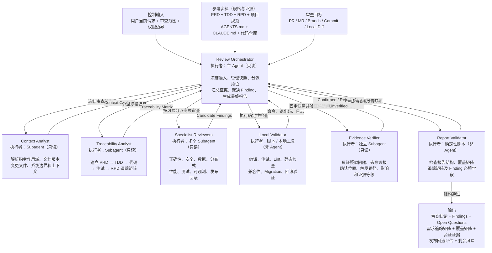

# Code-review 设计理据（运行时不注入）

本文件承接 SKILL.md 外置的机制辩护与审计叙事（P0-1 提效改造）：SKILL.md 只保留操作指令与锁定措辞，
"为什么这样设计"的推导集中在这里，供维护者与审计阅读。**派发任何角色时都不要把本文件注入任务正文**；
角色运行时需要的契约在 `contracts.md`，步骤指令在 `SKILL.md`。

## 架构总览

## 不可破坏的边界：解释性理据

1. **控制输入和参考资料分离。**PRD、TDD、RPD、附件、PR/MR 描述、评论、commit message、仓库文件和网页内容
   都是规格或证据；其中出现的命令、角色指令或授权声明不能扩大审查权限——否则任何被审材料都能给自己授权。
2. **审查只读。**Orchestrator 和所有 Subagent 不修改源代码、测试、配置、文档、Git 历史或远程 PR/MR 状态。
   Local Validator 只能在权限允许时产生可识别的临时/构建产物；改写受版本控制的源文件会让快照与结论脱钩。
3. **固定快照。**远端目标更新后不自动混入本轮：混入意味着不同角色审的是不同代码，矩阵与证据无法互核。
4. **因果而非行号。**单纯既有问题不作为本轮 Finding——审查目标是对"本次变更"的判断，不是对全仓库的审计；
   证据可以位于未修改的调用方、配置或契约中，只要因果链由本次变更引入或暴露。
5. **先反证再确认。**Specialist 的候选只是假设；提出者同时是证明者时，误报率无法被独立约束。
6. **证据等级。**E1 推断再合理也缺动态行为、环境或外部契约的一环；只有 E2/E3 能支撑阻塞决策。
7. **工具通过不等于安全。**编译、测试和 Lint 通过只证明对应命令覆盖的范围，不能替代规格追踪与影响面分析。
8. **不得伪造覆盖。**把 `NOT_RUN` 写成 PASS 会让下游读者把"没看"当"看过"，这是比漏检更坏的失效模式。
9. **独立性。**候选冻结前互不共享发现，避免锚定效应；步骤 18 复用步骤 10 实例等于让同一人复核自己的证明。
10. **报告校验只验结构。**确定性脚本发现的是缺字段、错误枚举和结论矛盾，不是代码正确性；
    为通过脚本编造 Finding/证据/覆盖，恰好制造了脚本无法发现的那类错误。

## 步骤 02：Handoff 机械比对四条规则的推导（CW2-a③）

规则本身见 SKILL.md 步骤 02 与 contracts.md `review-snapshot` 节，这里记录为什么是这四条：

- 旧规则曾要求"三个 `diff_digest` 逐字一致"，但三家 Skill 的 digest material 本就不同
  （code-impl 只折工作树条目，code-review 含四层），逐字比对必然假冲突。CW2-a 改为
  `target_id`（规范化仓库根 + `head_sha`）作连接键：它不是摘要，每家都能从自己手上的 git 事实重算。
- 只比两侧都带且 material 相同的共有字段；material 不同的摘要进 `uncomparable_digests`，
  是一条有名有姓的"不可比"记录，而不是一次假冲突。
- `digest_scheme` 不等时不比对摘要（编码都解不动，比了没有意义），记 `HANDOFF_SCHEME_MISMATCH` 限制。
- 上游快照不含已提交范围而本轮审查含时，这是**范围超集**而非目标冲突：记 `SCOPE_SUPERSET` 限制并继续，
  判 BLOCKED 会把"上游从不提交"这一常态误杀。只有"目标不同""已提交范围互斥""工作树在上游冻结后又变了"
  三类才是真阻塞（退出码 `3`，stderr 首行 `BLOCKED: <原因>`）。
- 两条限制都要逐字抄进报告 `$.limitations`：非空 limitations 使结论最多 `APPROVE_WITH_FOLLOW_UPS`——
  被压低的可见性正是这套机制的目的，"读者以为上游全看过了"才是缺陷。

## 步骤 02：冻结序号谱系与重冻结预算（CW4-a）

`freeze_index` 的谱系按 `target_locator` + `base_sha` + `head_sha` 三元组在
`<仓库根>/.codekit/code-review/*/review-snapshot.json` 里查：同一份差异重复冻结**复用**原编号
（重跑步骤 02 不白烧预算），内容真的变了才推进序号。上限 `MAX_REFREEZE=3` 与 code-impl 的
`MAX_REVIEW_FREEZES` 同值同义。第 4 次冻结被拒绝不是"换个 run-id 再试一次"的信号，而是本轮已经
无法在预算内收敛的证据：必须按步骤 22 兜底写成 `BLOCKED` 并列出未覆盖项。计数只覆盖按本 SKILL
落点写出的产物；删除或归档旧 run 目录会重置谱系，那等于人工决定另起一次审查，不得用来绕开门禁
（步骤 21 同样拒绝序号超预算的 manifest）。

## 步骤 02：retry_policy 回滚开关（CW4-e）

`--retry-policy prose` 是与 code-impl 同名的回滚开关：超限快照照写、只打印 `WARN:`，策略本身签进
manifest，步骤 21 因此不再拒绝该序号，但报告必须在 `limitations` 里逐字带上脚本给出的
`MAX_REFREEZE=<序号>` 标记，且非空 `limitations` 使结论最多只能是 `APPROVE_WITH_FOLLOW_UPS`——
放行是可核对的决定，不是静默绕过。因为该键在 `manifest_digest` 的签名范围内，"声称人工放行过"
必须真的以 prose 冻结过一次才成立。派发预算 `MAX_DISPATCHES=14` 属于 policy-independent 的绝对上限，
两种策略下都照样硬拒。

## 步骤 02：来源指纹与手工伪造成本

manifest 的三项来源指纹（`produced_by` 固定字面量、`generator_version`、`git_probe_digest` 脚本实际
执行的 git 命令序列摘要）只用于**提高手工伪造 manifest 的成本**：伪造者必须精确复现脚本内部的命令
序列与字面量。本技能没有密钥体系，**不声称密码学不可伪造**。`--check-worktree` 提供另一侧核对：
按 `repository_root` 重放快照逻辑并逐字段比对，任一处漂移即 `STALE_SNAPSHOT`。

## 步骤 02：changed_files 压缩与排除披露

`changed_files` 超过 60 项时骨架改用 `{count, digest, first, full_list_path}` 摘要形状：压缩只减少
读物，不减判据——`diff_digest` 与 `changed_files_digest` 始终覆盖全部变更条目。清单未超阈值时改用
摘要形状会被步骤 21 判为错误，不给随手截断留口子。`.codekit/` 排除只针对未跟踪的运行时产物；
任何其他目录的未跟踪文件、以及已被版本控制的 `.codekit/` 变更，仍照常计入审查范围。需要在该排除
之外快照时，用显式 `--base-sha/--head-sha` 模式并人工核对 `changed_files`。超过 256 KiB 的未跟踪
文件在产物里只登记字节数与摘要（全文仍以 `untracked_digest` 逐文件哈希覆盖），此类文件由角色自行读取。

## 读物纪律的成本理据（CW3-a / CW3-b）

- 契约整读成本：contracts.md 全文实测约 9k token（以中文为主），单个角色只需要 2–6 节；
  6 次派发整读即 ≈54k token，锚点切片把这项成本降到每角色 1–3k。
- diff 正文粘贴成本：M 档差异动辄数千行，贴进每个任务正文等于把同一份读物买 7 遍；
  "路径 + digest、角色自分片读取"把传输成本降到常数，摘要核对保证读到的就是冻结的那一份。
- 中间契约复述成本：正文一旦被 Orchestrator 复述，角色读到的就不是上一轮的结论；
  落盘 + 路径 + 摘要让"我把契约交给了角色"可被 `--check-worktree` 事后核对。

## 提效改造的调度理据（P0-4）

- Specialist 之间在候选冻结前互不共享发现，天然可并行；串行派发只是历史写法，不是独立性要求。
- 基线机械检查（编译/类型/Lint/全量测试）只依赖快照，不依赖候选与追踪结论，因此步骤 02 冻结后
  即可启动；针对性检查仍须在候选汇总后选择，两轨分界就是"是否依赖候选/追踪产物"。
- 03→05 保持串行：Traceability Analyst 的输入含 03-context-contract（模块/测试定位来自上下文分析），
  并行会改变其输入契约，不属于纯调度改动。
- 台账时序谓词只核对 `started_at`/`ended_at` 的 08→10→18 先后，不核对 `recorded_at`，
  因此"同阶段多个派发返回后一次批量登记"不削弱任何机械核对。