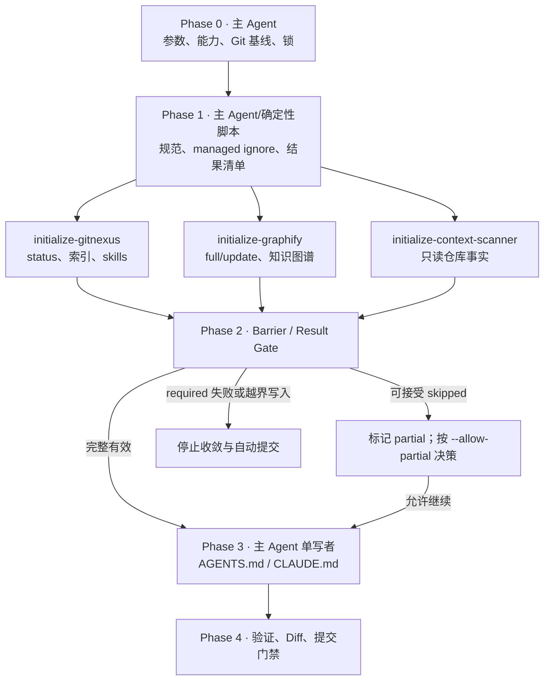

# 初始化仓库 AI 开发环境

把内置规范复制到目标仓库，建立或复用 GitNexus 与 Graphify 产物，并由主 Agent 统一维护 `AGENTS.md`、`CLAUDE.md`。默认只生成、验证和报告 diff；只有显式 `--commit` 才允许提交。

## 成功标准

- 单一确定性控制器在任何写入前冻结 Git 与托管文件基线，并取得 initialize 独占锁。
- `initialize-gitnexus`、`initialize-graphify` 与只读 `initialize-context-scanner` 遵循同一 Worker contract；并发度随宿主容量调整。
- 主 Agent 独立核验 Worker 状态、写入范围与 artifact，不把 `partial`/`failed` 转译为 `success`。
- `AGENTS.md`、`CLAUDE.md` 只有主 Agent在 Barrier 之后写入，且仅更新 CodeKit managed block。
- required 阶段全部成功；重复执行无无意义 diff；提交行为满足显式授权与 dirty 基线门禁。

## 参数

- `--language <set>`：逗号分隔的 `java | python | go | cpp`；省略时收集仓库内全部匹配语言，检测不到时使用 `java`。
- `--embeddings`：显式要求 GitNexus 构建语义索引；默认关闭。
- `--force`：显式重建 GitNexus/Graphify，不绕过验证或写入边界。
- `--allow-partial`：允许工具缺失等可接受的 `skipped` 继续生成上下文；仍不得把整体标记为 success，也不得放行真实失败。协作不可用必须映射为 `skipped + collab-unavailable`，整体保持 `blocked`。
- `--commit`：通过所有提交门禁后提交精确文件；默认不提交。

未知参数、空/重复/不支持的语言必须在任何写入前报错。

## 路径解析约定

> 本文档中的 `SKILL_DIR` / `SKILLS_ROOT` 解析方式、派发时必须显式传入的路径清单，以及“Skill 之间不得用相对路径互相引用文件”的纪律，统一见 `$SKILLS_ROOT/_shared/prompts/path-convention.md`；下面是本 Skill 的特有补充。

本 Skill 所有脚本一律以 **`<SKILL_DIR>` = 本文档所在目录的绝对路径** 解析后调用；插件安装时该目录为 `<plugin-cache>/skills/initialize`。示例中的 `<SKILL_DIR>` 必须先替换成该绝对路径再执行，不得依赖当前工作目录或残留的 shell 变量。派发 Sub-agent 时，必须在输入中显式给出 `<SKILL_DIR>` 的绝对路径与 `run-manifest.json` 的绝对路径，不得让 Sub-agent 自行猜测脚本位置。

## 核心不变量

1. 所有阶段只通过 `scripts/controller.py` 进入；先基线、后写入，先能力探测、后工具调用。
2. `.codekit/initialize.lock` 是仓库级独占锁；冲突时停止，不并发初始化同一仓库。
3. 临时清单放在项目根 `.codekit/initialize/<run-id>/`；若遇 EROFS/EACCES/EPERM，控制器必须输出明确 warning 并降级到私有系统临时目录，不把底层 `O_EXCL` 异常直接暴露为无上下文失败。
4. 一次用户调用只允许一个 `run-id`。Barrier 的输入路径/JSON 错误是可恢复错误：保持当前 phase 和锁，修复或复制输入后重试同一个 run；不得自动重新执行完整 initialize。只有用户明确再次请求时才启动新 run。
5. GitNexus 和 Graphify 不得写 `AGENTS.md`、`CLAUDE.md`；`initialize-context-scanner` 只返回事实和证据路径。
6. `.gitignore`、`.graphifyignore`、规范索引和上下文文件只更新各自的 CodeKit managed block，保留用户内容及其他工具 block。
7. Worker 只能写声明的路径；Git 可见的真实 diff 按路径申报，被 ignore 的分析产物目录按控制器授予的前缀判定。出现未授权或未申报路径时停止收敛与自动提交。
8. 任一 required 阶段失败即失败；工具不存在是 `skipped`，整体为 partial，默认禁止提交。失败 manifest phase 统一为 `aborted`，final report status 仍为 `failed`。
9. 任一托管文件在运行前 dirty 时可更新其 managed block，但本次运行禁止自动提交。

## 执行架构与职责



| 参与者 | 职责 | 允许写入 |
|---|---|---|
| 主 Agent | Phase 0、容量规划、Barrier、上下文合并、最终验证与可选提交 | 全部 CodeKit 托管路径 |
| 确定性控制器 | 持有状态机、可信 Worker 权限、结果摘要、managed block、最终门禁与锁释放 | 参数明确指定的托管路径/运行目录 |
| `initialize-gitnexus` | 按 `status` 决策复用或索引，生成 GitNexus skills | `.gitnexus/` 与探测后声明的具体 skills 路径 |
| `initialize-graphify` | 校验缓存与 sidecar，执行 full/update，报告 chunk 状态 | `graphify-out/` |
| `initialize-context-scanner` | 收集结构、模块、命令和证据，不做推断性写入 | 无 |

不要假设永远有三个子 Agent 槽位。容量足够时并行三路；容量不足时按可用槽位分批或串行，但必须创建三个指定名称的独立会话。协作能力不可用或指定角色无法创建时，状态必须为 `BLOCKED`，不得由主 Agent代做、普通串行自检或伪造独立结果。Claude 使用 Agent/Skill，Codex 使用 `spawn_agent` 等协作能力，OpenCode 使用其 task/subagent 能力；`allowed-tools` 不是跨平台能力开关。

## Subagent 强制调用规则（Claude Code / Codex / OpenCode）

`initialize-gitnexus`、`initialize-graphify` 和 `initialize-context-scanner` 是硬性阶段门禁，不是可选建议。Phase 0 完成并取得 `prepared` manifest 后，主 Agent 必须读取对应的外部角色文件并创建三个指定名称的独立 Sub-agent；记录角色名、输入快照、独立会话标识和返回状态，等待三个结果后才能进入 Barrier。主 Agent不得自行执行角色工作来替代调用。

按宿主派发的方式（Claude Code / Codex / OpenCode 的角色标识与语法差异、“不得把派发指令注入子代理”的纪律、以及 Skill 在各宿主下的调用名）见 `$SKILLS_ROOT/_shared/prompts/subagent-mandate.md`，其中 `SKILLS_ROOT` = `dirname(SKILL_DIR)`。进入任何派发阶段前必须读取该文件；角色由 `manage-global-agents.py`（仓库安装脚本）安装为**全局裸名**，不存在 `@agent-<plugin>:<name>` 这类插件作用域角色名。

无法创建任一指定角色、无法保持独立会话、返回不符合 Worker contract 或结果快照不一致时，阶段状态必须为 `BLOCKED`/`failed`，停止收敛与提交；不得降级为主 Agent执行、普通工具摘要或“建议调用”。**该门禁只约束主 Agent（Orchestrator）：被派发的角色 Sub-agent 一律不再派发下一级 Sub-agent，也绝不因自身缺少派发能力而返回 `BLOCKED`；它只需按自己的角色契约完成本阶段并返回结构化结果。**

## Phase DAG 与门禁

### Phase 0：冻结基线

读取 [references/orchestration.md](references/orchestration.md)，按其中 Phase 0 清单启动控制器：

```bash
python3 "<SKILL_DIR>/scripts/controller.py" start [initialize arguments]
```

控制器创建 manifest、取得锁并进入 `prepared`。`prepare.py`、`reconcile.py`、`validate-result.py` 是控制器内部模块，不作为编排入口直接调用。

### Phase 1：分析与只读扫描

先读取 [references/tool-adapters.md](references/tool-adapters.md) 选择 GitNexus/Graphify 模式，再读取 [references/worker-contract.md](references/worker-contract.md)。随后强制调用 [agents/initialize-gitnexus.md](agents/initialize-gitnexus.md)、[agents/initialize-graphify.md](agents/initialize-graphify.md) 和 [agents/initialize-context-scanner.md](agents/initialize-context-scanner.md)，由对应独立 Sub-agent 生成每一路 result。

- GitNexus 以 `status` 为真相源。默认命令为 `gitnexus analyze --skills --skip-agents-md --verbose`，仅显式 `--embeddings` 才追加语义索引；实际执行必须经过 `scripts/run-gitnexus.py`，隔离全局 registry，不通过 `npx`/`dlx` 下载。
- 当 GitNexus 支持 `--skills` 时，准备阶段会尝试创建 `.claude/skills` 与 `.agents/skills` 两个目标目录；若宿主目录只读且 help 支持 `--skip-skills`，manifest 标记 `community-only`，Worker 追加该 flag 并保留社区 skills；不支持时明确失败。Worker 必须申报每一处 Git 可见的变更路径；被 ignore 的分析产物目录只需申报实际写入的顶层条目，控制器按授权前缀核验。
- Graphify Agent Skill 使用 `$graphify . --update --no-viz`（Codex）或 `/graphify . --update --no-viz`（Claude/OpenCode）；Shell CLI 必须使用其真实子命令 adapter，不能执行 `graphify .`。混合仓库或无明确语义后端时默认使用 `graphify extract . --out . --code-only`；Worker 按 `tools.graphify.supports.ast_process_pool` 与 `max_workers` 能力决定是否追加 `--max-workers 1`，未知能力按不支持处理且无 fallback flag 时明确失败。
- `initialize-context-scanner` 只返回结构化事实、命令候选与证据路径；主 Agent不得用自己的扫描摘要代替该 result。

### Phase 2：Barrier / Result Gate

不得在所有已启动 Worker 结束前生成上下文。使用：

```bash
python3 "<SKILL_DIR>/scripts/controller.py" gate \
  --manifest <run-manifest.json> --result <worker-result.json>...
```

控制器使用内置的 task 权限表验证真实 `git status`/diff、未申报路径、artifact 与 root，并摘要已验证结果。Worker 的 `allowed_paths` 只能收窄权限，不能扩大权限。被 ignore 的产物目录以 Phase 0 的顶层条目快照与授权前缀比较，缓存文件数量变化不视为越界写入，未预期的新目录仍然会失败。真实 Worker 失败时控制器进入 `aborted` 并释放锁；结果路径或 JSON 输入错误则保持当前 run/锁并输出可恢复提示；仅完整 gate 可进入 `gated`。

### Phase 3：上下文单写者

读取 [references/context-files.md](references/context-files.md)。主 Agent基于 Scanner 事实和已验证 artifact 形成输入，再调用：

```bash
python3 "<SKILL_DIR>/scripts/controller.py" reconcile \
  --manifest <run-manifest.json> --context <scanner-result.json> \
  --worker-result <worker-result.json>...
```

控制器只接受 gate 时已摘要且内容未变化的 Worker result，并进入 `reconciled`。它只更新 CodeKit blocks：`AGENTS.md` 项目事实与 standards block、`CLAUDE.md` standards imports，以及成功 Graphify 运行的 `.codekit-state.json`。禁止将 `CLAUDE.md` 复制为 `AGENTS.md`。

### Phase 4：验证、Diff 与提交门禁

读取 [references/final-report.md](references/final-report.md)，执行：

```bash
python3 "<SKILL_DIR>/scripts/controller.py" finish --manifest <run-manifest.json>
```

`finish` 由控制器自行执行 reconcile 记录的每条 `required_for_initialize` 仓库验证命令，真实退出码写入 `final_report.validations`：命令不经 shell 解析，禁止重定向、管道、命令替换与通配符，可执行程序必须在控制器白名单内或为仓库内的明确脚本路径，超时由 `--validation-timeout`（默认 900 秒）控制。主 Agent 不预先执行验证命令，也不得用自己的判断替代控制器结果；`--validation-result` 只在显式 `--allow-attested-validations` 的外部验证环境下接受，此时仍禁止自动提交。

随后展示本次托管文件的 status、diff stat 和关键 diff。若启动时显式传入 `--commit`，`finish` 由控制器在持锁状态下执行提交门禁，仅精确提交本次已授权且未被 Git ignore 的路径；不得由主 Agent在控制器之外自行 stage 或提交。

不推送，不创建 MR/PR。控制器在 `finish` 后释放锁；gate/reconcile 失败会自动 abort。若宿主在阶段之间被中断，使用：

```bash
python3 "<SKILL_DIR>/scripts/controller.py" abort \
  --manifest <run-manifest.json> --reason <reason>
```

它只释放 run-id 匹配的锁。

## 详细资料路由

- 阶段、容量适配、锁与恢复：[references/orchestration.md](references/orchestration.md)
- Worker schema、允许路径、状态与 artifact 校验：[references/worker-contract.md](references/worker-contract.md)
- GitNexus/Graphify 探测、缓存和平台 adapter：[references/tool-adapters.md](references/tool-adapters.md)
- Scanner 事实、managed blocks 与上下文生成：[references/context-files.md](references/context-files.md)
- 最终状态、diff、提交/锁释放报告：[references/final-report.md](references/final-report.md)
- `initialize-gitnexus`：[agents/initialize-gitnexus.md](agents/initialize-gitnexus.md)
- `initialize-graphify`：[agents/initialize-graphify.md](agents/initialize-graphify.md)
- `initialize-context-scanner`：[agents/initialize-context-scanner.md](agents/initialize-context-scanner.md)

只在进入对应阶段时读取相关 reference，不预先加载全部文件。
