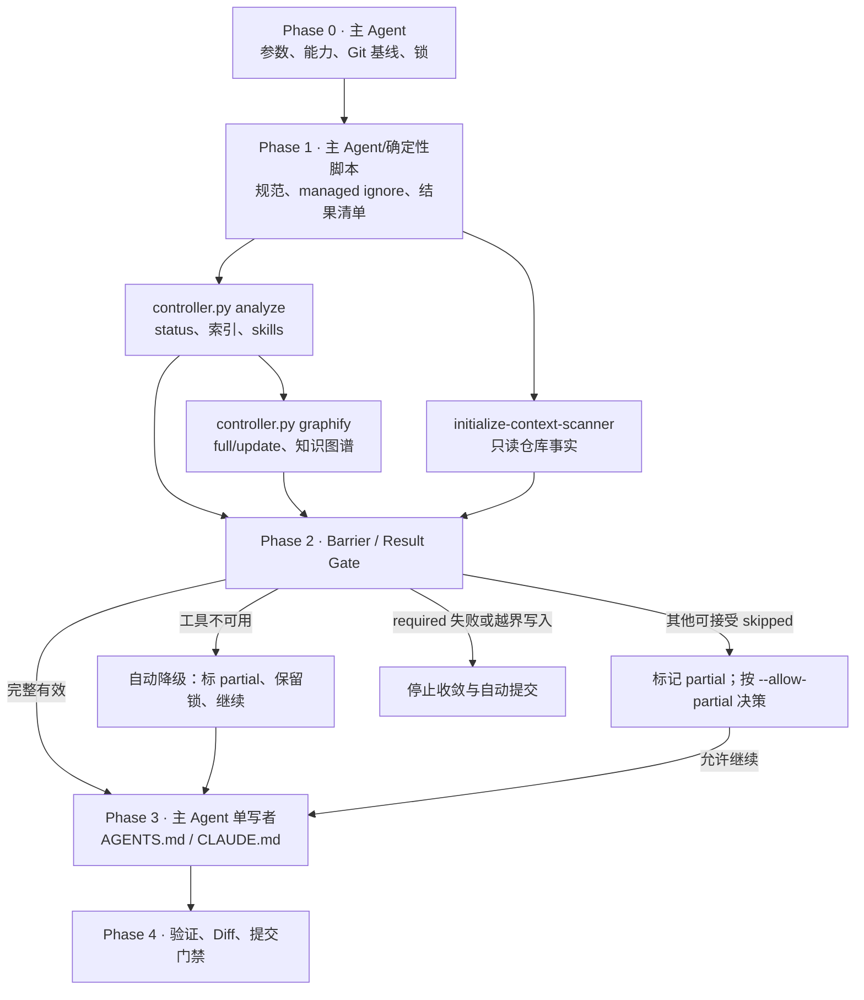

# 初始化仓库 AI 开发环境

把内置规范复制到目标仓库，建立或复用 GitNexus 与 Graphify 产物，并由主 Agent 统一维护 `AGENTS.md`、`CLAUDE.md`。默认只生成、验证和报告 diff；只有显式 `--commit` 才允许提交。

**输出语言（本轮第一句回复即生效；只用 `@initialize` 等无自然语言方式触发时同样默认简体中文）：**面向用户的过程说明、diff 摘要和最终报告使用简体中文；专有名词、参数、代码、命令、路径、JSON 字段名与状态字面量（如 `BLOCKED`）和原始日志保持英文原文；写入 `AGENTS.md`、`CLAUDE.md`、`.standard/` 与运行目录产物等内容按各自模板与契约的既有语言要求执行。规则原文见 `$SKILLS_ROOT/_shared/prompts/output-language.md`，派发子代理时必须把该规则带进任务正文。

## 成功标准

- 单一确定性控制器在任何写入前冻结 Git 与托管文件基线，并取得 initialize 独占锁。
- 使用的编程语言要么来自用户显式指定（`language_source=explicit`），要么来自仓库实测（`detected`）；两者都拿不到时 `start` 在任何写入前报错停止，主 Agent 必须把实测转述给用户、问到答复后带 `--language` 重跑，不得静默采用任何一种语言或只有文档示例的仓库被当成已有工程初始化。
- `controller.py analyze` 与 `controller.py graphify` 作为控制器的两个确定性步骤按序执行、只读 `initialize-context-scanner` 作为独立 Sub-agent，三者统一遵循同一 Worker contract；并发度随宿主容量调整。
- 主 Agent 独立核验 Worker 状态、写入范围与 artifact，不把 `partial`/`failed` 转译为 `success`。
- `AGENTS.md`、`CLAUDE.md` 只有主 Agent在 Barrier 之后写入，且仅更新 CodeKit managed block。
- required 阶段全部成功；重复执行无无意义 diff；提交行为满足显式授权与 dirty 基线门禁。
- 宿主没有暴露子代理工具面时，在 Phase 1 产生任何业务写入之前就停止，并给出可执行的修复路径；不得留下一半的托管文件变更。
- 同一仓库重复执行 initialize 是受支持的常规路径：每次 `start` 重新冻结基线，托管文件只替换各自的 CodeKit managed block，内容未变时不落盘，因此对已完成初始化的仓库再跑一次应得到空的 `prepared_changed_files` 与零 diff。
- 非 `failed` 的运行以醒目的「需要重启 Agent 应用以生效」提示结束报告。

## 参数

- `--language <set>`：逗号分隔的 `java | python | go | cpp`。省略时由控制器**实测**仓库（源码后缀 + 各层级工程清单，跳过根下的 `doc`/`docs`），把识别到的全部语言一次带上；**测不出来时 `start` 在任何写入前报错停止，不存在默认语言**——主 Agent 必须就此向用户确认后带 `--language` 重跑（见 Phase 0）。`manifest` 里的 `language_source`（`explicit` / `detected`）与 `language_basis`（实测依据原文）记录这次结论的来源，报告照抄。
- `--embeddings`：显式要求 GitNexus 构建语义索引；默认关闭。
- `--force`：显式重建 GitNexus/Graphify，不绕过验证或写入边界。重复执行 initialize 本身不需要该参数，缺省时索引与图谱按 current 复用。
- `--allow-partial`：允许**前提性**降级继续生成上下文。注册现在是「先真尝试、被拒才升级」（见 `--allow-global-writes`），所以它只剩一种用法：**用户明确拒绝那次仓库外写入**，本次不写注册表并按 `partial/registry-missing` 继续；embedding 前提同属这一类。**工具在本宿主不可用（未安装 / 读不到 / 跑不起来 / 缺注册）不再需要它**，那类降级自动处理（见下条）。无论哪种，都不得把整体标记为 success，也不得放行真实失败。协作不可用必须映射为 `skipped + collab-unavailable`，整体保持 `blocked`。
- `--strict-tools`：把「工具不可用」恢复成 fail-closed：门禁据此判失败并 abort。默认关闭（自动降级跑完），给需要「宁可失败也不接受静默降级」的 CI 用。
- `--commit`：通过所有提交门禁后提交精确文件；默认不提交。
- `--no-git-hooks`：跳过 Phase 4 在本仓库安装 Graphify 的 git 钩子（`post-commit`/`post-checkout` 与 merge driver）。**默认不跳过**：图谱只在 initialize 期间刷新，下一次提交就会腐烂，钩子才是它长期有效的条件。该步骤只写 `.git/hooks` 与本仓库 `git config`，不碰任何托管上下文文件；失败会把整体降级为 `partial` 并禁止自动提交，报告给出重试与 `graphify hook uninstall` 回滚命令。
- `--allow-global-writes`：**预先**授权在仓库之外写入（`gitnexus embeddings install`、把仓库写进真实 `GITNEXUS_HOME/registry.json`）。注册不依赖它：注册是「先真写一次，宿主拒绝才升级申请」，所以没传这个 flag 也不会被提前拦住——**能写就直接写**。只在两种场合传：用户在被拒后明确同意，或用户主动授权整轮。
  - **注册前提**：`list`/`query`/`context`/`impact`/`trace`/`cypher`/`check`/`detect-changes` 与 MCP 图查询只从该注册表解析仓库，缺注册时索引有效但一律报 `No indexed repositories found`。因此 gitnexus 步骤会先自己尝试一次 `gitnexus index <root>`（幂等、只写注册表）：成功即继续，不需要任何人点头；**宿主拒绝时以可恢复的 `registry-denied`（退出码 77）停下**，保持 run 与锁并给出 `retry_command`，主 Agent 必须按宿主提权通道原样重跑这条命令（宿主差异见 [references/tool-adapters.md](references/tool-adapters.md) 的「全局注册」），成功后重跑 `analyze`；重试仍被拒才询问用户，用户拒绝时带 `--allow-partial` 接受 `partial/registry-missing`。
  - **embedding 前提**：按 `gitnexus_embedding_mode=drop` 显式降级，不失败；显式 `--embeddings` 而 runner 缺本地栈时才要求本授权（这一条仍是 fail-closed，与注册不同）。

未知参数、空/重复/不支持的语言必须在任何写入前报错。省略 `--language` 且实测不出语言时同样在任何写入前报错，并按 Phase 0 的规定停下来问人——**没有默认语言**。

## 路径解析约定

> 本文档中的 `SKILL_DIR` / `SKILLS_ROOT` 解析方式、`<PYTHON>` 启动器按宿主的解析规则、派发时必须显式传入的路径清单，以及“Skill 之间不得用相对路径互相引用文件”的纪律，统一见 `$SKILLS_ROOT/_shared/prompts/path-convention.md`；下面是本 Skill 的特有补充。

本 Skill 所有脚本一律以 **`<SKILL_DIR>` = 本文档所在目录的绝对路径** 解析后调用；插件安装时该目录为 `<plugin-cache>/skills/initialize`。示例中的 `<SKILL_DIR>` 必须先替换成该绝对路径再执行，不得依赖当前工作目录或残留的 shell 变量。派发 Sub-agent 时，必须在输入中显式给出 `<SKILL_DIR>` 的绝对路径与 `run-manifest.json` 的绝对路径，不得让 Sub-agent 自行猜测脚本位置。

## 核心不变量

1. 所有阶段只通过 `scripts/controller.py` 进入；先基线、后写入，先能力探测、后工具调用。
2. `.codekit/initialize.lock` 是仓库级独占锁，不是「初始化过就不再允许」的标记：同一仓库可以重复执行 initialize。冲突时控制器先判定持有者——manifest 已终态（`finished`/`aborted`）或已不可读的遗留锁由控制器回收并写入 warning 后继续；仍可能活跃的 run 则停止，不并发初始化同一仓库，并在报错中原样给出 owning run-id、manifest 路径与可执行的 `abort` 回收命令。
3. 临时清单放在项目根 `.codekit/initialize/<run-id>/`；若遇 EROFS/EACCES/EPERM，控制器必须输出明确 warning 并降级到私有系统临时目录，不把底层 `O_EXCL` 异常直接暴露为无上下文失败。
4. 一次用户调用只允许一个 `run-id`。Barrier 的输入路径/JSON 错误是可恢复错误：保持当前 phase 和锁，修复或复制输入后重试同一个 run；不得自动重新执行完整 initialize。只有用户明确再次请求时才启动新 run。
5. GitNexus 和 Graphify 不得写 `AGENTS.md`、`CLAUDE.md`；`initialize-context-scanner` 只返回事实和证据路径。
6. `.gitignore`、`.graphifyignore`、规范索引和上下文文件只更新各自的 CodeKit managed block，保留用户内容及其他工具 block。渲染后的内容与现有文件一致时跳过落盘，因此上一次运行之后没有变更时，重复执行的 `prepared_changed_files` 为空；被人工改过的规范模板文件会在重复执行时被模板覆盖，这是预期的升级路径而不是幂等性缺陷。
7. Worker 只能写声明的路径；Git 可见的真实 diff 按路径申报，被 ignore 的分析产物目录按控制器授予的前缀判定。出现未授权或未申报路径时停止收敛与自动提交。
8. 任一 required 阶段**真实失败**即失败；工具在本宿主不可用则不同：它不是运行失败，而是环境事实。此类结果记为 `skipped + tool-missing`（读不到/跑不起来同样归入这一类，只是 `state` 不同），整体为 `partial`，**门禁不因此 abort、不释放锁、也不要求 `--allow-partial`**——运行继续走 reconcile 与 finish，报告逐条点名降级项与实测状态。默认禁止提交，`--strict-tools` 可恢复 fail-closed。`required_for_initialize` 验证命令的程序未安装同样记为 `skipped`（partial 且禁止提交）；程序不在控制器白名单则是可恢复的契约错误，在 reconcile 写入前报错，不是 finish 阶段的失败。真实失败时 manifest phase 为 `aborted`、final report status 为 `failed`。
9. 任一托管文件在运行前 dirty 时可更新其 managed block，但本次运行禁止自动提交。

## 执行架构与职责



| 参与者 | 职责 | 允许写入 |
|---|---|---|
| 主 Agent | Phase 0、容量规划、Barrier、上下文合并、最终验证与可选提交 | 全部 CodeKit 托管路径 |
| 确定性控制器 | 持有状态机、可信 Worker 权限、结果摘要、managed block、最终门禁与锁释放；并执行 `analyze` 与 `graphify` 两个步骤 | 参数明确指定的托管路径/运行目录 |
| 控制器 `analyze` 步骤 | 按 `status` 决策复用或索引，生成 GitNexus skills；参数全部由 manifest 推导 | `.gitnexus/` 与探测后声明的具体 skills 路径 |
| 控制器 `graphify` 步骤 | 按缓存与 sidecar 决策 full/update，生成知识图谱；参数全部由 manifest 推导 | `graphify-out/` |
| `initialize-context-scanner` | 收集结构、模块、命令和证据，不做推断性写入 | 无 |

不要假设永远有两个分析槽位。GitNexus 与 Graphify 都由控制器同步执行，只有 Context Scanner 必须创建一个指定名称的独立会话；宿主没有可用派发槽位时，这一路仍然要建立，不得由主 Agent代做、普通串行自检或伪造独立结果。协作能力不可用或指定角色无法创建时，状态必须为 `BLOCKED`。Claude 使用 Agent/Skill，Codex 使用 `spawn_agent` 等协作能力，OpenCode 使用其 task/subagent 能力；`allowed-tools` 不是跨平台能力开关。该能力是否真的存在，以 Phase 0 的 `probe-collab.py` 实测结论为准：宿主自报「支持多代理」和 `codex features list` 的 flag 状态都不构成证据，实测可以在工具面为空时仍报 stable。

## 派发规则与工具执行方式（Claude Code / Codex / OpenCode / Qoder / Qoder CN）

`initialize-context-scanner` 是硬性阶段门禁，不是可选建议。Phase 0 完成并取得 `prepared` manifest 后，主 Agent 必须读取对应的角色文件并创建一个指定名称的独立 Sub-agent；记录角色名、输入快照、独立会话标识和返回状态，等待结果后才能进入 Barrier。主 Agent不得自行执行角色工作来替代调用。

两个分析器都不派发 Sub-agent，改由控制器执行子命令生成同 schema 的 Worker result：GitNexus 走 `analyze`，Graphify 走 `graphify`（必须排在 `analyze` 之后）。主 Agent 只需调用控制器，不得自行拼装 `gitnexus` / `graphify` 命令或手工编写这两个 result。

> 为什么 Graphify 不能留在子代理会话里：宿主的权限层按**执行上下文**区别对待同一条命令。实测（Qoder CN 桌面端 `--permission-mode auto`、`interactive=false`）子代理不继承主会话的工具允许规则（子代理的权限上下文里 `additionalRules` 为空），因此每一条子代理 Bash 都要经远程 auto-mode 分类器裁决：`graphify extract` 在三次派发的五次尝试里全部被拒，而同一子代理的 `graphify --version`、`--help`、`extract --help` 全部放行；主会话有 `rule.tool_allow` 命中、从不进分类器（22 次 Bash、0 次拒绝）。auto 模式下被拒的命令**不会**再落人工审批提示，`required` 阶段失败即整轮 `abort`。同形态重派、加 `mode="dontAsk"`（实测被归一成 `permissionMode: auto`）都无效。把这一路交给控制器执行是唯一在 Skill 权限内的解法；**不要**为了绕过分类器而包装 argv、改名或改走 `npx`/`pipx`——那是在规避宿主的安全边界。

按宿主派发的方式（Claude Code / Codex / OpenCode / Qoder / Qoder CN 的角色标识与语法差异、“不得把派发指令注入子代理”的纪律、以及 Skill 在各宿主下的调用名）见 `$SKILLS_ROOT/_shared/prompts/subagent-mandate.md`，其中 `SKILLS_ROOT` = `dirname(SKILL_DIR)`。进入任何派发阶段前必须读取该文件；角色由 `manage-global-agents.py`（仓库安装脚本）安装为**全局裸名**，不存在 `@agent-<plugin>:<name>` 这类插件作用域角色名。

无法创建指定角色、无法保持独立会话、返回不符合 Worker contract 或结果快照不一致时，阶段状态必须为 `BLOCKED`/`failed`，停止收敛与提交；不得降级为主 Agent执行、普通工具摘要或“建议调用”。**该门禁只约束主 Agent（Orchestrator）：被派发的角色 Sub-agent 一律不再派发下一级 Sub-agent，也绝不因自身缺少派发能力而返回 `BLOCKED`；它只需按自己的角色契约完成本阶段并返回结构化结果。**

> 代价声明：GitNexus 与 Graphify 两路不再具备「由另一个独立会话产出证据」的性质——它们的 result 由控制器自己执行、自己校验。门禁仍然独立复核证据（Git 基线与写入范围、artifact 可解析、`allowed_paths` 收窄），但不宣称这两路存在独立会话。

> 顺序代价：Graphify 排在 `analyze` 之后，图谱建立在 GitNexus 刚写出的 `.claude/skills` / `.agents/skills` 镜像之上。这些目录由 Phase 0 的 managed `.gitignore` 条目隐藏、并由 `.graphifyignore` 的 managed 规则排除在抽取之外，门禁的越界检查按授权前缀核验它们；改动这条链路时要用 `test_both_tool_steps_drive_the_whole_flow_in_order` 复测，不要靠人眼判断「应该没影响」。

## Phase DAG 与门禁

### Phase 0：冻结基线

读取 [references/orchestration.md](references/orchestration.md)，先按 `$SKILLS_ROOT/_shared/prompts/path-convention.md` 解析 `<PYTHON>`（Windows `py -3`，macOS/Linux `python3`）。

**第一步是实测宿主的协作能力**，它必须排在 `start` 之前：`start` 就会写 `.standard/` 与 managed ignore，而派发能力缺失原本要到 Phase 1 才暴露，先写后停会留下一半的托管变更。

```bash
<PYTHON> "$SKILLS_ROOT/_shared/scripts/probe-collab.py" --host <claude|codex|opencode|qoder|qodercn>
```

`--host` 按你自己所在的宿主显式填写：脚本只能按环境变量猜宿主，猜错会误阻断一次本可完成的初始化。默认模式只读，不写仓库也不改任何宿主配置；在 Codex 上它本地导出模型可见 prompt，检查 `spawn_agent` 等工具是否真的存在，不产生 token。退出码 1 表示 `unavailable`，0 表示 `available` 或 `unknown`。

- `unavailable`：**不启动 run**，按共享契约的顺序处理——先向用户说明缺的是宿主的子代理工具并申请授权；同意后运行同一脚本加 `--enable`（它只改一个键，写完自测复验，复验不过逐字节回滚）；用户拒绝时不写任何配置。两种结果都必须以醒目的重启提示结束本轮：宿主只在启动时读取配置，**本轮不可能靠改配置继续**，需完全退出并重启该 Agent 应用后重跑 initialize。`fix` 字段原文转述。
- `unknown`：既不放行也不阻断，照常进入 `start`；真正派发失败时按 `collab-unavailable` 停止。
- `available`：把实测到的工具列表原样写进最终报告作为证据。

只有 Codex 有可开启的开关；Claude / OpenCode / Qoder 的派发工具由宿主内置，`--enable` 对它们返回 `refused` 且不写任何配置——不得为这些平台编造配置项，也不得把"没有开关"报成"已开启"。

随后按其中 Phase 0 清单启动控制器：

```bash
<PYTHON> "<SKILL_DIR>/scripts/controller.py" start [initialize arguments]
```

只有按该回退顺序把每个候选都用 `--version` 实测过、全部拿不到版本号时，才能判定 Python 缺失；单次静默非零退出（Windows 上的 `python3` 商店别名桩就是这样）不是证据。报告必须写出你实测过的命令、退出码与输出。

控制器创建 manifest、取得锁并进入 `prepared`。`prepare.py`、`reconcile.py`、`validate-result.py` 是控制器内部模块，不作为编排入口直接调用。

**语言识别是三态，不是两态**：`start` 要么按 `--language` 采用用户指定的语言，要么实测出语言（源码后缀 + 各层级工程清单，**跳过仓库根下的 `doc`/`docs`**——那里的示例片段是这套技能自己的产物，不是已经选定的语言），要么**报错退出且什么都不写**。第三种情况下不得替用户挑一种语言：`standard/02-stack/` 只有 `java`、`python`、`go`、`cpp` 四套模板，选错会把和本项目无关的规范复制进 `.standard/`、写进 `AGENTS.md`/`CLAUDE.md` 的索引块，并被后续所有 subagent 当作项目规范读取；而「识别不出来」最常见的真实原因正是仓库还没有代码或只有文档示例，这恰是要不要初始化工程结构的问题，必须由人回答。

报错文本已经给出实测依据（枚举条目数、被排除的文档目录源码数、非支持语言源码的后缀与计数，例如「仓库里只找到非支持语言源码（ts 2 个、js 1 个）」），主 Agent 的处理是固定的：

1. 把这段实测原样转述给用户，**不要**改写成「已默认按 java 处理」之类的说法，也不要凭 README、目录名或自己的印象替用户决定；
2. 用宿主提供的提问能力给出**恰好这四个选项**（`java`、`python`、`go`、`cpp`，允许多选）；宿主没有提问工具面时，在正文里提出同样的问题并**结束本轮**等回答，不得一边提问一边继续写入。会不会弹出选择框由宿主决定（有提问工具面的宿主会弹窗，Codex/OpenCode 只能正文提问），本 Skill 保证的是「停下来问、拿到答复才继续」，不是弹窗本身。
3. 拿到答复后带 `--language <答复>` 重跑同一条 `start`，并把 `language_source=explicit` 与最终选择的语言写进报告；用户拒绝选择或拒绝提供语言时停止，报告 `blocked`，不留下任何托管文件变更。

`manifest` 的 `language_source`（`explicit` / `detected`）与 `language_basis`（实测原文）是这次决定的证据，报告必须原样列出——只写 `languages: [python]` 分不出它是用户说的还是测出来的。

**工具不可用时的处置**：`prepare.py` 从**已实测**的四态得出结论并写进 `resolution_hint` 与 `tools.<tool>.state`——`ok` / `not-installed` / `not-readable` / `not-executable`，判据与处置见 [references/tool-adapters.md](references/tool-adapters.md)。解析顺序是 `CODEKIT_<TOOL>_RUNNER` → 安装器写出的 `toolchain.json` → `PATH` → CodeKit 已知目录；**清单优先于 `PATH`**，所以结果跨宿主确定。

后两态在 Codex 桌面端是常态而不是配置错误：它的沙箱**按路径拒绝文件系统访问**（实测 `%APPDATA%\npm` 的 `stat` 即 EACCES、`%LOCALAPPDATA%\Programs\Python` 整目录不可达），而 `PATH` 里用户级条目其实是全的——所以**把目录加进 `PATH` 无效**，问题不在 `PATH`。真正的解法是让工具落在已实测可读可执行的 CodeKit 工具链根 `<home>/.local/share/CodeKit/` 里，那由安装器负责：提示必须给出「重跑安装器（`install.cmd install` / `install.sh install`）并勾选该组件」或 `CODEKIT_GITNEXUS_RUNNER` / `CODEKIT_GRAPHIFY_RUNNER` 这两条真出路。诊断时可用 `$SKILLS_ROOT/_shared/scripts/resolve-runner.py --tool <gitnexus|graphify>`（退出码 0/3/4/5 分别对应四态）在**同一个会话里**复测，不要再靠猜路径。

**不得把这类降级当失败处理**：它按 `skipped + tool-missing` 记录（`not-readable` / `not-executable` 同样归入 tool missing，只是状态不同），门禁据此判 `partial` 但**不 abort、不释放锁、也不要求 `--allow-partial`**；运行继续到 finish，报告逐条点名降级项、实测状态与修复命令。`--strict-tools` 供 CI 恢复 fail-closed。绝不用 `npx`/`pipx` 兜底，也不得把 `available=false` 写成 `execution-failed`（那是把「本机跑不了」误报成「工具坏了」）。

Phase 0 解析 GitNexus runner 并把 embedding 与**全局注册**两个前提写进 manifest：`tools.gitnexus`（`command` / `runner` / `identity_stable` / `local_embeddings`）、`gitnexus_index`（`present` / `pdg` / `embeddings`）、`gitnexus_embedding_mode`、`gitnexus_registry`（`dir` / `path` / `registered` / `writable` / `action`）、`options.allow_global_writes`。`action` 是本次的处理计划，取值与处置见 [references/tool-adapters.md](references/tool-adapters.md) 的「全局注册」：`none` / `authorized` / `declined` / `attempt`。

**Phase 0 不为工具前提拦人也不提问**：预检用的 `os.access` 在按路径拒绝文件系统访问的沙箱里会谎报可写，用「看起来写得进去吗」决定要不要问人，会把本来能自己完成的运行也停下。注册由一次真实写入来满足或暴露（`attempt`），被拒才升级。补齐本地 embedding 栈是可降级前提，显式 `--embeddings` 时仍是 fail-closed。这一条只约束工具前提；**语言识别失败是唯一的例外**，它必须停下来问人（见上），因为没有任何一次实测能替用户决定项目该用哪种语言的规范。

### Phase 1：分析与只读扫描

先读取 [references/tool-adapters.md](references/tool-adapters.md) 选择 GitNexus/Graphify 模式，再读取 [references/worker-contract.md](references/worker-contract.md)。随后：

1. **先派发 Context Scanner Sub-agent**：[agents/initialize-context-scanner.md](agents/initialize-context-scanner.md)，在独立会话中生成 `context-scanner` result。
2. **在等待窗口内运行 GitNexus 步骤**（控制器同步执行，不派发 Sub-agent）：

```bash
<PYTHON> "<SKILL_DIR>/scripts/controller.py" analyze --manifest <run-manifest.json>
```

3. **紧接着运行 Graphify 步骤**（同样由控制器执行，必须排在 `analyze` 之后）：

```bash
<PYTHON> "<SKILL_DIR>/scripts/controller.py" graphify --manifest <run-manifest.json>
```

两个步骤各自按冻结的 runner、索引/缓存模式执行，并按 Worker contract 写出 `<run-id>/gitnexus-result.json` 与 `<run-id>/graphify-result.json`；每个步骤只写自己那一个 result，都不推进 manifest 阶段（阶段由 gate 推进）。顺序写错时 `graphify` 返回可恢复的输入错误（保持当前 run 与锁），先补跑 `analyze` 即可，不会把整轮判成失败。

- GitNexus 以 `status` 为真相源：`status --json` 报 `current` 且 artifact 存在时直接复用索引，返回 `skipped + index-current`，不再执行 analyze。命令前缀只取 manifest 的 `tools.gitnexus.command`（`CODEKIT_GITNEXUS_RUNNER`、`PATH` 上的真实安装，或 CodeKit 已知安装目录里的真实安装），**不得**回落到 `.gitnexus/run.cjs`（它按 `gitnexus@latest` 走 npx，会漂移分析器身份并触发全量重建），也不通过 `npx`/`dlx` 下载；解析失败（`runner` 为 `unresolved`，或入口解析到了但 `available=false`）按 tool missing 返回 `skipped` 并带上 `resolution_hint`。基准参数为 `analyze --skills --skip-agents-md --verbose`，并镜像 `gitnexus_index.pdg`、按 `gitnexus_embedding_mode` 追加 `--drop-embeddings` 或先安装 embedding 栈；执行一律经过 `scripts/run-gitnexus.py`：默认 `--registry disposable` 隔离全局目录，只有用户已授权时才走 `--registry real`（真实目录，绝不静默回落）——已注册的仓库不需要刷新注册，`analyze` 因此仍留在 disposable，否则只读 `GITNEXUS_HOME` 下会被无谓地拒成 `failed`。这些参数由控制器推导，主 Agent 不得自行覆盖。
- **注册校验（不得省略）**：`status` 走仓库内 `.gitnexus/`，查询类命令与 MCP 图查询走全局 registry，两者可以不一致，所以 `status=current` 与 analyze 退出码 0 都**不能**证明查询路径可用。控制器在两条路径上都会实测 `gitnexus_registry_state`，并共用同一条决策（`resolve_missing_registration`）：已注册则不动；用户已拒绝（`--allow-partial`）则不写也不尝试，记 `partial + registry-missing`；其余情况先经 `gitnexus index <root>`（`--registry real`）**真跑一次**补注册（复用路径尤其需要，那时 analyze 不会运行）——成功即注册落地并继续，被拒则以可恢复的 `registry-denied` 停下并给出 `retry_command`，非权限原因失败降级为 `partial + registry-missing`，**已授权却仍不落地才算 `failed`**；成功后把实测到的 `registry` 写进 result。被拒也可能发生在 `analyze` / `embeddings install` 自身（那时它们已经跑过，拿不到重试循环）：result 记 `failed`，但 `error.message` 与 warnings 必须点名被拒的 `registry.json` 路径、失败的命令与重试命令，不得只报一个「退出码 77」。

**被拒之后只补注册**：按宿主提权通道重跑的必须是同一条命令 `<PY> "<SKILL_DIR>/scripts/controller.py" register --manifest <run-manifest.json>`（或直接取控制器返回的 `retry_command` 原样执行）。它只做那一次仓库外写入，不产出 result、不推进 manifest 阶段、不释放锁；成功后重跑 `analyze` 即可续上同一个 run。不得用「预先传 `--allow-global-writes`」代替这一步，也不得把 `registry-denied` 当运行失败去 `abort`。Gate 对 complete 的 gitnexus result 会自己重测一次注册，缺失即拒绝，绝不采信 result 的自述。
- 当 GitNexus 支持 `--skills` 时，准备阶段会尝试创建 `.claude/skills` 与 `.agents/skills` 两个目标目录；若宿主目录只读且 help 支持 `--skip-skills`，manifest 标记 `community-only`，控制器追加该 flag 并保留社区 skills；不支持时明确失败。控制器必须申报每一处 Git 可见的变更路径；被 ignore 的分析产物目录只需申报实际写入的顶层条目，门禁按授权前缀核验。
- Graphify 以缓存与 sidecar 为真相源：`graphify-out/graph.json`/`manifest.json` 可解析且节点非空、`.graphify_root` 规范化后等于当前仓库根、`.codekit-state.json` 的 root/version/ignore digest/mode 全部匹配且 `last_status == success` 时走 `update`，否则走 `extract`（`--force` 强制 full）。命令前缀只取 manifest 的 `tools.graphify.runner` 绝对路径，**不得**回落裸名 `graphify`（宿主 shell 可能看不到用户级 `PATH`），也不通过 `npx`/`pipx` 下载；路径参数与 `--out` 一律传仓库根的绝对路径（`update` 不接受 `--out`，且它把 `.graphify_root` 原样写成传入的路径，用 `.` 会让 root-match 依赖 cwd）。本路固定使用 `--code-only` 本地 AST 模式：语义/full 模式需要 backend、model、key 预检且要用户明确要求，manifest 不承载这些字段，所以**不得**静默退化。`tools.graphify.supports.ast_process_pool` 为 false 且 `max_workers` 为 true 时以 `GRAPHIFY_MAX_WORKERS=1` 收敛并行（`--max-workers` 只有 `extract` 接受，`update` 遇到未知 option 直接 `exit 2`）；两个能力位都为 false 时不执行。`graphify update` 用退出码 1 加「Nothing to update」表达无增量，那是完整复用，记 `skipped + no-change`，不是 `failed`。解析失败（`runner_type` 为 `unresolved`、入口解析到了但 `available` 为 false）与能力不支持一律按 tool missing 返回 `skipped` 并带上 `resolution_hint`，不得报 `execution-failed`。initialize 不使用 `$graphify` / `/graphify` 这类 Agent Skill 形态，也不执行 `graphify .`。
- `initialize-context-scanner` 只返回结构化事实、命令候选与证据路径；主 Agent不得用自己的扫描摘要代替该 result。

### Phase 2：Barrier / Result Gate

不得在所有已启动 Worker 结束前生成上下文。使用：

```bash
<PYTHON> "<SKILL_DIR>/scripts/controller.py" gate \
  --manifest <run-manifest.json> --result <worker-result.json>...
```

控制器使用内置的 task 权限表验证真实 `git status`/diff、未申报路径、artifact 与 root，并摘要已验证结果。Worker 的 `allowed_paths` 只能收窄权限，不能扩大权限。被 ignore 的产物目录以 Phase 0 的顶层条目快照与授权前缀比较，缓存文件数量变化不视为越界写入，未预期的新目录仍然会失败。真实 Worker 失败时控制器进入 `aborted` 并释放锁；结果路径或 JSON 输入错误则保持当前 run/锁并输出可恢复提示；仅完整 gate 可进入 `gated`。

barrier 结论为 `partial` 且**全部**由工具不可用造成时，门禁保留在 `gated` 并写入 `worker_gate.degradations`（逐条含 task、状态、错误码与原文提示）：运行照常进入 Phase 3 与 Phase 4，报告必须逐条点名并给出修复命令（重跑安装器）——**不要中止，也不要让用户为了继续而重跑一次**。只要混进真实失败（例如 Graphify chunk 失败），仍按原有语义 abort 并要求显式授权。`--strict-tools` 可把工具不可用也恢复成 fail-closed。

### Phase 3：上下文单写者

读取 [references/context-files.md](references/context-files.md)。主 Agent基于 Scanner 事实和已验证 artifact 形成输入，再调用：

```bash
<PYTHON> "<SKILL_DIR>/scripts/controller.py" reconcile \
  --manifest <run-manifest.json> --context <scanner-result.json> \
  --worker-result <worker-result.json>...
```

控制器只接受 gate 时已摘要且内容未变化的 Worker result，并进入 `reconciled`。它只更新 CodeKit blocks：`AGENTS.md` 项目事实与 standards block、`CLAUDE.md` standards imports，以及成功 Graphify 运行的 `.codekit-state.json`。禁止将 `CLAUDE.md` 复制为 `AGENTS.md`。

### Phase 4：验证、Diff 与提交门禁

读取 [references/final-report.md](references/final-report.md)，执行：

```bash
<PYTHON> "<SKILL_DIR>/scripts/controller.py" finish --manifest <run-manifest.json>
```

`finish` 由控制器自行执行 reconcile 记录的每条 `required_for_initialize` 仓库验证命令，真实退出码写入 `final_report.validations`：命令不经 shell 解析，禁止重定向、管道、命令替换与通配符，可执行程序必须在控制器白名单内或为仓库内的明确脚本路径（Python 命令按宿主：macOS/Linux `python3 …`，Windows `py -3 …`），超时由 `--validation-timeout`（默认 900 秒）控制。reconcile 已用同一白名单预检这些命令：程序不在白名单、含禁用 shell 语法或仓库脚本缺失时作为可恢复的契约错误在写入任何托管文件之前中止（修复 context 后重试同一个 run）；白名单内但本机未安装的程序在 finish 记为 `skipped` 并写入 `final_report.validation_warnings`，整体降级为 `partial` 且禁止提交（`commit_status` 为 `blocked-skipped-validations`）。主 Agent 不预先执行验证命令，也不得用自己的判断替代控制器结果；`--validation-result` 只在显式 `--allow-attested-validations` 的外部验证环境下接受，此时仍禁止自动提交。

其余校验全部干净后，`finish` 还会为本仓库执行一次 `graphify hook install`（`post-commit`/`post-checkout` 与 merge driver，只写 `.git/` 内的钩子和仓库级 git config，不产生 Git 可见变更，也不碰托管文件）。这一步默认开启，只有 `--no-git-hooks` 才跳过；命令、退出码与输出尾部写入 `final_report.graphify_git_hooks`。graphify 缺失、过旧或 graphify 阶段本身没有产出可用图谱时记为 `skipped` 并给出原因；真实失败会让整体降级为 `partial`、`commit_status` 变为 `blocked-graphify-git-hooks`，报告必须原样给出可重试命令与 `graphify hook uninstall` 回滚命令。

随后展示本次托管文件的 status、diff stat 和关键 diff。若启动时显式传入 `--commit`，`finish` 由控制器在持锁状态下执行提交门禁，仅精确提交本次已授权且未被 Git ignore 的路径；不得由主 Agent在控制器之外自行 stage 或提交。

`finish` 在非 `failed` 时返回 `restart_required: true` 与 `restart_notice`（同时打到 stderr）。最终报告必须把该提示作为**最后一个醒目段落**原样转述给宿主应用重启，不得省略或降级为脚注；`failed` 时 `restart_required` 为 `false`，不得输出成功态提示。规则见 [references/final-report.md](references/final-report.md)。

不推送，不创建 MR/PR。控制器在 `finish` 后释放锁；gate/reconcile 失败会自动 abort。若宿主在阶段之间被中断，使用：

```bash
<PYTHON> "<SKILL_DIR>/scripts/controller.py" abort \
  --manifest <run-manifest.json> --reason <reason>
```

它只释放 run-id 匹配的锁。

## 详细资料路由

- 阶段、容量适配、锁与恢复：[references/orchestration.md](references/orchestration.md)
- Worker schema、允许路径、状态与 artifact 校验：[references/worker-contract.md](references/worker-contract.md)
- GitNexus/Graphify 探测、缓存和平台 adapter：[references/tool-adapters.md](references/tool-adapters.md)
- Scanner 事实、managed blocks 与上下文生成：[references/context-files.md](references/context-files.md)
- 最终状态、diff、提交/锁释放报告：[references/final-report.md](references/final-report.md)
- GitNexus 步骤（由控制器执行，参数全部来自 manifest）：`scripts/gitnexus-step.py`
- Graphify 步骤（由控制器执行，参数全部来自 manifest）：`scripts/graphify-step.py`
- `initialize-context-scanner`：[agents/initialize-context-scanner.md](agents/initialize-context-scanner.md)

只在进入对应阶段时读取相关 reference，不预先加载全部文件。
