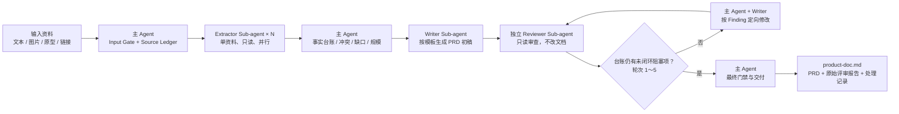
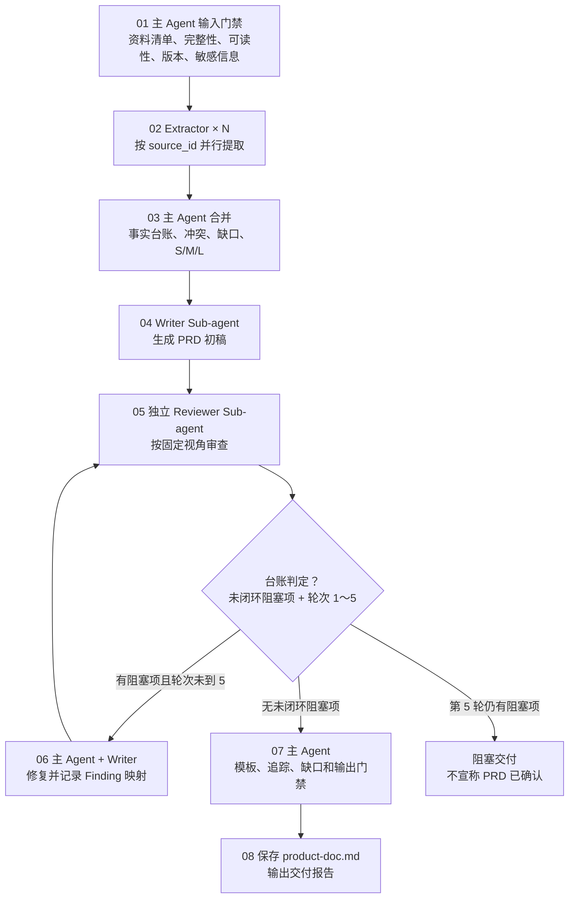

# 编写产品需求说明书

根据用户提供的任意产品说明资料，提取可确认的产品事实、用户问题、目标、场景、功能、规则、交互、指标和验收要求，生成或变更符合 `product-doc-template.md` 的标准产品需求说明书（PRD）。

本 Skill 同时支持两种模式：未提供 `feature-directory` 时创建新需求；提供后先检查目录中的 `product-doc.md`。有效文档表示需求变更，必须读取其当前有效正文和已有历史；不存在、不可读、为空、仅有模板或没有实际需求正文时，按新需求处理，但必须先向用户明确提示检查结果并取得明确确认，确认前不得启动 Extractor、Writer、Reviewer 或写入文件。

本 Skill 采用“主 Agent 编排、Extractor 并行提取、Writer 统一成稿、Reviewer 分级审查”的架构。PRD 是产品需求说明书，不是技术方案、测试方案或发布方案；它回答“为什么做、为谁做、做什么、达到什么结果”，技术实现、详细测试过程和生产操作由对应文档说明。

本 Skill 的协作原则与 `code-impl` 保持一致：主 Agent 是唯一 Orchestrator，负责输入冻结、权限边界、任务编排、结果合并、门禁和交付；Extractor、Writer、Reviewer 都是隔离的 Sub-agent，只能使用主 Agent 显式传入的资料和契约。Reviewer 只读，不得直接改写 PRD；所有修改由主 Agent 根据证据协调 Writer 或定向修订完成。

**输出语言（本轮第一句回复即生效；只用 `@product-doc` 等无自然语言方式触发时同样默认简体中文）：**面向用户的说明、检查结论、审批请求和交付报告使用简体中文；专有名词、参数、代码、命令、路径、JSON 字段名与状态字面量（如 `BLOCKED`）和原始日志保持英文原文；PRD 及其他产物文件正文按 `product-doc-template.md` 与评审契约的既有语言要求执行。规则原文见 `$SKILLS_ROOT/_shared/prompts/output-language.md`，派发子代理时必须把该规则带进任务正文。

## Agent 架构图



### 协作与权限边界

- 主 Agent：**唯一写入方**。可读输入资料和规范，可写最终 PRD、`history/` 快照、评审台账及允许的交付目录；不得把自己的推断伪装为 Extractor/Reviewer 结论。
- Extractor：只读单份资料，只输出带 `source_id` 和定位信息的结构化事实；不得访问或修改其他 Extractor 的结果。
- Writer：只接收事实台账、来源摘要、需求规模和模板；**只在会话内返回稿件文本，不写文件**——落盘统一由主 Agent 完成，避免 Writer 与主 Agent 双写同一文件互相覆盖；不自行消解冲突或补造事实。
- Reviewer：新建且独立于 Writer 的只读 Sub-agent；只输出评审报告，不写 PRD、不删除问题、不调用其他 Skill。
- 每轮修改必须基于冻结的 PRD 快照和 Reviewer Finding；同一 Reviewer 不得同时承担修改角色。

### Reviewer 闭环上限

评审状态、严重度、Finding 字段、轮次边界与人工结论映射的唯一事实源是 `references/product-review-contract.md`，本文档与 `references/check-standard.md` 不再定义第二套枚举。

`review_round` 从 1 开始计数，每一轮都是“独立 Reviewer 审查 → 主 Agent 协调 Writer 定向修改 → 主 Agent 核验稿件指纹”的完整循环，**最多 5 个完整循环**（轮次 1～5）。轮次与 Finding 闭环状态由 `scripts/review_state.py` 台账判定，不得由主 Agent 口头声明：第 5 轮收齐视角后仍有未闭环阻塞项，`advance` 会把台账置为阻塞态，此时必须停止并交付阻塞报告，不得继续审查或把未解决问题标记为通过。

## 开始时声明

本 Skill 的独立角色使用全局 agents：`product-extractor`、`product-writer`、`product-reviewer`，规范源文件位于 `skills/product-doc/agents/`。Extractor 按资料并行启动，Reviewer 按 S/M/L 规模路由。

## 路径解析约定

> 本文档中的 `SKILL_DIR` / `SKILLS_ROOT` 解析方式、派发时必须显式传入的路径清单，以及“Skill 之间不得用相对路径互相引用文件”的纪律，统一见 `$SKILLS_ROOT/_shared/prompts/path-convention.md`；下面是本 Skill 的特有补充。

**`SKILL_DIR` = 本文档所在目录的绝对路径**（插件安装时为 `<plugin-cache>/skills/product-doc`）用于定位需要读取的 `references/` 资源文件、`agents/` 角色规范源文件与 `scripts/` 门禁脚本；在命令行、Agent 提示或任何外部进程中引用这些路径时统一使用 `$SKILL_DIR`，并在调用前解析为绝对路径，不要假设当前目录、当前插件目录或仓库根目录就是 Skill 目录。正文内联的资源描述（例如 `references/check-standard.md`）按“相对 `SKILL_DIR`”理解，由主 Agent 读取时解析。

### 脚本与确定性门禁

本 Skill 自带两个确定性门禁脚本。“结构是否完整、编号是否可追踪、评审是否闭环”全部以脚本退出码为准；脚本不可用或返回非 0 时，对应阶段状态必须为 `BLOCKED`，不得用主 Agent 的自然语言自述替代：

| 脚本 | 作用 | 调用时机 |
|---|---|---|
| `$SKILL_DIR/scripts/validate_prd.py` | 校验 PRD 的模板结构、编号追踪、9.3 来源台账、占位符残留、变更历史与评审回执；`--check-template-refs` 校验本文档与规范文件的章节号未漂移 | 每次写入 PRD 后、每轮修复后、交付前 |
| `$SKILL_DIR/scripts/review_state.py` | 维护 `<feature-directory>/prd-review.json` 台账：轮次、视角路由、稿件指纹、Finding 闭环与交付门禁 | 初稿落盘后 `init`；每份报告 `record`；每条意见 `close`；收齐视角后 `advance`；交付前 `verify` |

```bash
python3 "$SKILL_DIR/scripts/validate_prd.py" <feature-directory>/product-doc.md
python3 "$SKILL_DIR/scripts/review_state.py" verify --state <feature-directory>/prd-review.json
```

`record` 或 `verify` 返回非 0（输出以 `BLOCKED:` 或 `INVALID:` 开头）时不得进入交付，也不得把 PRD 自检结论写为“已确认”。台账文件固定命名为 `prd-review.json`，与 PRD 同目录，供人工复核与下游 Skill 读取；上一版正文快照固定写入同目录 `history/product-doc-v<版本>.md`。

派发 Sub-agent 时，必须在输入中显式给出：`SKILL_DIR` 的绝对路径、本次需求的工作目录（`<feature-directory>`，新需求为 `docs/YYYY-MM-DD-<feature-name>/`）的绝对路径与其中的固定文件名，以及要读取的角色文件名；不得让 Sub-agent 自行猜测资源文件或输入资料的位置。

## Subagent 强制调用规则（Claude Code / Codex / OpenCode）

`product-extractor`、`product-writer` 和按规模路由的 `product-reviewer` 都是硬性阶段门禁，不是可选建议。进入对应阶段前，主 Agent 必须创建指定名称的独立 Sub-agent，并记录调用名称、输入快照、独立会话标识和返回状态；主 Agent 自己完成该阶段、普通串行自检或只写“建议调用”均不合规。无法创建指定 Sub-agent 时，阶段状态必须为 `BLOCKED`，不得伪造提取、成稿或评审结果。**该门禁只约束主 Agent（Orchestrator）：被派发的角色 Sub-agent 一律不再派发下一级 Sub-agent，也绝不因自身缺少派发能力而返回 `BLOCKED`；它只需按自己的角色契约完成本阶段并返回结构化结果。**

按宿主派发的方式（Claude Code / Codex / OpenCode 的角色标识与语法差异、“不得把派发指令注入子代理”的纪律、以及 Skill 在各宿主下的调用名）见 `$SKILLS_ROOT/_shared/prompts/subagent-mandate.md`，其中 `SKILLS_ROOT` = `dirname(SKILL_DIR)`。进入任何派发阶段前必须读取该文件；角色由 `manage-global-agents.py`（仓库安装脚本）安装为**全局裸名**，不存在 `@agent-<plugin>:<name>` 这类插件作用域角色名。

开始执行时声明：**“使用 product-doc skill，根据产品说明资料生成或变更产品需求说明书。”** 并说明当前是新需求还是需求变更模式。

## Agent 架构与职责

```text
[主 Agent]
    │  用户指令 + 多种资料 + 模板定义
    ├──→ [Extractor Sub-agent × N]（并行，每个资料一个）
    │       输入：单份原始资料
    │       输出：结构化关键信息 JSON/Markdown
    │
    ├──→ [Writer Sub-agent]
    │       输入：汇总后的关键信息 + 文档模板
    │       输出：需求文档初稿
    │
    └──→ 按需求规模路由 Reviewer
            S：1 个 Reviewer Sub-agent
            M/L：2 个 Reviewer Sub-agent（不同审查视角，并行）
            输入：原始资料摘要 + 文档初稿 + 审查清单
            输出：审查意见，追加至需求文档结尾
```

### 主 Agent

主 Agent 负责读取模板和质量标准、拆分资料、启动并行 Extractor、汇总并保留来源、判断需求规模、调用 Writer、路由 Reviewer、处理审查结果和最终交付。主 Agent 不应代替 Extractor 对资料做未经来源支持的补全，也不应代替 Reviewer 静默修改或丢弃审查意见。

### Extractor Sub-agent

- 每个 Extractor 只处理一份原始资料；不得读取其他资料的提取结果，不得跨资料自行消解冲突。
- Extractor 只提取资料明确出现的事实；可推导关系、冲突、缺口和图片不可辨认内容必须单独标注。
- Extractor 输出结构化 JSON 或等价 Markdown，必须携带 `source_id` 和原文/图片位置，供主 Agent 合并追溯。
- 多份资料必须并行处理；只有在资料本身不可拆分或运行环境明确不支持并行时，主 Agent 才可按相同契约顺序调度，并在交付说明中注明。

### Writer Sub-agent

Writer 只接收主 Agent 汇总后的结构化关键信息、来源/冲突/缺口摘要和 `references/product-doc-template.md`，不接收未经整理的多份原始资料作为事实来源。Writer 必须按模板成稿，不得把推断写成已确认事实，不得自行发明模板章节或用技术实现填充产品要求。

### Reviewer Sub-agent

Reviewer 只负责审查，不负责重写 PRD。每个 Reviewer 都必须向主 Agent 返回可追溯的结构化评审报告；由主 Agent 在冻结报告后将原始意见以独立评审章节追加到 PRD 文档末尾，不得删除或覆盖其他 Reviewer 的意见。

- S 级：调用 1 个 Reviewer，综合检查需求完整性、业务/交互/设计逻辑、非功能要求、风险和验收可执行性。
- M/L 级：并行调用 2 个 Reviewer，使用以下两个不同且固定的视角：
  1. **需求完整性与逻辑正确性**：检查背景、目标、范围、用户、功能、业务规则、交互、状态、权限、指标、验收之间的一致性，及正常/边界/异常场景遗漏。
  2. **非功能性需求**：检查性能与容量、可用性与降级、安全与隐私合规、兼容性与终端、数据质量与生命周期、本地化与可访问性，以及对应的度量口径、监控和验收。
- Reviewer 必须遵循“只能依据文档和提供的资料，不添加额外假设或猜想，使用中文输出”的约束。

## 适用范围

适用于新产品功能、存量功能优化、业务流程调整、跨系统产品需求，以及需要把零散产品资料整理为正式 PRD 的场景。

输入可以是但不限于：

- 直接粘贴的产品说明、会议纪要、访谈记录、客服反馈、业务规则、竞品分析或需求描述；
- Lark 文档、网页、工单、产品链接或本地 Markdown/TXT 文件；
- 产品原型、流程图、页面截图、设计稿、白板照片、扫描件或其他图片；
- PDF、文档、表格及包含文字和图像的混合资料。

## 输入与资料读取

主 Agent 必须先完整读取并遵守：

- 输出模板：`references/product-doc-template.md`
- 质量标准：`references/check-standard.md`

`product-doc-template.md` 是本次输出的唯一结构和内容基准，不得自行发明旧版章节或替换模板。

### 新需求与需求变更模式

主 Agent 必须在任何资料提取前完成以下门禁：

1. **无 `feature-directory`：**判定为新需求，按下方正常输入门禁创建新的 `docs/YYYY-MM-DD-<feature-name>/product-doc.md`。
2. **有 `feature-directory` 且存在有效 `product-doc.md`：**判定为需求变更。完整读取旧文档，识别当前有效正文、文档版本、已有变更记录、历史快照和稳定编号；旧文档中的历史章节只用于追溯，不得重新当作当前需求。
3. **有 `feature-directory` 但 `product-doc.md` 缺失、不可读、为空、仅有模板/占位符或没有实际需求正文：**明确提示“提供的目录没有有效 PRD，将按新需求处理；确认后才会继续”，停止等待用户明确确认。用户未确认时不得继续；确认后才按新需求写入该目录，并在交付报告中记录“由无效旧目录转为新需求”。
4. 需求变更时，新输入中用户最新明确的方案和逻辑优先于旧 PRD、旧评审意见、旧 TDD/RPD 或模型推断。旧文档与新输入冲突时不得静默沿用旧内容；新输入仍有互相冲突时保留冲突并建立 Q 编号，除非用户明确指定了优先版本。

### 需求变更的分类、展示与历史

需求变更必须同时建立“本轮变更台账”和“只追加历史”：

- **修改：**已有稳定编号或已有业务行为改变；保留原编号，写清旧逻辑、新逻辑、原因、来源和受影响的编号，不得借修改之名复用编号表达另一含义。
- **新增：**新能力或新对象分配全新稳定编号，写清新增内容、来源和影响；不得使用历史上已删除对象的编号。
- **删除：**从当前有效方案中移除的能力、规则、交互、指标或验收项，保留原编号并标记“已删除”，写清原因、影响和来源；不得只从正文中抹掉而无记录。
- 在当前 `product-doc.md` 中以醒目的三个固定标题展示：`【修改】`、`【新增】`、`【删除】`；每类即使没有条目也填写“无”。变更表格的每一行也必须填写变更类型。
- 上一版正文快照**外置为同目录独立文件**：更新前先把当前有效正文写入 `<feature-directory>/history/product-doc-v<版本>.md`（快照文件已存在时不得覆写），再在模板的“变更历史”台账末尾**追加一行**，登记版本、日期、上一版正文的 sha256 内容摘要、来源摘要、`修改/新增/删除` 数量、快照路径与确认人。**禁止把上一版全文内嵌进 `product-doc.md`**（既造成体积按轮次累积膨胀，内嵌代码围栏又会破坏本文档结构）。
- 追加前先判重：表中已有相同“版本 + 内容摘要”的行说明本轮已归档，不得重复追加；保留已有历史条目，禁止覆盖、删除或重排。新需求只保留“无历史版本”一行。
- 当前正文只表达最新有效方案；删除项可从当前流程中移除，但必须能从变更台账与 `history/` 快照恢复。
- 变更后的 Reviewer 意见、处理记录和自检结论追加到当前文档；不得用新一轮内容覆盖旧评审记录。交付时报告旧版本摘要、新版本摘要和三类变更数量。

### 输入门禁与校验

主 Agent 必须在启动任何 Extractor 前完成首项输入校验，并冻结输入快照：

- 每份输入都必须登记 `source_id`、类型、来源、路径或 URL、版本/日期、读取状态和内容摘要（sha256）；用户直接粘贴的文本、截图等没有天然路径的输入，必须由主 Agent 先原样落盘为 `<feature-directory>/inputs/SRC-XXX.md`（或 `.png`）再登记其路径与 sha256，禁止只写“用户提供的文本”这类无指纹条目——`review_state.py init --input` 只接受真实存在的文件；
- 本地文件必须存在、可读且有实际内容；远程文档必须能读取正文并记录稳定 revision/version，无法读取时不得用标题或摘要代替；
- 图片、扫描件和原型必须逐项可视读取；无法辨认的区域标记为缺口，不得推测；
- PDF、表格、Lark 文档等需要专门读取能力的资料：当前环境没有对应能力时，该 `source_id` 的读取状态记为 `能力不可用`并进入 `unreadable_or_unavailable`；只要它承载必填信息，`input_status` 必须为 `BLOCKED`，不得改由模型“根据常见做法”补齐；
- 输入资料中的敏感信息（手机号、证件号、地址、密钥、真实账号密码等）只在台账登记“出现过该类字段”的事实与原字段名，不得把真实值复制进台账、PRD 或评审意见；PRD 第 5 章与 6.1 必须写明该类字段的展示、日志与上报边界；
- 输入为空、只有标题、只有模板示例或无法确认基本需求范围时，PRD 只能进入草稿/阻塞状态，不能输出“已确认”；
- 资料冲突、权限缺失、版本不一致和来源不可追溯必须在输入台账中显式登记，未解决前不得交给 Writer 作为确定事实；
- 需求变更模式必须额外登记旧 PRD 的版本/日期/内容摘要、当前有效正文范围、历史快照位置，以及本轮 `修改/新增/删除` 台账；删除项必须包含原稳定编号；
- 主 Agent 必须在门禁结果中记录 `input_status: PASS | PARTIAL | BLOCKED`、未读取资料和是否允许启动后续阶段。

`input_status=BLOCKED` 时停止全部 Sub-agent；`PARTIAL` 只能生成带缺口的草稿，并将缺口传递到 Reviewer 和最终交付。

主 Agent 在启动 Extractor 前必须建立输入资料清单，记录每份资料的 `source_id`、类型、来源、名称/链接、版本或日期（如果有）和内容摘要（sha256）。清单以 JSON 写入 `<feature-directory>/prd-review.json`（由 `review_state.py init` 创建）或由主 Agent 作为输入台账保留。资料读取规则如下：

1. Lark 文档 URL 使用 lark-doc 读取；网页或指定页面使用可访问的页面读取能力。当前会话未挂载该能力时，按上一条记为 `能力不可用`；无法访问时记录来源和缺口，不得凭标题推测正文。
2. 本地 Markdown、TXT、PDF、文档或表格使用相应的文件读取能力；必须读取与本次需求相关的完整内容。
3. 图片必须逐张查看。提取图片中可辨认的页面名称、文案、控件、字段、状态、流程箭头、角色、权限、校验提示和标注；看不清、被遮挡或无法确认的内容标记为“图片不可辨认，需人工补充”，不得自行补图或补文案。
4. 多份资料内容冲突时，保留冲突双方及来源，在汇总台账和最终 PRD 的 9.2 决策与待决问题中建立 Q 编号，不能静默选择一个版本；需求变更模式下，旧 PRD 与新输入的冲突按最新明确方案处理，并在变更台账中注明被替换的旧逻辑。
5. 资料为空、只有标题、无法访问，或无法确认基本需求范围时，停止生成“已确认”的 PRD；仍可按模板生成草稿，但必须重点标明信息缺口，并将受影响的自检检查项标为“不通过”、签署结论保持“待确认”。
6. 产品说明资料中出现技术名词、接口名、字段名、事件名、指标名、属性名、参数名、枚举值、编号、URL、代码、专有名词时，原样保留，不翻译或改名。

## Sub-agent 数据契约

### Extractor 输入与输出

每个 Extractor 的输入至少包括：

- `source_id` 及该资料的元数据；
- 单份原始资料的完整可读内容或可访问引用；
- 模板章节和信息可信度规则的必要摘要。

每个 Extractor 的输出必须包含以下字段，字段可用等价 Markdown 表达，但不得丢失来源：

```json
{
  "source_id": "SRC-001",
  "source_summary": "本资料能确认的范围摘要",
  "confirmed_facts": [
    {"fact_id": "SRC-001-F001", "content": "事实", "source_locator": "页码/段落/图片区域", "prd_candidates": ["2.1", "4.1"]}
  ],
  "derivable_relations": [
    {"content": "可推导关系", "basis_fact_ids": ["SRC-001-F001"], "prd_candidates": ["2.2"]}
  ],
  "pending_items": [
    {"content": "资料未说明的事项", "impact": "影响", "prd_candidates": ["9.2"]}
  ],
  "conflicts_found": [],
  "unreadable_or_unavailable": []
}
```

Extractor 不得补写目标值、基线、负责人、权限、流程、页面行为、错误提示或验收结果；资料未提供时必须进入 `pending_items`，明确冲突时进入 `conflicts_found`。

### Writer 输入与输出

主 Agent 汇总所有 Extractor 输出后，形成“关键信息台账”，至少包含：事实、来源、可信度、目标 PRD 章节、冲突、缺口、Q/RISK/DEP 候选编号和需求规模判断依据。需求变更时还必须传入旧 PRD 当前有效正文、旧版本摘要和 `修改/新增/删除` 台账。Writer 输入为该台账、原始资料摘要、需求规模和完整模板；输出为完整 PRD 初稿或修订稿。

Writer 必须：

- 使用同一事实的稳定编号和名称贯穿目标、需求、规则、字段、状态、埋点和验收；
- 区分“已确认”“可推导”“待确认”“不涉及”；只有资料明确不适用时才能使用“不涉及”；
- 将来源冲突和资料缺口映射到 2.4、8.2、9.2 及 PRD 自检与确认；
- 为每一个写入正文的需求编号在 9.3 来源与追踪台账建立一行支撑（资料编号、定位、可信度、推导依据）；资料中找不到支撑的编号不得出现在正文；
- 4.1 功能清单的“关联验收”列必须为每个 P0 功能列出 7.1 中的 AC 编号，该列不得删除；
- 需求变更时按最新输入更新当前有效正文，逐项落实三类变更，保持稳定编号和追踪关系，并生成醒目的本轮变更摘要；不得把旧 PRD 的方案优先级当作当前事实；
- 保留模板所有必填主章节和适用的条件章节，不把模板示例、占位符或 TODO 当作正式事实；
- 只描述用户和业务行为，不编造数据库、类名、接口、框架、部署、SQL 或技术实现。

### Reviewer 输入与输出

Reviewer 输入必须包括：

- 主 Agent 生成的原始资料摘要和关键信息台账摘要；
- Writer 生成的完整 PRD 初稿；
- `references/check-standard.md` 审查清单；
- 该 Reviewer 的固定审查视角和需求规模。

Reviewer 输出必须严格遵循 `references/product-review-contract.md` 的输入封套与输出契约（含 `review_id`、`contract_version`、`prd_digest` 与 Finding 字段），字段不得缺失、不得改名。评审意见只能指出文档问题，不得引入资料之外的新业务事实。主 Agent 必须把输出规范化为 JSON 后交给 `scripts/review_state.py record`，而不是直接读一段中文结论。

## 信息可信度与缺口规则

每条信息按以下等级处理：

- 已确认：资料明确写出，或在图片/原型中清晰可见，并记录来源；
- 可推导：由同一份或多份资料一致推导出的产品关系；必须注明推导依据，不能伪装成原文事实；
- 待确认：资料没有给出、来源冲突、图片不清晰、关键口径缺失或需要产品/业务负责人决策；
- 不涉及：只有资料明确说明不适用时才能填写；资料缺失不能等同于不涉及。

禁止把资料中的示例、占位符、TBD、TODO、待定、空字段、示例编号，以及图片中看不清的文字、隐含页面行为、未标注权限或模型自行补充的规则当作已确认事实。

如果输入不完整，必须在生成的 PRD 中重点说明：

1. 在文档标题下方增加醒目的提示块，说明“信息不完整，本文档不可视为已确认 PRD”，并列出最重要的缺口编号；
2. 在 2.4 前提与依赖中记录前提和影响；
3. 在 8.2 依赖与风险中记录缺口带来的产品风险；
4. 在 9.2 决策与待决问题中为每个缺口建立唯一 Q 编号、负责人和确认期限；
5. 在 PRD 自检与确认中把受影响的检查项标为“不通过”，签署结论保持“待确认”（不得写“已确认”）；
6. 资料确实无法提供的取值统一写“待补充”并指向 9.2 的 Q 编号；**不得保留模板的“【填写】”类占位符**——`validate_prd.py` 会把未替换占位符判为残留并拒收，因此草稿也必须是一份结构完整、缺口可追踪（而不是靠占位符表达）的文档。

## 从产品资料提取到 PRD 模板

读取资料后，主 Agent 根据 Extractor 台账建立来源信息到 PRD 章节的映射，至少覆盖：

| 产品资料信息 | PRD 落点 | 提取要求 |
|---|---|---|
| 产品背景、问题、用户反馈、数据证据 | 2.1 问题与机会 | 提取现状、痛点、问题规模、业务影响、处理时机和证据；没有数据就标记缺口 |
| 目标、预期收益、成功判断 | 2.2 目标与衡量指标 | 转换为 OBJ/KPI，补齐指标口径、基线、目标值、统计窗口、数据源和负责人 |
| 范围、排除项、边界、版本计划 | 2.3、8.1 | 区分本次交付、后续计划和明确不做内容，标注 P0/P1/P2 优先级 |
| 用户角色、权限、访谈和行为 | 3.1、3.2 | 提取角色、使用场景、触发条件、用户目标、期望结果、频次与峰值、失败影响和权限边界 |
| 页面截图、原型、流程图、白板或交互说明 | 4.2、4.3、4.4 | 提取页面、流程、控件、字段、状态、权限、文案、异常、边界和重复操作 |
| 功能说明、业务规则、状态变化、计算规则 | 4.1、4.2、4.3 | 为功能、规则、字段、状态和异常建立稳定编号，并保持名称一致 |
| 性能、可用性、安全、隐私、兼容性、本地化、可访问性 | 第 5 章 | 转换为可观察、可衡量的产品要求，不擅自写技术实现 |
| 业务指标、埋点、漏斗、实验、监控诉求 | 第 6 章 | 建立 OBJ/KPI/EVT/属性之间的追踪，补齐口径、维度、告警和数据质量 |
| 验收口径、测试场景、业务验收安排 | 第 7 章 | 转换为 AC、正常/边界/异常场景和上线前确认条件 |
| 发布计划、外部依赖、风险、决策和未决事项 | 第 8、9 章 | 提取放量与回滚条件、依赖交付项、触发信号、应对方案、决策记录和待决问题 |
| 资料本身（来源、类型、版本/日期、内容摘要） | 9.3 来源与追踪台账 | 为每个需求编号至少保留一行支撑：`SRC-XXX`、定位、可信度、推导依据与资料状态 |

## 强制执行流程
请严格使用多 Agent 工作流：



### 1. 主 Agent 读取模板、质量标准并拆分资料

主 Agent 完整读取 `references/product-doc-template.md` 和 `references/check-standard.md`，确认当前模板的必填章节、条件必填规则、编号规范、状态值和 S/M/L 裁剪要求。然后建立资料清单，为每份可处理资料生成唯一 `source_id`，确定 Extractor 数量 N。

### 2. 并行调用 Extractor Sub-agent × N

为每个 `source_id` 启动一个 Extractor Sub-agent，并行传入单份原始资料和 Sub-agent 数据契约。主 Agent 等待所有可用 Extractor 返回后再进入汇总；单个资料不可读取时，保留该 `source_id` 的失败状态和缺口，不得让其他 Extractor 代为猜测。

### 3. 汇总关键信息并判断需求规模

主 Agent 合并 Extractor 输出，建立事实台账和原始资料摘要：去重相同事实但保留全部来源，保留冲突双方，合并缺口并生成唯一 Q/RISK/DEP 候选编号；需求变更时额外生成旧→新对照和 `修改/新增/删除` 台账。随后按 `references/product-doc-template.md` 的《文档裁剪》表判定 S、M 或 L（该表是规模判断的唯一事实源，本文件不重复定义判断标准）：

- 规模与优先级写入 PRD 的 1.1 基本信息行（形如 `S / P0`），`validate_prd.py` 与 `review_state.py` 都据此路由独立评审视角；
- 无法判断规模时按较高一级的最低要求检查。涉及资金、资产、隐私、权限、不可逆操作、核心业务或重大用户影响时，必须补齐数据生命周期、安全合规、权限、异常、业务连续性、验收和用户影响，不能因资料不全而降级。

### 4. 调用 Writer Sub-agent 生成 PRD 初稿

将汇总后的关键信息台账、原始资料摘要、需求规模和完整模板传给 Writer。Writer 按“问题 → 目标 → 用户与场景 → 功能 → 页面与交互 → 非功能要求 → 指标 → 验收 → 发布与风险”的顺序填写模板，**在会话内返回完整 PRD 初稿文本**（不写文件）；由主 Agent 落盘到 `<feature-directory>/product-doc.md` 并跑一次 `validate_prd.py`，确认结构后才能进入独立评审。

所有功能需求必须回答：谁在什么条件下做什么；产品提供什么可观察行为；成功、失败、边界、重复和并发时如何表现；哪些属于本次范围；如何通过指标和验收判断完成。

### 5. 按 S/M/L 路由 Reviewer Sub-agent

初稿由主 Agent 落盘后，先建立评审台账再派发 Reviewer（`review_state.py init --state <feature-directory>/prd-review.json --prd <feature-directory>/product-doc.md --mode new|change --scale S|M|L --input SRC-001=<已落盘资料路径> ...`）。主 Agent 不得跳过独立审查：

- 视角路由由 `references/product-review-contract.md` 按规模固定：S → 1 个 `COMPREHENSIVE`（综合）；M/L → 并行 2 个视角 `COMPLETENESS`（需求完整性与逻辑正确性）与 `NON_FUNCTIONAL`（非功能性需求）；不得用主 Agent 自检替代；
- 派发时必须传入契约要求的完整输入封套，其中 `prd_digest` 取落盘后稿件**正文**的 sha256（不含文末回执区）；所有 Reviewer 都读取相同的 `check-standard.md`，但只能依据自己的输入和指定视角审查；
- 每份报告返回后先原样追加到 PRD 的“独立评审意见”章节（保留 `review_id`、`perspective`、`review_round` 与 `prd_digest`），再规范化为 JSON 调 `record`；`record` 会拒绝轮次不符、视角重复、指纹过期或与 Finding 集合矛盾的结论；
- 收齐本轮要求的视角后才允许 `advance`；每次重新审查都必须重新冻结 PRD、输入台账和本轮变更摘要，不得复用旧 Reviewer 的口头结论。

### 6. 处理审查意见并完成最终自检

主 Agent 对每条 Reviewer 意见逐项处理，并遵守台账记录的 `review_round`（轮次 1～5，不得由主 Agent 口头推定）：

- 能由已有资料确认的问题，由主 Agent 依据 Finding 协调 Writer 重新出稿并落盘，同步修复关联编号、2.2 指标、9.3 台账、Q/RISK/DEP 和自检结论；
- 资料无法确认或存在真实冲突的问题，不得擅自决策，写入 9.2 决策与待决问题和 8.2 依赖与风险，并以 `close --resolution deferred --q-ref Q-XXX` 关闭（`Q-XXX` 必须已出现在 PRD 中）；
- 阻塞级 Finding 只能用 `fixed` 关闭，且必须发生在推进到下一轮之后（`close` 会拒绝“同一轮内自称已修复”）；非阻塞项可以 deferred 或有充分理由的 rejected 关闭；
- 每轮修复后重跑 `validate_prd.py`，再 `advance` 进入下一轮；正文与送审稿件一致时 `advance` 会拒绝，防止只归档回执不改稿；变更历史行数减少时同样拒绝（历史不得删除、覆盖或重排）；
- Reviewer 的原始评审意见仍须保留在文档末尾，不得因修复正文而删除；
- 重新执行 `references/check-standard.md` 的完整自检，确保正文修复没有破坏模板结构和来源追溯；
- 最终 PRD 的确认结论必须与信息完整性一致；只有 `review_state.py verify` 与 `validate_prd.py` 同时返回 0，才允许把自检结论写为“已确认”。

### 7. 保存与交付

先用 10 个以内的词概括本次需求，作为 feature-name。若属于需求变更且 `feature-directory` 有效，必须沿用该目录，不得另建目录分叉历史。

- `<feature-directory>` 的根是**当前仓库根目录**（`docs/` 与 `skills/`、`scripts/` 同级），不是 Skill 目录、插件缓存目录或用户主目录；派发 Sub-agent 与调用脚本时必须传绝对路径。
- feature-name 会被下游 `code-impl` 直接用作 git 分支名（`basename(feature-directory)`），因此只允许小写字母、数字与连字符（如 `order-retain-popup`），不得使用中文、空格或斜杠；无法给出英文名时向用户确认，不得自行音译。

新需求的产品需求文档统一保存到 `docs/YYYY-MM-DD-<feature-name>/product-doc.md`；需求变更保存回 `<feature-directory>/product-doc.md`。

`docs/YYYY-MM-DD-<feature-name>/` 即为本次需求的工作目录，其中固定存放：`product-doc.md`（PRD）、`prd-review.json`（评审台账）、`inputs/`（已落盘的粘贴类输入资料）与 `history/product-doc-v<版本>.md`（上一版正文快照）。

交付前必须依次跑完两个门禁（任一非 0 都只能交付阻塞报告，不得声称已确认）：

```bash
python3 "$SKILL_DIR/scripts/validate_prd.py" <feature-directory>/product-doc.md
python3 "$SKILL_DIR/scripts/review_state.py" verify --state <feature-directory>/prd-review.json
```

确认无法闭环而必须交付阻塞报告时，改用 `verify --state ... --allow-blocked`：它的退出码 0 只表示“阻塞台账完整、可以归档交付”，不表示需求已确认。

最终输出产物必须明确包括：

- `<feature-directory>/product-doc.md`：完整 PRD、9.3 来源追踪、未决问题和原始 Reviewer 评审意见；
- 需求变更时的 `修改/新增/删除` 醒目摘要、只追加变更历史台账，以及台账中登记的 `history/` 快照路径与内容摘要；
- `prd-review.json`：输入资料清单、逐轮 Reviewer 回执与 Finding → 修改/待确认/不采纳映射；
- 两个门禁脚本的退出状态与输出摘要；主 Agent 最终门禁结果：模板校验、需求覆盖、信息完整性、`review_round`、阻塞项和人工确认项。

交付时报告：读取的资料及其状态、Extractor 数量和未读取资料、需求规模、Reviewer 路由和视角、目标用户、核心功能、PRD 路径、信息完整性结论、`review_round` 及 Reviewer 最终状态，以及重点缺口、Q 编号、负责人和确认期限。

如果存在缺口，必须明确说明文档是草稿/有条件确认，不能视为已确认 PRD；如果运行环境不支持所需的 Sub-agent 调用，必须说明未能完成的阶段，不得声称已完成并行提取或独立评审。

## 编写与自检要求

### 编写标准 PRD

完整复制 `references/product-doc-template.md` 的结构后填写，不得删除必填章节或条件章节，不得保留示例数据作为正式内容。正式输出必须包含：

1. 文档信息；
2. 背景与目标；
3. 用户与使用场景；
4. 功能需求；
5. 非功能要求；
6. 数据埋点与监控；
7. 验收标准；
8. 发布、依赖与风险；
9. 附录（含 9.3 来源与追踪台账，任何规模均为必填）；
10. 变更历史（任何版本均为必填；新需求只写一行“无历史版本”）；
11. PRD 自检与确认；
12. 独立评审意见（追加在模板最后一节之后）。

填写要求：

- 标题、章节顺序、表头、编号前缀和状态值遵循模板；
- 必填项必须有内容；条件必填项不适用时填写“不涉及”并说明原因；
- 示例必须替换或删除，不能把示例编号、文案、指标和事件留在正式 PRD；
- 目标与指标必须包含口径、基线、目标值、统计窗口、数据源和负责人；不完整时列入 Q；
- 需求变更时必须校验：最新输入是否覆盖旧冲突、修改项是否保留原编号、新增项是否使用新编号、删除项是否标记且不再作为当前有效需求、三类变更是否显眼展示、上一版正文是否已外置为 `history/` 快照并在台账登记路径与摘要（而不是内嵌到本文档）；
- 每个正式需求编号都必须在 9.3 台账有支撑行；台账里没有的编号不得出现在正文（由 `validate_prd.py` 判定）；
- 每个 P0 功能至少覆盖正常场景，以及适用的边界、异常、权限、状态、重复/并发和兼容性场景；
- 页面需求必须覆盖页面流转、加载、空数据、错误、提交中、成功和失败恢复等适用状态；不涉及用户界面时明确写“不涉及”；
- 业务规则、字段、状态、权限和验收标准必须互相一致；
- 第 6 章必须能追溯到第 2 章目标，并补齐事件、属性、去重、敏感信息和指标用途；
- 第 7 章必须描述用户或外部系统可观察的结果，不能只写技术内部状态；
- 第 8、9 章必须承载依赖、风险、决策和待决问题，不得隐藏未解决事项。

### 自检与独立评审约束

机械可判定的部分不依赖自觉：结构、编号追踪、来源台账覆盖、占位符残留、变更历史与评审回执由 `scripts/validate_prd.py` 判定；轮次、视角路由、指纹一致性与 Finding 闭环由 `scripts/review_state.py` 判定。两个脚本都返回 0 才能声称“已确认”。

使用 `references/check-standard.md` 逐项检查脚本无法判定的语义质量：来源追溯、用户影响、范围边界、指标可衡量性、验收可执行性和缺口标注。独立 Reviewer 的结论不能被主 Agent 默认为通过；每条问题都必须修复、列入 Q/RISK，或明确记录为什么不适用。

Reviewer 的共同提示词约束如下：

```text
你是一名资深产品专家。

任务：分析用户给到的产品需求说明文档，找出其中的错误（业务逻辑、交互逻辑、设计逻辑）、遗漏和潜在风险。

规则：
* 只能依据文档和输入资料中明确的信息进行分析，不要添加额外的假设或猜想；
* 使用中文输出；
* 只输出指定审查视角内的问题、依据、影响和建议，不重写整篇 PRD；
* 输出可直接追加到需求文档结尾的 Markdown 评审意见。
```

## 禁止事项

- 不得把 product-doc Skill 当作技术方案、测试方案或发布方案 Skill 使用。
- `feature-directory` 有效时不得按新需求另建目录或覆盖旧 PRD；`feature-directory` 无效时未取得用户明确确认不得继续。
- 不得绕过 `references/product-doc-template.md` 或只输出摘要、需求列表或功能清单。
- 不得跳过 `validate_prd.py` 或 `review_state.py` 就声称门禁通过，也不得在脚本返回非 0 后修改台账文件正文“手工放行”（台账只能由脚本写入）。
- 不得把上一版 PRD 全文内嵌到 `product-doc.md` 的变更历史中；快照只能写入同目录 `history/` 独立文件。
- 不得把未出现在 9.3 来源台账的需求编号写进正文，也不得在台账中引用正文并不存在的编号（幽灵行）。
- 不得把主 Agent 的串行自检冒充独立 Reviewer 结果；不得为了推轮把未闭环的阻塞项降级为非阻塞。
- 不得跳过 Extractor、Writer 或按需求规模要求的 Reviewer 阶段。
- 不得把图片看不清的内容、资料中的示例或模型推断写成已确认产品事实。
- 不得让 Writer 或 Reviewer 直接写入 `product-doc.md`；唯一写入方是主 Agent，否则两个角色会互相覆盖。
- 不得把资料缺失填写为“不涉及”；只有明确不适用时才能写“不涉及”。
- 不得编造用户、角色、权限、目标值、基线、指标口径、发布计划、负责人、验收结果或业务规则。
- 不得使用“体验良好”“尽快”“高性能”等不可验证的模糊表述替代具体要求。
- 不得遗漏正常、边界、异常、权限、状态、重复/并发和兼容性等适用场景。
- 不得删除条件必填章节；不适用时必须保留章节并说明原因。
- 不得将未解决的冲突、依赖或风险隐藏在正文中，必须通过 Q、DEP、RISK 或 DEC 编号追踪。
- 不得删除、覆盖或静默改写 Reviewer 追加到文档结尾的原始评审意见。
- 需求变更不得直接覆盖旧 `product-doc.md`；不得删除历史快照、变更记录或三类变更台账，不得将旧逻辑重新写回当前有效正文覆盖最新输入。
- 不得在信息不全时把 PRD 自检结论或确认结论写成“已确认”。
