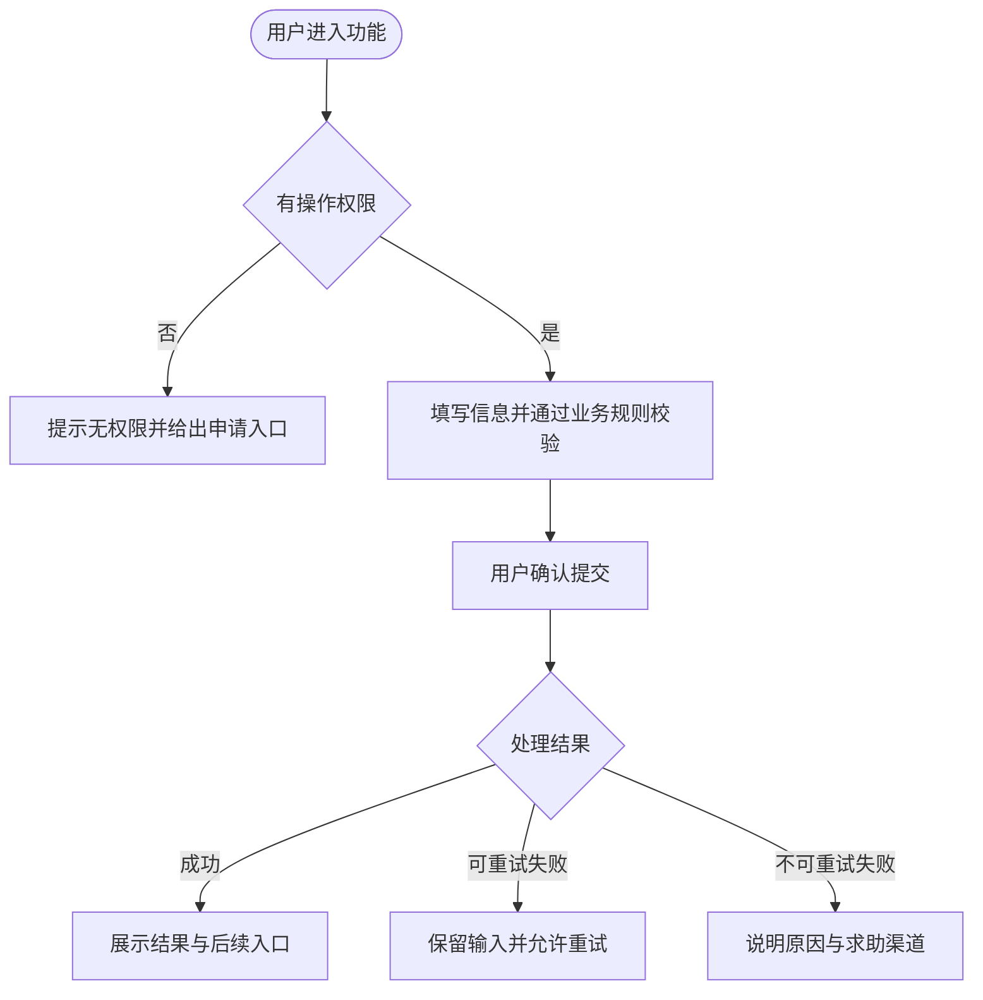

# 产品需求说明书模板

> 面向互联网服务的产品需求文档，覆盖新功能、存量功能优化、业务流程调整和跨系统需求。本文档回答“为什么做、给谁用、做什么、怎么算成功”，是产品行为的事实来源；技术实现、测试用例和生产操作分别由技术方案、测试方案、发布方案承载。

## 使用说明

1. 标注“必填”的内容不得省略；条件必填不适用时写“**不涉及**”并说明原因。
2. 只描述用户和业务可观察的行为，不写数据库、接口、框架、缓存等实现方式。
3. 目标、指标和验收必须可观察、可衡量，禁止“体验良好”“性能较快”“尽量兼容”等模糊表述。
4. 每个需求对象使用唯一稳定编号，编号不携带版本或优先级；对象废弃时保留编号并标记“已删除”，禁止复用。
5. 功能、流程、页面、字段、状态、埋点和验收中的名词与编号必须一致；示例（`【】` 占位符、样例行）在正式文档中必须替换或删除。
6. 需求优先级统一使用：`P0` 本次必须交付；`P1` 本次应交付，产能不足时与业务方确认后顺延；`P2` 本次有余量才做或明确排入后续。顺延和排除项必须写入 2.3 非目标。
7. 范围、业务规则或指标变化时：更新变更记录，区分“修改 / 新增 / 删除”并同步受影响的需求、原型、埋点和验收；不得覆盖旧版本，必须在文末追加变更历史和上一版正文快照，当前正文只表达最新有效方案。
8. 每个需求对象都必须能在 9.3 来源与追踪台账中找到支撑它的资料编号 `SRC-XXX` 与可信度（已确认 / 可推导 / 待确认）；资料中找不到支撑的编号不允许出现在正文，正文有编号而台账无对应条目视为结构缺陷。
9. 上一版正文快照以**同目录 `history/` 独立文件**保存，本文档只记录其路径与内容摘要；禁止把上一版全文内嵌进本文档（会造成体积按轮次累积膨胀，且内嵌代码围栏会破坏本文档结构）。

## 文档裁剪

| 规模 | 判断标准 | 最低要求 |
|------|----------|----------|
| S | 单页面或单功能、单一角色、无资金/隐私/权限变化 | 第 1～7 章、9.3 来源与追踪台账、变更历史、独立评审意见与 PRD 自检与确认；第 8 章与第 9 章其余小节按需 |
| M | 跨页面或跨系统、多角色、有状态或权限变化 | S 全部内容，并补齐业务流程、页面状态、字段与权限、依赖风险和业务监控 |
| L | 核心链路、资金/资产/隐私数据、多团队协作或重大调整 | M 全部内容，并补齐数据生命周期、安全合规、分阶段放量、异常恢复和全场景验收 |

涉及资金、资产、隐私、权限或不可逆操作时按较高一级检查，不得因资料不全降级。

## 编号前缀

| 对象 | 前缀 | 对象 | 前缀 |
|------|------|------|------|
| 需求文档 / 目标 / 指标 | PRD / OBJ / KPI | 场景 / 功能 | SC / FR |
| 业务规则 / 异常 / 状态 | BR / AF / ST | 页面 / 字段 | UI / F |
| 事件 / 实验 / 验收标准 | EVT / EXP / AC | 依赖 / 风险 / 待决 / 决策 | DEP / RISK / Q / DEC |
| 输入资料 / 评审发现 | SRC / PR | 评审轮次 | R\<轮次\> |

编号一律写在表格首列或三级标题中（如 `### FR-001：下单挽留`），正文其他位置只引用不重复定义；同一编号只能定义一次。

---

# 1. 文档信息（必填）

## 1.1 基本信息

| 项目 | 内容 |
|------|------|
| 需求名称 / PRD 编号 | 【填写】/【PRD-ORDER-2026-001】 |
| 文档版本 / 状态 | 【0.1】/ 草稿 · 评审中 · 已确认 · 已归档 |
| 需求规模 / 优先级 | S · M · L / P0 · P1 · P2 |
| 负责人 | 产品、研发、测试必填；业务、设计、数据、运营按需 |
| 关联工单 / 目标版本 | 【链接】/【填写】 |
| 创建日期 / 最后更新日期 | YYYY-MM-DD / YYYY-MM-DD |

## 1.2 变更记录

| 版本 | 日期 | 修改人 | 变更类型 | 变更内容 | 影响的编号 | 确认人 |
|------|------|--------|----------|----------|------------|--------|
| 【0.1】 | YYYY-MM-DD | 【填写】 | 新增 | 初稿 | 首次创建 | 【填写】 |

### 本轮变更摘要（需求变更时必填）

> 三类必须醒目展示，无变化时填“无”。删除项保留原编号并标记“已删除”；新增项使用新编号，不得复用历史编号。

- **【修改】**：【编号】旧逻辑 → 新逻辑；原因/来源：【填写】；影响：【填写】
- **【新增】**：【新编号】新增内容；原因/来源：【填写】；影响：【填写】
- **【删除】**：【原编号】删除内容；原因/来源：【填写】；影响/替代方案：【填写】

---

# 2. 背景与目标（必填）

## 2.1 问题与机会

> 说明现状、用户痛点、业务机会和为什么现在做。关键判断必须有数据、调研、客服工单或竞品证据；没有数据时记为缺口并进入 9.2。

- 现状流程与产品形态：【填写】
- 用户遇到的问题及影响规模（含基线数据）：【填写】
- 业务影响与现在处理的原因：【填写】
- 证据链接：【数据报表 / 用户调研 / 工单 / 其他】

## 2.2 目标与衡量指标

> 目标描述期望的业务或用户结果，不描述实现方式。指标类型取 `结果指标`（功能是否达成）、`过程指标`（漏斗与行为）、`护栏指标`（防止局部优化伤害整体），每个目标至少配一个结果指标和一个护栏指标。

| 目标编号 | 产品目标 | 目标用户 | 预期结果 | 优先级 |
|----------|----------|----------|----------|--------|
| OBJ-001 | 【填写】 | 【填写】 | 【可观察结果】 | P0 |

| 指标编号 | 类型 | 指标名称 | 计算口径（分子/分母/去重/排除） | 基线及日期 | 目标值 | 统计周期 | 数据源 | 负责人 |
|----------|------|----------|--------------------------------|------------|--------|----------|--------|--------|
| KPI-001 | 结果指标 | 【填写】 | 【填写】 | 【数值及日期】 | 【填写】 | 【连续 30 天】 | 【填写】 | 【填写】 |
| KPI-002 | 护栏指标 | 【填写】 | 【填写】 | 【填写】 | 【不得高于/低于】 | 【填写】 | 【填写】 | 【填写】 |

## 2.3 范围与非目标

| 类型 | 内容 | 说明 |
|------|------|------|
| 本次范围 | 【填写】 | 【覆盖的用户、终端、区域】 |
| 非目标 | 【本次明确不做】 | 【原因及是否排入后续版本】 |

## 2.4 前提与依赖

| 类型 | 内容 | 当前状态/依据 | 不成立时的影响 | 编号 | 负责人 | 确认期限 |
|------|------|---------------|----------------|------|--------|----------|
| 业务/政策前提 | 【填写】 | 【已确认 / 待确认】 | 【填写】 | 【Q-XXX】 | 【填写】 | 【日期】 |
| 技术与存量约束 | 【终端、存量接口、历史数据】 | 【填写】 | 【填写】 | 【DEP-XXX】 | 【填写】 | 【日期】 |
| 外部团队/系统依赖 | 【团队、系统、供应商】 | 未开始 / 进行中 / 已就绪 | 【填写】 | 【DEP-XXX】 | 【填写】 | 【日期】 |

---

# 3. 用户与使用场景（必填）

## 3.1 角色与场景

| 场景编号 | 角色 | 使用场景与动机 | 触发条件 | 用户目标 | 期望结果 | 频次 | 失败影响 |
|----------|------|----------------|----------|----------|----------|------|----------|
| SC-001 | 【填写】 | 【填写】 | 【入口/事件/推送】 | 【填写】 | 【填写】 | 【日/周频次及峰值】 | 【填写】 |

## 3.2 角色与操作权限

| 角色 | 可查看数据 | 可执行操作 | 明确不允许 | 数据范围 | 授权来源 |
|------|------------|------------|------------|----------|----------|
| 【角色】 | 【填写】 | 【填写】 | 【填写】 | 仅本人 / 组织 / 全部 | 【填写】 |

---

# 4. 功能需求（必填）

## 4.1 功能清单

| 编号 | 功能名称 | 一句话说明（用户获得什么能力） | 优先级 | 本次范围 | 关联目标 | 关联验收 | 负责人 |
|------|----------|--------------------------------|--------|----------|----------|----------|--------|
| FR-001 | 【填写】 | 【填写】 | P0 | 是 | OBJ-001 | AC-001 | 【填写】 |

> 每个 P0 功能的“关联验收”必须列出 7.1 中至少一个 AC 编号；确无验收时保留该列并填写“待补充”并在 9.2 建 Q 编号，不得删列。

## 4.2 业务流程

> 存量功能先说明现状流程和痛点，再给目标流程和变化点；全新功能说明“现状不涉及”的原因。流程图覆盖权限判断、校验、确认、成功、可重试失败和不可重试失败，不展开技术组件。

| 环节 | 角色 | 输入 | 关键规则 | 输出与反馈 | 异常分支 | 关联编号 |
|------|------|------|----------|------------|----------|----------|
| 【环节 1】 | 【填写】 | 【填写】 | BR-001 | 【填写】 | AF-001 | FR-001 |

## 4.3 功能详细说明

> 每个功能复制本节填写；简单功能可精简为一个表格，但必须覆盖前置条件、主流程、规则、字段、状态和异常。

### FR-XXX：【功能名称】

| 项目 | 内容 |
|------|------|
| 解决的问题 | 【对应 SC-XXX / OBJ-XXX】 |
| 操作角色 | 【引用 3.2 中的角色】 |
| 前置条件 | 【进入前必须满足的业务状态】 |
| 触发方式 | 【用户操作 / 业务事件 / 推送】 |
| 完成条件 | 【用户可观察到的结果】 |
| 不可逆影响 | 【涉及资金、数据删除、对外发送等，或“无”】 |
| 关联页面 / 原型 | 【UI-XXX、原型链接与版本】 |
| 关联埋点 / 验收 | 【EVT-XXX / AC-XXX】 |

**主流程**

1. 【角色执行的动作】；
2. 【产品的处理与反馈】；
3. 【用户可观察的结果】。

**业务规则**

| 编号 | 名称 | 适用条件 | 规则内容（必须/禁止/应该/可以） | 冲突时的优先级 | 示例 |
|------|------|----------|-----------------------------------|----------------|------|
| BR-001 | 【填写】 | 【角色、状态、时间】 | 【填写】 | 【填写】 | 【输入 → 输出，含边界】 |

**字段与内容**

| 编号 | 字段 | 类型 | 必填 | 默认值 | 长度/范围/格式 | 空值语义 | 可编辑条件 | 脱敏与权限 | 错误提示 |
|------|------|------|------|--------|----------------|----------|------------|------------|----------|
| F-001 | 【填写】 | 文本/数字/日期/枚举 | 是 · 否 | 【填写】 | 【填写】 | 【缺失/null/空的含义】 | 【填写】 | 【填写】 | 【填写】 |

**业务状态**（对象有生命周期时填写；加载、报错等界面状态写入 4.4）

| 编号 | 状态 | 进入条件 | 允许操作 | 触发动作 → 目标状态 | 是否可逆 | 用户反馈 |
|------|------|----------|----------|----------------------|----------|----------|
| ST-001 | 【填写】 | 【填写】 | 【填写】 | 【事件】→【状态】 | 是 · 否 | 【含非法操作提示】 |

**异常与边界**

| 编号 | 触发条件 | 产品行为 | 用户提示 | 用户下一步 | 重复/并发结果 |
|------|----------|----------|----------|------------|----------------|
| AF-001 | 网络超时或依赖不可用 | 【填写】 | 【明确、可行动】 | 重试 / 修改 / 求助 | 【不得重复创建或扣减】 |
| AF-002 | 重复提交或并发修改 | 【填写】 | 【填写】 | 【填写】 | 【填写】 |
| AF-003 | 权限在操作中失效 | 【填写】 | 【填写】 | 【填写】 | 【不泄露对象是否存在】 |

## 4.4 页面与交互（涉及界面时必填）

> “入口与返回”列说明页面之间从哪里到哪里，原型说明布局与操作；业务流程图不能替代页面交互，视觉稿不能替代状态说明。页面编号 `UI-XXX`，状态编号 `UI-XXX-<状态>`（如 `UI-002-SUBMITTING`）；原型链接必须可访问并标注版本或日期。

| 页面编号 | 页面/弹窗 | 入口与返回 | 核心任务 | 原型链接与版本 | 关联需求 |
|----------|-----------|------------|----------|----------------|----------|
| UI-001 | 【填写】 | 【导航进入/返回位置】 | 【填写】 | 【链接/版本】 | FR-001 |

**页面状态**

| 页面/状态 | 触发条件 | 展示与可用操作 | 输入与返回行为 | 文案与提示 |
|-----------|----------|----------------|----------------|------------|
| UI-001-LOADING | 首次进入或刷新 | 加载反馈，可返回 | 保留筛选条件 | 不提前宣称结果 |
| UI-001-EMPTY | 无数据 | 空状态与清除筛选入口 | 保留筛选条件 | 说明原因和下一步 |
| UI-002-ERROR | 字段或规则校验失败 | 定位到具体字段 | 保留全部输入 | 说明规则与修正方式 |
| UI-002-SUBMITTING | 已提交未返回结果 | 展示处理中并禁用提交 | 不产生重复业务结果 | 【填写】 |
| UI-002-FAILED | 获得失败结果 | 提供重试或修改 | 保留输入 | 说明是否已生效 |
| UI-003-DENIED | 未登录或无权限 | 提供登录、申请权限或返回 | 【填写】 | 不泄露对象是否存在 |

> 至少覆盖：全部页面的入口、返回、取消路径；加载、空数据、错误、提交中、成功、失败六种界面状态；重复点击、未保存内容、失败恢复行为；关键文案与不同终端（iOS/Android/Web/小程序）的差异。

---

# 5. 非功能要求（必填）

> 每项必须有度量口径和目标值；不适用时在最后一列说明原因。可引用公司既有规范。

| 类别 | 要求 | 度量口径与目标值 | 不适用说明 |
|------|------|-------------------|------------|
| 性能与容量 | 核心页面的可交互时间、核心操作的完成时延 | 【终端与网络；P95 ≤ 2 秒；成功与失败分开统计；预期 DAU/QPS/数据量与峰值系数】 | 【填写】 |
| 可用与降级 | 核心功能可用性、最大可接受中断、数据与业务恢复目标 | 【例如月度可用性 ≥ 99.9%；RPO/RTO；降级时用户看到什么、有无替代路径】 | 【填写】 |
| 安全与隐私 | 认证与授权边界、敏感数据分类与最小采集、防滥用、关键行为审计 | 【禁止明文展示/日志/埋点上报的字段；保存期限与删除导出方式；风险事件记录与保留时间；依据的法规或公司规范】 | 【填写】 |
| 兼容与终端 | 支持的浏览器、App/小程序版本、屏幕尺寸、存量数据与外部调用方 | 【最低支持版本；不支持范围；新旧行为差异；兼容期限与迁移提示】 | 【填写】 |
| 数据质量 | 关键业务对象的完整性、准确性、唯一性和及时性 | 【必填字段与允许缺失率；业务唯一规则；可接受延迟；负责人】 | 【填写】 |
| 本地化与可访问性 | 语言、时区、货币与数字格式；键盘与焦点、对比度、替代文本 | 【支持语言与回退；时区与夏令时规则；目标级别如 WCAG 2.2 AA】 | 【填写】 |

> 涉及个人信息、资金、账号、交易、未成年人或跨境数据时，必须由业务与法务负责人确认合法依据、告知与同意、最小必要、保存期限、删除与导出能力，未确认前不得写“已确认”。

---

# 6. 数据埋点与监控（必填）

> 追踪链路：目标 → 指标 → 关键漏斗 → 行为与结果事件 → 看板与告警。本节只定义业务事件和指标口径；埋点实现、技术监控、告警路由和 Runbook 由技术方案细化。

## 6.1 事件定义

> 事件名稳定、低基数且表达已发生的业务事实，动态业务 ID 放在属性中。

| 编号 | 事件名 | 业务含义 | 触发时机 | 必填属性（含类型、枚举、空值语义） | 去重依据 | 上报端 | 敏感信息边界 | 负责人 |
|------|--------|----------|----------|--------------------------------------|----------|--------|--------------|--------|
| EVT-001 | 【稳定事件名】 | 【已发生的业务事实】 | 【精确到成功展示、有效点击或服务端最终结果】 | 【属性名、类型与枚举；未知时 `unknown`】 | event_id | Web/App/Server | 【禁止上报的内容】 | 【填写】 |

## 6.2 指标与漏斗

> 通用属性须有统一定义：`event_id`（事件唯一标识，用于去重）、`event_time`（业务发生时间，ISO 8601 含时区）、`result`（`success`/`failed`）、`error_type`（失败类型，低基数枚举）、`client_version`。跨端关联操作需定义 `operation_id`，首次提交与重试保持一致。

| 指标/分析 | 关联目标 | 计算口径 | 维度 | 所需事件 | 时间窗口 | 排除项 |
|-----------|----------|----------|------|----------|----------|--------|
| 【KPI-001】 | OBJ-001 | 【引用 2.2】 | 渠道、终端、用户类型 | EVT-001 | 【填写】 | 机器人、内部账号 |
| 【关键漏斗】 | 【填写】 | 进入 → 填写 → 提交 → 成功 | 【填写】 | 【填写】 | 【单次会话/单日】 | 【填写】 |

## 6.3 看板、告警与数据质量

| 项目 | 内容 | 触发条件/目标 | 周期 | 负责人 |
|------|------|----------------|------|--------|
| 业务看板 | 核心结果指标、漏斗转化、失败分布 | 正常基线：【填写】；下钻维度：版本、错误类型、场景 | 【日/周】 | 【填写】 |
| 业务告警 | 核心成功率下降、漏斗转化异常 | 【例如成功率低于 99% 持续 10 分钟，且样本量 ≥ N】；级别 P1/P2/P3 | 【填写】 | 【填写】 |
| 数据质量 | 事件覆盖率、上报延迟、重复率、必填属性有效率 | 【例如业务结果与结果事件差异 ≤ 0.1%】 | 【填写】 | 【填写】 |

> 告警级别 P1/P2/P3 表示异常处置优先级，与 1.1 的需求优先级无关。

## 6.4 实验设计（涉及 A/B 实验时必填）

| 编号 | 假设 | 对照/实验组差异 | 分流单位与比例 | 主指标 | 护栏指标 | 最小样本与周期 | 停止与决策规则 |
|------|------|------------------|----------------|--------|----------|----------------|------------------|
| EXP-001 | 【若改变 X，则 Y 用户的 Z 指标改善，因为……】 | 【只保留本次要比较的变量】 | 【user/device/组织；比例】 | KPI-001 | KPI-002 | 【填写】 | 主指标显著且护栏不恶化才放量；开始前固定口径，中途修改须记录原因 |

---

# 7. 验收标准（必填）

> 描述用户或外部系统可观察的结果，不依赖数据库表、类名或内部方法。每个 P0 功能至少有一条正常场景和适用的异常、边界、权限、并发和兼容性场景。

## 7.1 验收清单

| 编号 | 关联需求 | 场景 | 前置条件 | 操作 | 预期结果 | 验收方式 | 负责人 |
|------|----------|------|----------|------|----------|----------|--------|
| AC-001 | FR-001 | 【正常提交】 | 【填写】 | 【填写】 | 【页面、通知或数据表现】 | 【人工验收/线上指标】 | 【填写】 |

需覆盖的适用场景：字段边界（空值、极值、特殊字符、超长）；权限（未登录、越权、权限中途变化）；状态（合法迁移、非法迁移、终态重复操作）；并发与重复（双击、重复请求、多端同时修改）；依赖异常（超时、部分成功、重试后一致）；兼容性（最低版本、存量数据、不同终端）；埋点（触发时机、次数、属性、去重、敏感字段）。

## 7.2 验收与上线确认

| 项目 | 内容 |
|------|------|
| 验收安排 | 负责人【产品/业务】；环境、账号与数据准备方式【填写，不记录真实密码与敏感数据】；范围【P0/P1 及明确排除项】 |
| 未通过项处理 | 【编号、负责人、期限和重新确认方式】 |
| 上线前必须完成 | 所有 P0 验收项通过且无阻塞项；埋点与指标口径已验证；适用安全与隐私项已有结论；帮助文档与客服口径已准备；遗留项已记录负责人和期限 |

---

# 8. 发布、依赖与风险（推荐）

## 8.1 发布与放量

| 阶段 | 面向用户与范围 | 观察指标 | 放量/回滚条件 | 时间 | 负责人 |
|------|----------------|----------|----------------|------|--------|
| 小流量 | 【内部/白名单/x% 用户】 | 【KPI 与护栏指标】 | 【达到什么条件继续放量；出现什么现象回滚】 | 【日期】 | 【填写】 |
| 全量 | 【全部用户】 | 【填写】 | 【填写】 | 【日期】 | 【填写】 |

> 存量功能变更需说明用户感知变化、公告或引导方式，以及是否需要旧入口或旧数据保留期。

## 8.2 依赖与风险

| 类型 | 编号 | 事项 | 影响与阻塞范围 | 预防或应对 | 触发信号 | 状态 | 负责人 |
|------|------|------|----------------|------------|----------|------|--------|
| 依赖 | DEP-001 | 【团队/系统/供应商交付项】 | 【需求编号】 | 【填写】 | - | 未开始 / 进行中 / 已就绪 | 【填写】 |
| 风险 | RISK-001 | 【填写】 | 可能性【高中低】× 影响【高中低】 | 【填写】 | 【可观察信号】 | 开放 / 已降低 / 已关闭 | 【填写】 |

---

# 9. 附录（按需）

> 9.3 来源与追踪台账不适用裁剪，任何规模均为必填；其余小节按需，不适用时保留标题并写明原因。

## 9.1 术语与参考文档

| 术语/文档 | 定义或用途 | 链接/来源 |
|-----------|------------|-----------|
| 【填写】 | 【使用本业务统一语言解释；避免歧义】 | 【链接/负责人】 |

## 9.2 决策与待决问题

| 类型 | 编号 | 问题或决策 | 结论或备选 | 依据 | 影响范围 | 负责人 | 截止日期 | 当前状态 |
|------|------|------------|------------|------|----------|--------|----------|----------|
| 已决策 | DEC-001 | 【填写】 | 【最终决策】 | 【数据、用户价值、成本、风险】 | 【编号】 | 【填写】 | - | 已关闭 |
| 待决 | Q-001 | 【填写】 | 【待定】 | 【为什么必须确认】 | 【影响的范围】 | 【填写】 | 【日期】 | 待确认 |

## 9.3 来源与追踪台账（必填）

> 本节是“资料 → 需求编号”的唯一可校验入档产物：每个正式需求编号必须能在本表找到至少一行支撑。可信度取值：已确认 / 可推导 / 待确认。未读取或不可辨认的资料也必须建行，状态列写“未读取”。

| 编号 | 需求文档对象 | 资料编号 | 定位（页码/段落/图片区域） | 可信度 | 推导依据 | 资料状态与版本/摘要 | 负责人 |
|------|--------------|----------|------------------------------|--------|----------|----------------------|--------|
| SRC-001 | （资料本身，不指向需求编号） | SRC-001 | 全文 | 已确认 | - | 【类型 + 版本/日期 + sha256 前 12 位】 | 【填写】 |
| OBJ-001 | 2.2 目标 | SRC-001 | 【第 2 节第 3 段】 | 已确认 | - | 【同上】 | 【填写】 |
| FR-001 | 4.1 功能清单 | SRC-001 | 【原型 P-03】 | 可推导 | 由 SRC-001-F004 与流程图一致推出 | 【同上】 | 【填写】 |

需求编号与资料的多对多关系在本表逐行展开；同一编号对应多份资料时写多行，冲突行必须在“可信度”列写“待确认”并指向 9.2 的 Q 编号。字段编号 `F-XXX` 随其父功能记录，不单独建行；`SRC-XXX` 只在本节定义。

---

## 变更历史（只追加，不覆盖；需求变更时必填）

> 每轮变更只允许在本节末尾**追加**一行台账，不得覆盖、删除或重排已有行。上一版正文快照写入同目录 `history/product-doc-v<版本>.md`（全文原文），本表只记录其路径与内容摘要；**禁止将上一版全文内嵌到本文档**。新需求只保留一行“无历史版本”。
>
> 追加前必须先查重：若表中已存在相同“版本 + 内容摘要”的行，说明本轮已归档，不得重复追加。快照文件已存在时同样不得覆写。

| 版本 | 日期 | 内容摘要（sha256 前 12 位） | 来源摘要 | 变更数量 | 快照路径 | 确认人 |
|------|------|------------------------------|----------|----------|----------|--------|
| 【填写】 | 【日期】 | 【上一版正文摘要】 | 【旧版资料编号与状态】 | 修改【N】/新增【N】/删除【N】 | `history/product-doc-v【版本】.md` | 【填写】 |
| 0.1 | 【日期】 | 【本版正文摘要】 | 【SRC 列表】 | 修改 0/新增【N】/删除 0 | 无历史版本 | 【填写】 |

> 新需求只保留“无历史版本”那一行（删除上一行示例）；需求变更时除“无历史版本”行可在首次变更时删除外，不得删除任何已有行，只能按轮次追加新行。

# PRD 自检与确认（必填）

| 检查项 | 结论 | 证据/说明 |
|--------|------|-----------|
| 问题有证据，目标与指标口径可计算，基线、目标值和护栏明确 | 通过 / 不通过 | 【填写】 |
| 范围、非目标、前提与依赖明确，未做的事有归属 | 通过 / 不通过 | 【填写】 |
| 角色、权限边界和核心场景覆盖真实使用情况 | 通过 / 不通过 | 【填写】 |
| P0 范围与本次可投入产能匹配 | 通过 / 不通过 | 【填写】 |
| 流程、规则、字段、状态和权限之间无冲突，名称与编号一致 | 通过 / 不通过 | 【填写】 |
| 页面与状态覆盖全部适用路径，原型可访问 | 通过 / 不通过 / 不涉及 | 【填写】 |
| 性能、可用性、安全隐私、兼容性和数据质量要求可衡量 | 通过 / 不通过 / 不涉及 | 【填写】 |
| 埋点、看板与告警可追溯到目标指标 | 通过 / 不通过 | 【填写】 |
| 每个 P0 功能都有正常、边界和异常验收标准 | 通过 / 不通过 | 【填写】 |
| 待决问题、依赖和风险都有负责人和期限，阻塞项已有结论 | 通过 / 不通过 | 【填写】 |

| 项目 | 内容 |
|------|------|
| 结论 | 待确认 / 已确认 / 有条件确认 / 退回修改 |
| 阻塞项与遗留项 | 【编号、影响、负责人、期限 / 无】 |
| 签署 | 产品、研发、测试、业务负责人【姓名/日期】 |

## 独立评审意见（按轮次追加，不覆盖；必填）

> 每份 Reviewer 报告由主 Agent **原样**追加在本节末尾，一轮一个三级标题。下列回执字段不得省略：它们是唯一能证明“评审对象是当前稿”与“两个视角都跑过”的信息。

### R1 · COMPREHENSIVE · PR-R1-CO

| 回执项 | 内容 |
|--------|------|
| 稿件摘要 | 【prd_digest：sha256 前 12 位】 |
| 状态 | APPROVE / APPROVE_WITH_FOLLOW_UPS / REQUEST_CHANGES / BLOCKED |
| 摘要 | 【审查范围与结论】 |

| Finding | 严重度 | 分类 | 位置 | 证据 | 影响 | 处理结果 |
|---------|--------|------|------|------|------|----------|
| PR-001 | Blocker / High / Medium / Low | 【category】 | 【编号/章节】 | 【依据】 | 【影响】 | 已修复 / 待确认（Q-XXX）/ 不采纳（理由） |

[可直接追加的中文评审意见正文]
