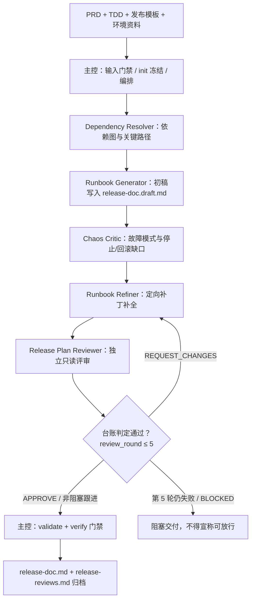

# 编写后端发布方案

根据已有的 PRD 和后端技术方案（TDD），提取本次变更的服务、产物、接口、基础设施、发布策略、验证、观察和回滚信息，生成可执行的后端发布方案。本 Skill 的产物是“发布方案”，不是后端技术方案：不得重新设计架构、补写技术方案，或用推测内容替代未提供的发布事实；需求变更必须区分修改、新增、删除对发布服务、产物、接口、基础设施、验证、观察和回滚的影响。

本 Skill 采用“主控 Agent 编排、Dependency Resolver 前置解析、Runbook Generator 成稿、Chaos Critic 故障审查、Runbook Refiner 定向补全、Release Plan Reviewer 独立评审”的五阶段闭环。五个子代理只分析资料和生成发布方案，不直接执行生产发布；主控负责输入准备、阶段门禁、事实追溯、结果合并和最终交付。设计动机与历史取舍见 `references/rationale.md`（运行时不需要读取）。

**输出语言（本轮第一句回复即生效；只用 `@release-doc` 等无自然语言方式触发时同样默认简体中文）：**面向用户的说明、风险清单、协调请求和交付报告使用简体中文；专有名词、参数、代码、命令、路径、服务与产物标识、JSON 字段名与状态字面量（如 `BLOCKED`）和原始日志保持英文原文；发布方案正文按 `release-doc-template.md` 与评审契约的既有语言要求执行。规则原文见 `$SKILLS_ROOT/_shared/prompts/output-language.md`，派发子代理时必须把该规则带进任务正文。

本 Skill 的独立角色使用全局 agents：`release-dependencies`、`release-writer`、`release-critic`、`release-refiner`、`release-reviewer`，规范源文件位于 `skills/release-doc/agents/`。

## 路径解析约定

> `SKILL_DIR` / `SKILLS_ROOT` / `<PYTHON>` 的解析方式、派发时必须显式传入的路径清单，以及“Skill 之间不得用相对路径互相引用文件”的纪律，统一见 `$SKILLS_ROOT/_shared/prompts/path-convention.md`；下面是本 Skill 的特有补充。

`SKILL_DIR` = 本文档所在目录的绝对路径（插件安装时为 `<plugin-cache>/skills/release-doc`），用于定位 `references/` 资源、`agents/` 角色规范与 `scripts/` 门禁脚本；命令行中引用时统一使用 `$SKILL_DIR` 并在调用前解析为绝对路径。正文内联的资源描述按“相对 `SKILL_DIR`”理解。

派发 Sub-agent 时，必须显式给出：`SKILL_DIR` 绝对路径、`<feature-directory>` 绝对路径与固定文件名（输入 `product-doc.md`、`technical-doc.md`，输出 `release-doc.md`）、要读取的角色文件名，以及台账文件 `release-review.json` 的绝对路径。大段内容一律传**路径 + digest**，由子代理自己读文件；主控不搬运正文。

## Subagent 强制调用规则（Claude Code / Codex / OpenCode / Qoder / Qoder CN）

五个发布角色都是硬性阶段门禁，不是可选建议。进入对应阶段前，主控必须创建指定名称的独立 Sub-agent，并记录调用名称、输入快照、独立会话标识和返回状态；主控自己完成该阶段、普通串行自检或只写“建议调用”均不合规。无法创建指定 Sub-agent 时，阶段状态必须为 `BLOCKED`，不得伪造依赖解析、方案、故障审查、修订或独立评审结果。**该门禁只约束主 Agent：被派发的角色 Sub-agent 一律不再派发下一级 Sub-agent，也绝不因自身缺少派发能力而返回 `BLOCKED`。**

按宿主派发的方式见 `$SKILLS_ROOT/_shared/prompts/subagent-mandate.md`（`SKILLS_ROOT` = `dirname(SKILL_DIR)`），进入任何派发阶段前必须读取。角色由 `manage-global-agents.py` 安装为**全局裸名**，不存在插件作用域角色名。

## 门禁脚本与台账

机械事实一律由脚本判定，不依赖主控或子代理的自述。评审流程的唯一事实源是 `references/release-review-contract.md`（状态/严重度枚举、输入封套、输出契约、循环边界都在其中）：

| 脚本 | 职责 | 调用时机 |
|---|---|---|
| `$SKILL_DIR/scripts/validate_release_doc.py` | 校验 RPD 的模板章节、检查表状态与证据、发布结果预写、示例占位符、变更历史与评审回执；`--draft` 允许初稿保留待定稿状态；`--check-template-refs` 校验本文档与规范文件的章节/枚举未漂移 | 初稿落盘后（`--draft`）、每轮修复后、交付前 |
| `$SKILL_DIR/scripts/release_state.py` | 维护 `<feature-directory>/release-review.json` 台账：规模探针与声明校验、轮次（full/delta）、稿件指纹、Finding 闭环、Chaos 覆盖度与交付门禁；`digest` 输出正文指纹，`render-appendix`/`render-report` 分别渲染 RPD 回执块与 release-reviews.md 完整意见，`close --batch` 批量闭环，`diff` 判定修订是否超过整篇重写阈值，`patch` 机械补丁白名单直修并留痕，`chaos` 记录故障审查覆盖度 | 初稿落盘后 `init --scale`；派发前 `digest`；Chaos 审查后 `chaos`；每份报告双渲染后 `record`；意见 `close`（可批量）；修复后 `advance`（可 `--mode delta`）；纯机械缺陷 `patch`；交付前 `verify` |

```bash
<PYTHON> "$SKILL_DIR/scripts/validate_release_doc.py" <feature-directory>/release-doc.md
<PYTHON> "$SKILL_DIR/scripts/release_state.py" verify --state <feature-directory>/release-review.json
```

两个脚本都返回 0 才能声称“已确认/可放行”；`verify --allow-blocked` 只用于交付阻塞报告。流程状态至少记录：`input_status`、`dependency_status`、`runbook_status`、`chaos_status`、`refinement_status`、`review_round`、`review_status`、`release_gate`；其中 `review_round`、`review_status` 与 `release_gate` 只能取自台账（`show`/`verify` 输出），不得口头声明。

## Agent 架构与职责



- 主控 Agent：输入门禁、资料冻结、阶段调度、证据合并、最终写入和交付；不得用自身推测替代子代理输出，不得静默丢弃冲突或审查问题。
- Dependency Resolver：只读解析依赖，输出带证据的依赖图、关键路径和外部协调事项；不执行外部协调，不臆造服务关系、SLA、实例数量或协调人。
- Runbook Generator：只生成初稿并写入草稿文件，不执行发布，不把未知信息写成事实。
- Chaos Critic：只读故障模拟审查，输出结构化风险，不修改初稿，不删除或弱化风险。
- Runbook Refiner：只按风险清单定向补全，不重新设计 TDD，不引入无来源事实。
- Release Plan Reviewer：每轮新建的独立只读 Sub-agent，只审查发布方案，不审查代码、不修改 RPD、不调用 `codekit:code-review`。

### Reviewer 闭环上限

`review_round` 从 1 开始，每轮严格执行“Release Plan Reviewer 审查 → Runbook Refiner 定向修改 → 主控复核”的完整循环，最多 5 轮，由 `release_state.py` 判定。中间轮可用增量复核（`advance --mode delta`，只派 1 个全新 RECHECK Reviewer 复核未闭环 Finding 与被修改小节）；第 1 轮与最终交付轮必须是全量评审，增量复核不得连续进行，规则详见契约。只有 `Blocker`/`High`（blocking）触发评审轮；`Medium`/`Low`（含已登记的固有缺口）走 `APPROVE_WITH_FOLLOW_UPS` 非阻塞跟进，不据此开轮。第 5 轮后仍有 Blocker/High、Reviewer 返回 `BLOCKED`、输入快照不一致或无法启动独立 Reviewer 时，必须停止并交付阻塞报告（`verify --allow-blocked`），不得继续循环或宣称可放行。

### 规模判定与按规模裁剪

`init --scale S|M|L` 时脚本运行规模探针，从 RPD 机械判定最低严格度并记录实测依据（服务数、适用基础设施、高风险信号、未决风险字段）：

- **强制 L 级**：命中资金/账务/交易链路/用户资产任一字段为“是”（带注解的肯定回答同样计信号）、不可逆迁移/删表删字段（DROP TABLE/DROP COLUMN/TRUNCATE 不限围栏；围栏内 SQL 去注释后整体扫描，注释替代空白、跨行书写与 TRUNCATE 省略 TABLE 形态同样命中）、无标准回滚路径任一信号，即强制 L 级全矩阵；声明只能上调不能下调，探针结论与声明不一致即拒绝。模板提示语（引语）不算信号；否定豁免只作用于短语所在子句（含括号/冒号切分），不得用同行混排吞掉真实信号；风险字段取值只认关键信息项目/内容表且 first-wins，重复风险行报 KEY003、探针按未决 fail-closed，服务数取含服务名称表头表格的最大行数；风险字段未决不得判 S。
- **S 级**（单服务、无适用基础设施、风险全否）：17 章骨架仍全保留，但不涉及的基础设施小节与依赖变更可**折叠**为单行 `不涉及 + 原因`，不必复制完整空表；**章节只折叠不删除**，折叠必须带原因（验证器 COLLAPSE001 判定）；发布策略三套参数/检查表只注入命中的一套。
- **M/L 级**：保留完整表格与检查项；Chaos 全矩阵。
- **Chaos 剪枝**：必查故障模式由台账规模与探针结论推导（`required_chaos_modes`）：M/L 全 11 模式；S 级始终必查超时/部分成功/重复执行/依赖不可用/版本不兼容/流量放大/监控失效/回滚失败，另按适用基础设施追加消息积压（MQ）/数据异常（MySQL、Redis）/配置未生效（Nacos）。剪枝范围写入派发封套，Critic 不得自行扩大或缩小；审查结果经 `chaos` 命令入台账，缺必查模式即拒收；报告必须携带与当前稿一致的 `rpd_digest`，findings 与评审 Finding 走同一闭环台账，正文变更后旧覆盖度失效必须重跑。
- **Reviewer 按规模路由**：S 级免除不适用基础设施小节的逐行核对，但仍须核对折叠理由与高风险字段；封套与报告都带 `scale`，与台账不一致即拒收。
- **交付联动**：`verify` 重跑探针，正文风险信号超出台账规模、RPD 发布规模行与台账不一致、Chaos 未入台账或覆盖度指纹与交付稿不一致、回执节之后出现非回执章节（REVIEW006 同口径），均不得交付；交付轮始终全量。

## 输入与资料读取

开始时声明：**“使用 release-doc skill，根据 <feature-directory> 中的 TDD（技术方案）和 PRD（产品需求）生成后端发布方案。”**

唯一输入参数是 `<feature-directory>`，必须指向当前仓库中的本次需求专用工作目录（例如 `docs/YYYY-MM-DD-<feature-name>`）。输入只按固定文件名查找：PRD 为 `product-doc.md`，TDD 为 `technical-doc.md`；`release-doc.md` 是本 Skill 输出，若已存在则作为上一版有效方案完整读取并保留历史，不属于前置强校验输入。

主控的第一项工作是输入门禁：目录与两份文档必须存在、可读、有实际正文，不能用空文件、模板或未完成占位内容代替；任一项无效时立即停止，不得读取其他资料或调度后续阶段，并向用户说明缺失项。通过门禁后，读取并整理已审核技术方案、变更窗口约束和适用环境配置，再建立冻结输入包：

- 每份资料登记 `source_id`、路径、revision/更新时间、读取状态与内容摘要（sha256），由 `release_state.py init --input SRC-001=<路径>` 落盘为台账；用户粘贴的文本必须先原样落盘为 `<feature-directory>/inputs/SRC-XXX.md` 再登记，禁止无指纹条目；
- PRD/TDD 必须覆盖完整文档，不只读摘要；TDD 只是模板时明确标记“仅有模板、没有实际技术方案”，不得把示例当变更事实；
- 发布模板 `references/release-doc-template.md` 必须完整读取并作为唯一输出结构；评审资源 `references/check-standard.md`、`references/release-review-contract.md`、`references/release-reviewer-prompt.md` 必须完整读取；
- 项目/发布证据（服务代码、配置、Schema/迁移、部署拓扑、流水线、监控、MR、产物、回滚资料）无法访问时标记 `NOT_ACCESSIBLE`，不得猜测。

`input_status` 只能为 `PASS | PARTIAL | BLOCKED`：PRD/TDD 任一缺失、无效、纯模板或无法确认变更范围时为 `BLOCKED`，停止全部子 Agent；非关键发布证据缺失时可为 `PARTIAL`，但缺口必须保留在 RPD、评审归档和交付报告中，不能作为放行依据。

## 需求变更识别与 RPD 历史

只依据 PRD 当前有效正文和最新 TDD 解析 `【修改】/【新增】/【删除】` 台账；历史快照只用于追溯，不得把已删除的旧逻辑列为本次发布内容。用户最新明确的方案优先于旧 PRD/TDD/RPD、旧评审意见和模型推断；冲突处理记入输入台账。

建立 `需求变更项 → 发布影响` 映射：修改项核对服务、接口、配置、数据和回滚变化；新增项核对新产物、依赖、发布顺序、监控和验证；删除项核对停用/清理、调用方影响、数据保留或前向修复、回滚语义和遗留风险。删除不是默认“无发布”，必须以 TDD、项目事实或用户明确输入证明不涉及。

已有 `release-doc.md` 的变更必须保留历史：写入新版本前，将上一版有效 RPD 正文、版本/日期、输入摘要和三类变更台账只追加到 `## 变更历史（只追加，不覆盖）`，保留已有历史、发布结果和遗留问题；当前正文只表达最新发布方案。快照围栏必须至少 4 个反引号（如 ````markdown，验证器 HIST002 判定）：上一版 RPD 自身含 ``` 围栏，同长度围栏无法嵌套。`release_state.py` 会拒绝变更历史行数倒退；快照围栏未闭合或标题泄漏时历史计数不可信，直接拒收。

## 发布方案的事实边界

发布方案只记录本次真实发布需要的内容，每项信息都必须能追溯到 TDD、项目文件、MR、构建流水线、发布系统、监控或用户明确提供的资料：

- “实际发布服务”只列本次需要发布的服务，不列仅被调用但未发布的依赖服务。
- 服务名、repo URL、changed module、MR、构建产物、版本、负责人、发布时间和发布时长，只有资料明确提供或已核验时才能填写确认值。
- 技术方案中的目标架构、流程、接口和数据变更，要转换成发布影响和检查项，不要原样扩写成另一份技术设计。
- 技术方案没有说明的内容，不得默认“无变更”“正常”“已验证”或“已回滚”；无此变更写 `不涉及` 并说明原因，未确认事实保留 `【填写】` 或标记需人工补充，并按契约登记为 RQ 待人工确认项（写入 `遗留问题`，供 `close --resolution deferred --q-ref` 引用）。
- 每个 `【修改】/【新增】/【删除】` 项必须给出发布影响、验证和回滚落点；删除项必须有调用方、数据/配置清理或“不涉及”的证据。
- `通过` 必须附证据；`不涉及` 必须附原因；“无法访问”只能作为发布前检查的 AI 结果，不能作为最终放行结论。
- 发布前事实与发布后结果必须区分：生成阶段使用模板规定的 `待执行`、`【填写】` 状态，不得提前写成已完成。

## 从 TDD 提取到发布模板

读取 PRD 和 TDD 后，建立“需求/技术方案章节 → 发布方案章节”映射，先覆盖三类变更台账，再至少覆盖：

| TDD/技术方案信息 | 发布方案落点 | 提取要求 |
|---|---|---|
| 需求理解与范围、目标、非目标、影响范围 | `关键信息`、`变更业务` | 提取业务目的、受影响功能、用户影响和不在范围内的内容 |
| Java 工程与模块、分层、部署拓扑 | `变更服务`、`变更产物`、`发布策略` | 只列真实发布服务、changed module、实例/批次关系和可回滚产物 |
| HTTP API、Dubbo/RPC、WebSocket | `变更接口`、`依赖变更`、发布前检查 | 区分本服务提供与依赖的接口，核验兼容性与验证方式 |
| MySQL、Redis、数据生命周期 | `基础设施变更`、`回滚方案`、发布后验证 | 提取 SQL、锁风险、数据初始化、校验、回滚或前向修复方案 |
| Producer、Consumer、消息契约 | `基础设施变更`、`依赖变更`、发布策略 | 提取 topic、group、兼容性、顺序、幂等、积压、DLQ 和暂停/恢复操作 |
| XXL-JOB/定时任务 | `基础设施变更`、`发布步骤`、`回滚方案` | 提取任务开关、并发、重试、暂停时机和恢复后校验 |
| Nacos/环境配置、Maven/Gradle、外部服务依赖 | `基础设施变更`、`依赖变更`、`变更产物` | 提取配置生效范围、依赖版本、环境差异和发布前置条件 |
| 性能、容量、可用性、韧性、兼容性 | `发布策略`、`发布后观察`、`回滚方案` | 指标、基线、阈值、观察时长和回滚触发条件具体化；没有阈值就保留待补充 |
| 监控大盘、SLI/SLO、告警和 Runbook | `发布前检查`、`发布后验证`、`发布后观察`、`回滚方案` | 提取监控链接、告警规则、责任人、验证证据和异常处置路径 |
| 技术方案中的风险、约束、假设和评审结论 | `关键信息`、`发布前检查`、`发布策略`、`遗留问题` | 识别风险等级、是否停机/降级、前置条件和必须人工确认的事项 |

TDD 章节明确说明不涉及对应能力时，在模板对应小节填 `不涉及` 和原因；章节缺失不能据此判定不涉及。

## 强制执行流程

严格按以下顺序执行五阶段；不得跳过任何阶段，也不得把主控自检冒充子代理结果。每阶段完成后主控检查输入完整性、输出结构和事实来源，再决定是否进入下一阶段。

### 阶段 1：Dependency Resolver（前置必选）

主控先完成来源识别、资料读取和项目事实核验，将技术方案组件清单、部署拓扑、依赖服务 SLA、变更窗口约束（仅限资料明确内容）传给 Dependency Resolver。其输出至少包含：

```text
依赖解析包：元信息（来源/覆盖范围/缺失资料）、组件清单（是否本次发布+证据）、
发布依赖图（节点/边/依赖类型+证据）、关键路径（顺序/阻塞条件/SLA 阈值+来源）、
外部协调事项（协调方/最晚确认时间/状态）、待确认与冲突
```

主控将依赖解析包落盘为 `<feature-directory>/release-deps.md` 供后续阶段按路径读取。缺少关键输入、依赖关系无法裁决或存在未处理 Blocker 时停止后续创作并报告缺口，不得按默认拓扑继续。外部协调事项只是清单和门禁，不代表已联系外部团队；除非用户明确授权，不得代发通知或执行发布操作。

### 阶段 2：Runbook Generator（核心创作）

Dependency Resolver 通过后，将 TDD 路径、`release-deps.md` 路径、完整模板路径和操作规范传给 Runbook Generator。操作规范必须强调：发布方案不是技术方案；严格遵循模板；每步有执行人、命令/入口、预期结果、验证命令、超时阈值、失败停止动作、回滚动作和证据位置；未知信息保留待补充，不得以常见运维做法补齐。

**Writer 把完整初稿直接写入 `<feature-directory>/release-doc.draft.md`**（不写正式文件），会话只返回路径、结构化摘要和缺口清单，不返回全文。每一步至少包含 `step_id`、顺序、目标、执行人、前置条件、操作命令/入口、预期结果、验证命令/证据、超时阈值、失败停止动作、回滚动作和状态；整份初稿还须覆盖服务发布顺序、基础设施前置边界、灰度/滚动策略、回滚顺序和待确认项。

主控对草稿跑 `validate_release_doc.py --draft` 并修复结构类缺陷（此时评审回执类报错属预期，评审后必须归零），确认步骤顺序与关键路径一致、没有无来源事实后，把草稿落盘为 `release-doc.md`，再执行 `release_state.py init --scale S|M|L` 建立台账（规模探针自动运行，声明不得低于探针判定；关键信息必须填发布规模行与四个高风险字段）。S 级初稿的不适用基础设施小节折叠为 `不涉及 + 原因`，发布策略只写命中的一套。初稿只能标为待审查/待执行。

### 阶段 3：Chaos Critic（故障模拟审查）

将初稿路径、TDD 路径、可访问的历史故障库、`references/check-standard.md` 和**台账推导的必查故障模式清单**传给 Chaos Critic。M/L 级全矩阵（超时、部分成功、重复执行、依赖不可用、版本不兼容、配置未生效、消息积压、数据异常、流量放大、监控失效、回滚失败）；S 级按探针结论剪枝，剪枝范围以封套为准，Critic 不得自行扩大或缩小。输出结构化风险列表，每条包含：

```text
ID（CHAOS-001）、对应步骤、严重度（Blocker/High/Medium/Low）、失败模式、
触发信号或证据、影响范围、缺失预案、建议补全、是否阻塞发布
```

历史故障库、监控证据或运行约束不可访问时必须写明“无法核验”和影响范围，不得声称完成历史故障覆盖；没有发现问题也要列出已检查场景和待人工确认项。主控将风险列表落盘为 `<feature-directory>/release-chaos.md`，并把审查覆盖度（scale、scenarios_checked、findings、取自 `digest` 命令的 rpd_digest）规范化为 JSON 后经 `release_state.py chaos` 入台账：缺必查模式、规模不符或指纹与当前稿不一致即拒收；findings 与评审 Finding 走同一闭环台账，任何 Blocker/High 未闭环时 `verify` 禁止定稿；Medium/Low 也必须补全、标明不适用理由或列为待人工确认。

### 阶段 4：Runbook Refiner（精准补全）

主控先把当前 `release-doc.md` 复制为快照 `<feature-directory>/release-doc.prev.md`，再将初稿路径、`release-chaos.md` 路径传给 Runbook Refiner。Refiner 逐条映射风险 ID，**以定向补丁修改 `release-doc.md`**（每条补丁含 Chaos ID、章节/步骤定位、原文、新文），会话只返回补丁清单、预案补全记录和待人工确认项，不返回修订版全文；仅当改动超过正文行数 30% 才允许整篇重写，由主控用 `release_state.py diff --before release-doc.prev.md --after release-doc.md` 判定，`full_rewrite_allowed=false` 时拒收整篇重写并要求改用补丁。

补全不得重新设计技术方案、不得引入风险列表之外的无来源事实、不得删除风险伪造闭环。主控验收：每条 Chaos ID 有处理状态（已修复/待人工确认/不适用及理由），修订版仍符合模板章节、表头、状态值和基础设施操作边界；仍有 Blocker/High 或引入无来源事实时退回并报告阻塞。

### 阶段 5：Release Plan Reviewer（独立发布方案评审）

主控按契约组装输入封套（`rpd_digest` 一律取自 `digest` 命令，全量轮 `perspective: COMPREHENSIVE`，`scale` 与台账一致），启动一个**全新的、只读的** Release Plan Reviewer Sub-agent，派发正文使用 `references/release-reviewer-prompt.md`。Reviewer 完整读取 PRD、TDD、RPD、模板、check-standard 与契约（S 级免除不适用基础设施小节的逐行核对，但仍核对折叠理由与高风险字段），按契约输出结构化 JSON 报告。

主控收到报告后依次执行：

1. 规范化为 JSON，`render-appendix` 生成紧凑回执块**原样追加**到 RPD 文末 `# 独立评审意见` 章节，`render-report` 生成完整意见节**只追加**到 `<feature-directory>/release-reviews.md`；两处不得手拼、不得删改；
2. `record` 记录报告（指纹不一致、轮次不符、重复记录都会被拒收）；
3. 逐项处理 Finding：修复（交 Refiner 定向补丁）、`close --resolution deferred --q-ref RQ-xxx`（缺口已在 RPD 登记）、或 `close --resolution rejected`（附证据的不采纳理由，Blocker/High 不得不采纳）；可 `close --batch` 批量闭环；
4. 若 `REQUEST_CHANGES`（仅由 Blocker/High 触发）：Refiner 定向修改 → `validate_release_doc.py` 通过 → `advance` 进入下一轮 → 对已修复项 `close --resolution fixed` → 重新 `digest` 并派发全新 Reviewer；不得由主控直接修改后伪造 Reviewer 通过。修复后的复核优先用增量轮：`advance --mode delta` 后只派 1 个全新 RECHECK Reviewer，封套只含未闭环 Finding、被修改小节与新旧指纹；RECHECK 确认修复的 Finding 写入 `verified_findings`（台账仍有未闭环项时不得空确认），据此 `close --resolution fixed`：delta 轮内闭环必须先记录本轮 RECHECK 报告并获其确认，不得先闭环后记录；脚本会拒绝未出现在任何后续 RECHECK 报告 `verified_findings` 中的 fixed 闭环，`verify` 交付前还会复查消费（提出后、闭环前存在 delta 轮的 fixed 必须被确认，闭环后的 delta 轮不追溯要求已闭环项）；RECHECK 发现新阻塞问题或上一轮已是 delta 时，必须 `advance`（默认 full）回到全量评审；最终交付轮必须是全量；
5. 若 `APPROVE`/`APPROVE_WITH_FOLLOW_UPS`：进入最终门禁。

Chaos 风险台账、预案补全记录与依赖解析包摘要由主控只追加归档到 `release-reviews.md`；RPD 内以 ID 与归档指针保持可追溯，待人工确认项以 RQ 编号写入 `遗留问题`。存在 Blocker/High 或 `BLOCKED` 时不得定稿；`review_round` 达到 5 仍未通过必须报告阻塞；无法启动独立 Sub-agent 时必须报告 `BLOCKED`，不得用主控自检或普通 Code Review 代替。

## 主控执行细则

### 1. 识别来源和发布边界

读取 PRD/TDD 并记录版本/更新时间后，先回答：本次发布解决什么业务问题？哪些服务、模块和实例真的需要发布？是否涉及 MySQL、Redis、MQ/Kafka、Nacos、XXL-JOB 或依赖接口？是否涉及资金、账务、交易链路、用户资产、停机或业务降级？是否存在可执行的前向发布、验证和回滚路径？无法回答关键问题时继续提取可确认信息，但对应字段保留待补充项，发布前检查设为未满足放行条件，而不是假设通过。

涉及用户资金、账户余额、交易、清算、提现、充值、账务、不可逆数据迁移、删除表或字段、大规模数据修复，或没有标准回滚路径时，不得按本模板生成低风险方案：先明确需要团队完整发布模板或升级审批流程，不得降低风险等级后继续。

### 2. 核验项目事实

仅在确有项目访问权限时核验：服务仓库与模块目录、实际变更文件、配置和数据库脚本；MR 状态、分支、流水线、实际发布产物和上一版可回滚产物；接口契约、依赖版本、配置中心条目、任务配置和 topic/group；发布系统灰度/滚动能力、实例顺序、readiness URL、流量路由；监控大盘、告警、基线、阈值、QA 验证账号/数据/步骤和责任人。核验结果写入证据位置；不能访问的系统只能标记“无法核验，需人工补充”，不得声称已检查。

### 3. 按发布模板编写

以 `references/release-doc-template.md` 为唯一输出结构，保留章节顺序、表头、状态枚举、提示语和条件章节，不能用摘要或自定义表格替代。输出必须完整包含以下章节（无变更也必须保留并填 `不涉及`）：

1. `关键信息`
2. `变更业务`
3. `变更服务`
4. `变更产物`
5. `变更接口`
6. `基础设施变更`
7. `依赖变更`
8. `发布前检查（人工 / AI）`
9. `发布策略`
10. `发布步骤`
11. `发布后验证`
12. `发布后观察`
13. `回滚方案`
14. `发布结果`
15. `遗留问题`
16. `变更历史（只追加，不覆盖）`
17. `独立评审意见`（脚本渲染的回执区）

以 Refiner 修订后的正文为主要草稿来源，主控负责与依赖解析包、技术方案证据和模板其他章节合并；任何 Chaos 风险处理状态和待人工确认项都必须可追溯（回执 ID + release-reviews.md 归档 + 遗留问题 RQ 登记）。内容约束：

- `关键信息` 完整覆盖需求、文档、工单、负责人、风险等级、**发布规模（S/M/L 单选，与台账一致）**、发布方式、时间、时长、停机、资金/账务/交易/资产（定稿必须是/否单选）和业务降级字段。
- `变更服务` 按真实发布顺序逐个列服务，写清 repo URL、changed module、MR、主要内容和影响范围；不能用“其他服务统一发布”。
- `变更产物` 每个发布服务都有生产产物和构建来源，并确认可回滚到上一个已发布产物；不能把源码提交当产物。
- `变更接口` 只写本服务对外提供的接口；依赖方接口变化写入 `依赖变更` 并填兼容性检查。
- `基础设施变更` 按模板分别处理 MySQL、Redis、MQ/Kafka、Nacos、XXL-JOB；适用项写执行人、执行时机、校验、回滚或前向修复，且放在服务发布前，不写进 `发布步骤`。
- `发布前检查` 每行有人工结果、AI 结果、最终状态和证据；适用检查未通过或无法确认时不能放行。
- `发布策略` 只能选择并详述 `灰度`、`滚动` 或 `灰度+滚动`，写明批次、流量比例、观察时长、readiness、兼容性和异常停止规则。
- `发布步骤` 按真实顺序逐步列出执行人和操作结果；每步验证失败必须停止；多服务逐个列出。
- `发布后验证` 覆盖适用的启动、注册、接口、数据、配置、消息、任务、资源、日志和告警验证；不涉及项写原因。
- `发布后观察` 有发布前基线、通过标准/回滚阈值、灰度后和全量后记录、观察时长和负责人；阈值不能留到发布后再补。
- `回滚方案` 写触发条件、服务回滚顺序、开关/任务/Producer/Consumer 处理、配置/数据库/Redis/Kafka/XXL-JOB 状态处理、回滚验证和证据。
- `发布结果` 生成阶段保留待执行字段；只有发布负责人在实际发布后、最终验证通过且所有适用检查通过时才能标记成功。
- `遗留问题` 不能删除；没有问题填 `无`，有问题写风险、临时措施、负责人和完成时间，待人工确认项带 RQ 编号。

### 4. 自检与评审

机械可判定的部分不依赖自觉：结构、状态证据、发布结果预写、示例占位符、变更历史与评审回执由 `validate_release_doc.py` 判定（每条缺陷带稳定错误码）；轮次、指纹一致性与 Finding 闭环由 `release_state.py` 判定。**机械补丁白名单**：只有 `STRUCT002`（章节顺序，脚本确定性重排、内容逐字节不变）与 `STATUS003`（状态枚举空白归一化，如 `通 过`→`通过`）两类纯机械缺陷允许主控用 `patch` 直修，不必派 Refiner + 全新 Reviewer 整轮；白名单以脚本错误码为唯一来源，门禁必须实际报出该码，每处直修写入台账 `mechanical_patches`（错误码、行号、旧值→新值、前后指纹），交付报告强制照抄。语义内容（证据值、步骤操作、阈值、负责人、结论改换）一律不在白名单，走 Refiner + 独立评审；补丁发生在最后一轮评审之后时，必须补一轮全量评审才能交付。语义自检按 `references/check-standard.md` 执行：每个适用检查项有可追溯证据、每个不适用项有原因、未知信息没有被写成通过/正常/已完成、发布顺序与变更服务一致、新旧版本兼容、回滚触发条件可观测可执行、关键指标有基线/阈值/时长/责任人、高风险范围没有被错误降级。

独立评审必须按阶段 5 执行并按契约验证报告；该评审不是代码审查，不得调用 `codekit:code-review`。评审意见必须在交付前处理或写入 `遗留问题`；报告无法通过契约校验、快照不一致、`review_round > 5` 或独立评审能力不可用时，最终状态必须为 `BLOCKED`。

### 5. 保存与交付

最终发布方案保存到 `<feature-directory>/release-doc.md`。交付产物：

- `release-doc.md`：完整 RPD，严格遵循模板，文末含脚本渲染的回执区；
- `release-reviews.md`：只追加归档的完整评审意见、Chaos 风险台账、预案补全记录与依赖解析包摘要；
- `release-review.json`：台账（轮次、Finding 闭环、RQ 登记）；
- 需求变更时的三类发布影响矩阵与只追加历史快照（在 RPD 变更历史节内）。

交付时从 `release_state.py show` 照抄台账摘要（含 `scale`/`probe_scale` 与实测依据、`chaos` 覆盖度、`mechanical_patches` 机械补丁台账：每一处主控直修的错误码、行号与旧值→新值，无补丁时写“无”），简要报告：输入来源、实际提取的服务、三类变更数量及影响、发布策略、旧/新 RPD 版本摘要、方案路径、独立评审状态、`review_round`、Finding → 修复/待确认/不采纳映射、未关闭问题和 `release_gate`，以及仍需人工补充的字段。明确说明：未填写的发布前检查、阈值、负责人、产物或回滚信息不能视为已放行。

## 禁止事项

- 不得把 `release-doc` 当作 `technical-doc` 使用，也不得输出后端技术方案。
- 不得绕过 `references/release-doc-template.md`，不得只输出发布策略或发布步骤摘要。
- 不得把 `technical-doc-template.md` 中的示例、占位符或设计建议当作真实发布事实。
- 不得从技术方案推测 MR、产物版本、负责人、监控链接、阈值、发布窗口或实际验证结果。
- 不得在没有证据时填写“通过”“正常”“成功”“已发布”或“已回滚”。
- 不得遗漏基础设施变更、依赖变更、发布后验证、发布后观察、回滚验证和遗留问题章节。
- 不得把数据库、缓存、消息、配置或任务操作混入服务发布步骤；它们必须先完成并通过发布前检查。
- 不得为了填满模板而虚构服务、接口、SQL、topic、Key、配置、任务或业务验证场景。
- 需求变更不得直接覆盖旧 `release-doc.md`，不得删除既有发布结果、评审处理记录、遗留问题或变更历史。
- 不得在会话中搬运初稿/修订版全文，不得手拼回执块或归档意见节，不得手工计算 digest，不得绕过台账口头宣布轮次、闭环或放行。
- 不得以增量复核轮作为最终交付轮，不得连续使用增量复核逃避全量审查，不得由 RECHECK 空确认或未经其 `verified_findings` 确认自称 fixed；不得把 Medium/Low 跟进项当作阻塞项反复开轮，也不得把 Blocker/High 降级为 Medium/Low 绕过门停。
- 不得绕过 `patch` 通道手改正文；不得借机械补丁之名修改证据值、步骤、阈值、负责人或改换状态结论；白名单外错误码不得直修；机械补丁不得免掉交付轮的全量独立评审，不得从交付报告中省略补丁台账。
- 不得下调规模绕过探针：命中高风险信号强制 L 级，不得把高风险字段写成否、不得把适用基础设施伪报为不涉及；章节只折叠不删除，折叠必须带原因；Critic 不得缩小封套给定的必查范围，主控不得绕过 `chaos` 门禁交付。