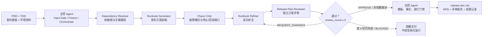
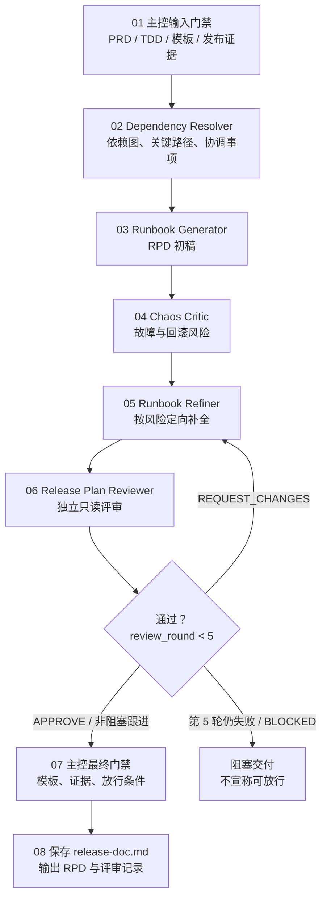

# 编写后端发布方案

根据已有的 PRD 和后端技术方案（TDD），提取本次变更的服务、产物、接口、基础设施、发布策略、验证、观察和回滚信息，生成可执行的后端发布方案。

本 Skill 的产物是“发布方案”，不是后端技术方案。不得在发布方案中重新设计架构、补写技术方案，或用推测内容替代未提供的发布事实。需求变更时必须区分修改、新增、删除对发布服务、产物、接口、基础设施、验证、观察和回滚的影响。

本 Skill 采用“主控 Agent 编排、Dependency Resolver 前置解析、Runbook Generator 成稿、Chaos Critic 故障审查、Runbook Refiner 定向补全、Release Plan Reviewer 独立评审”的五阶段闭环。五个子代理只分析资料和生成发布方案，不直接执行生产发布；主控 Agent 负责输入准备、阶段门禁、事实追溯、结果合并和最终交付。

**输出语言（本轮第一句回复即生效；只用 `@release-doc` 等无自然语言方式触发时同样默认简体中文）：**面向用户的说明、风险清单、协调请求和交付报告使用简体中文；专有名词、参数、代码、命令、路径、服务与产物标识、JSON 字段名与状态字面量（如 `BLOCKED`）和原始日志保持英文原文；发布方案正文按 `release-doc-template.md` 与评审契约的既有语言要求执行。规则原文见 `$SKILLS_ROOT/_shared/prompts/output-language.md`，派发子代理时必须把该规则带进任务正文。

本 Skill 的独立角色使用全局 agents：`release-dependencies`、`release-writer`、`release-critic`、`release-refiner`、`release-reviewer`，规范源文件位于 `skills/release-doc/agents/`。

## 路径解析约定

> 本文档中的 `SKILL_DIR` / `SKILLS_ROOT` 解析方式、派发时必须显式传入的路径清单，以及“Skill 之间不得用相对路径互相引用文件”的纪律，统一见 `$SKILLS_ROOT/_shared/prompts/path-convention.md`；下面是本 Skill 的特有补充。

本 Skill **不自带脚本**。**`SKILL_DIR` = 本文档所在目录的绝对路径**（插件安装时为 `<plugin-cache>/skills/release-doc`）只用于定位需要读取的 `references/` 资源文件与 `agents/` 角色规范源文件；在命令行、Agent 提示或任何外部进程中引用这些路径时统一使用 `$SKILL_DIR`，并在调用前解析为绝对路径，不要假设当前目录、当前插件目录或仓库根目录就是 Skill 目录。正文内联的资源描述（例如 `references/release-review-contract.md`）按“相对 `SKILL_DIR`”理解，由主 Agent 读取时解析。

派发 Sub-agent 时，必须在输入中显式给出：`SKILL_DIR` 的绝对路径、`<feature-directory>` 的绝对路径与其中的固定文件名（输入 `product-doc.md`、`technical-doc.md`，输出 `release-doc.md`），以及要读取的角色文件名；不得让 Sub-agent 自行猜测资源文件或输入文档的位置。

## Subagent 强制调用规则（Claude Code / Codex / OpenCode / Qoder / Qoder CN）

五个发布角色都是硬性阶段门禁，不是可选建议。进入对应阶段前，主控 Agent 必须创建指定名称的独立 Sub-agent，并记录调用名称、输入快照、独立会话标识和返回状态；主控 Agent 自己完成该阶段、普通串行自检或只写“建议调用”均不合规。无法创建指定 Sub-agent 时，阶段状态必须为 `BLOCKED`，不得伪造依赖解析、方案、故障审查、修订或独立评审结果。**该门禁只约束主 Agent（Orchestrator）：被派发的角色 Sub-agent 一律不再派发下一级 Sub-agent，也绝不因自身缺少派发能力而返回 `BLOCKED`；它只需按自己的角色契约完成本阶段并返回结构化结果。**

按宿主派发的方式（Claude Code / Codex / OpenCode / Qoder / Qoder CN 的角色标识与语法差异、“不得把派发指令注入子代理”的纪律、以及 Skill 在各宿主下的调用名）见 `$SKILLS_ROOT/_shared/prompts/subagent-mandate.md`，其中 `SKILLS_ROOT` = `dirname(SKILL_DIR)`。进入任何派发阶段前必须读取该文件；角色由 `manage-global-agents.py`（仓库安装脚本）安装为**全局裸名**，不存在 `@agent-<plugin>:<name>` 这类插件作用域角色名。

## Agent 架构与职责

```text
[主控 Agent]
    │  <feature-directory>（PRD + TDD）+ 发布模板 + 变更窗口约束 + 环境配置
    │
    ├──→ [Dependency Resolver Sub-agent]（前置必选）
    │       输入：技术方案组件清单 + 现有部署拓扑 + 依赖服务 SLA
    │       输出：发布依赖图 + 关键路径 + 外部协调事项清单
    │
    ├──→ [Runbook Generator Sub-agent]（核心创作）
    │       输入：技术方案 + 依赖图 + 发布模板 + 操作规范 Prompt
    │       输出：发布步骤初稿（含回滚步骤、验证命令、超时阈值）
    │
    ├──→ [Chaos Critic Sub-agent]（故障模拟审查）
    │       输入：步骤初稿 + 技术方案 + 历史故障库 + 审查清单
    │       输出：风险点列表（每步失败模式、影响、缺失预案）
    │
    ├──→ [Runbook Refiner Sub-agent]（精准补全）
            输入：步骤初稿 + Chaos Critic 风险列表
            输出：修订版 Runbook + 预案补全记录 + 待人工确认项

    └──→ [Release Plan Reviewer Sub-agent]（独立发布方案评审）
            输入：PRD + TDD + 修订版 Runbook + 发布方案评审契约
            输出：发布方案评审报告，不修改方案、不执行发布
```



### 主控 Agent

主控 Agent 的第一项工作是校验 `<feature-directory>` 及其中固定文件名的 PRD 和 TDD：目录必须存在且可读，`product-doc.md` 和 `technical-doc.md` 必须存在、可读，且分别包含实际需求内容和与本次变更对应的技术设计正文，不能用空文件、模板或未完成占位内容代替。任一项不存在、不可读或无效时，立即停止工作，不得读取其他资料或调度后续阶段，并向用户明确说明缺失项及需要补充的内容。若已有 `release-doc.md`，必须完整读取为上一版发布方案并保留其历史、评审和遗留项，不得把它当作可直接覆盖的草稿。

通过首项校验后，主控 Agent 必须读取并整理已审核技术方案、变更窗口约束和适用环境配置，再依次调度五个阶段。每一阶段都记录输入来源、输出、证据范围、未解决问题和下一阶段可使用的事实。主控不得用自身推测替代子代理缺失的输出，也不得静默丢弃冲突或审查问题。

如果运行环境支持 sub-agent，必须按下述角色启动独立 sub-agent；每个 sub-agent 都要收到本阶段所需的完整输入，不依赖主控的隐式上下文。如果不支持 sub-agent，主控必须明确报告无法满足“独立发布方案评审”门禁，不得把一次普通自检声称为独立子代理审查或继续放行。

### 角色隔离与权限边界

- 主控 Agent：负责 PRD/TDD 输入门禁、资料冻结、阶段调度、证据合并、`review_round` 计数、最终写入和交付；不得用自身推测替代子代理输出。
- Dependency Resolver：只读技术方案、部署拓扑和发布资料，输出带证据的依赖图、关键路径和外部协调事项，不执行外部协调。
- Runbook Generator：只生成发布方案初稿，不执行发布，不把未知信息写成事实。
- Chaos Critic：只读故障模拟审查，输出结构化风险，不修改初稿。
- Runbook Refiner：只根据 Chaos Finding 定向补全，不重新设计 TDD，不删除风险。
- Release Plan Reviewer：每轮新建的独立只读 Sub-agent，只审查发布方案，不审查代码、不修改 RPD、不调用 `codekit:code-review`。

### Reviewer 闭环上限

`review_round` 从 1 开始计数，每轮严格执行“Release Plan Reviewer 审查 → Runbook Refiner 定向修改 → 主控复核”的完整循环，最多 5 轮。第 5 轮后仍有 Blocker/High、Reviewer 返回 `BLOCKED`、输入快照不一致或无法启动独立 Reviewer 时，必须停止并交付阻塞报告，不得继续循环或宣称发布方案可放行。

## 需求变更识别与 RPD 历史

读取 PRD 和 TDD 后，先只依据 PRD 当前有效正文和最新 TDD，解析醒目的 `【修改】`、`【新增】`、`【删除】` 台账；PRD/TDD 的历史快照只用于追溯，不得把已删除的旧逻辑列为本次发布内容。用户最新明确的方案和逻辑优先于旧 PRD、旧 TDD、旧 RPD、旧评审意见和模型推断；冲突处理必须在输入台账中记录。

建立 `需求变更项 → 发布影响` 映射：修改项核对服务、接口、配置、数据和回滚变化；新增项核对新产物、依赖、发布顺序、监控和验证；删除项核对停用/清理、调用方影响、数据保留或前向修复、回滚语义和遗留风险。删除不是默认“无发布”，必须以 TDD、项目事实或用户明确输入证明不涉及。

已有 `release-doc.md` 的变更必须保留历史：写入新版本前，将上一版有效 RPD 正文、版本/日期、输入摘要和三类变更台账只追加到 `## 变更历史（只追加，不覆盖）`，保留已有历史、发布结果和遗留问题；当前正文只表达最新发布方案。不能直接覆盖旧方案或删除已发生的发布记录。

### Dependency Resolver Sub-agent

- 这是进入 Runbook Generator 前的必选阶段；未产出依赖图、关键路径和外部协调事项清单，不得开始生成步骤初稿。
- 只根据技术方案中的组件清单、现有部署拓扑、依赖服务 SLA、项目配置和可核验的发布资料解析依赖；不得臆造服务关系、SLA、实例数量、发布顺序或协调人。
- 识别服务、数据库、缓存、消息、配置中心、任务系统、网关、第三方接口、监控和发布平台之间的前置/后置关系，区分“本次需要发布”与“仅被调用的依赖”。
- 外部协调事项只作为清单和门禁输出，不代表主控已联系外部团队；除非用户明确授权，不得代替用户发送通知、修改外部系统或执行发布操作。

### Runbook Generator Sub-agent

- 只有在 Dependency Resolver 通过后启动。
- 输入必须包括技术方案、依赖图、`references/release-doc-template.md` 和操作规范 Prompt；操作规范至少包含停止条件、证据记录、权限边界、回滚要求和未知信息标记规则。
- 生成发布步骤初稿，必须覆盖依赖前置条件、服务发布顺序、每步执行人、操作命令或操作入口、验证命令/预期结果、超时阈值、失败停止动作、回滚步骤和证据位置。
- 只能把资料明确提供或已核验的内容写成事实；缺少命令、阈值、负责人、产物或环境参数时写 `【填写】` / `需人工补充`，不得以常见运维做法补齐。
- 初稿仍是“待审查/待执行”状态，不得写成发布成功或已完成。

### Chaos Critic Sub-agent

- 只负责故障模拟审查，不重写步骤初稿，不直接删除或弱化风险。
- 输入包括完整步骤初稿、技术方案、可访问的历史故障库和 `references/check-standard.md`；历史故障库不可访问时必须标为缺失输入，并基于现有资料完成有限审查，不能声称已完成历史案例覆盖。
- 按步骤模拟超时、部分成功、重复执行、依赖不可用、版本不兼容、配置未生效、消息积压、数据异常、流量放大、监控失效和回滚失败等适用故障，检查是否有可执行的停止、隔离、降级、恢复和验证预案。
- 每条风险必须包含唯一 ID、对应步骤、失败模式、触发信号/证据、影响范围、严重度、缺失预案、建议补全和是否阻塞发布；没有发现问题也要列出已检查的场景和待人工确认项。

### Runbook Refiner Sub-agent

- 只根据步骤初稿和 Chaos Critic 的结构化风险列表定向补全，不重新设计技术方案，不引入风险列表之外的无来源事实。
- 对每条风险逐项处理：补充步骤、验证、阈值、停止动作或回滚预案；无法安全补全时保留 `需人工确认`，说明缺失证据和阻塞原因。
- 输出修订版 Runbook、预案补全记录和待人工确认项；不得删除风险来伪造闭环，不得遗漏 Blocker/High 风险。
- 修订版必须仍符合 `references/release-doc-template.md` 的章节、表头、状态值和基础设施操作边界。

## Sub-agent 数据契约

主控传递给每个子代理的输入都必须标明来源、版本/更新时间（如有）、可访问状态和事实可信度。子代理输出可用结构化 Markdown 或 JSON 表达，但至少包含以下信息：

### Dependency Resolver 输出

```text
依赖解析包
├─ 元信息：输入来源、生成时间、覆盖范围、缺失资料
├─ 组件清单：组件、所属服务、是否本次发布、证据
├─ 发布依赖图：节点、边、依赖类型、前置/后置关系、证据
├─ 关键路径：顺序、阻塞条件、每段 SLA/超时阈值及来源
├─ 外部协调事项：事项、协调方、最晚确认时间、完成证据、状态
└─ 待确认与冲突：问题、影响、建议确认人
```

### Runbook Generator 输出

每一步至少包含：`step_id`、顺序、目标、执行人、前置条件、操作命令/入口、预期结果、验证命令/证据、超时阈值、失败停止动作、回滚动作和状态。整份初稿还必须包含服务发布顺序、基础设施前置操作边界、全量/灰度策略、回滚顺序和待确认项。

### Chaos Critic 输出

```text
- ID：CHAOS-001
  对应步骤：STEP-001
  严重度：Blocker / High / Medium / Low
  失败模式：...
  触发信号或证据：...
  影响：服务 / 用户 / 数据 / 可用性 / 安全 / 成本 / 发布
  缺失预案：...
  建议补全：...
  是否阻塞发布：是 / 否
```

### Runbook Refiner 输出

```text
| Chaos ID | 对应步骤 | 补全内容 | 验证方式 | 状态 |
|----------|----------|----------|----------|------|
| CHAOS-001 | STEP-001 | ... | ... | 已修复 / 待人工确认 / 不适用及理由 |
```

不得把子代理输出中的推断、建议或待确认项直接升级为发布事实；最终方案中的每项事实仍须回溯到技术方案、项目/发布系统证据或用户明确输入。

## 适用范围

适用于已有 TDD、技术设计文档或明确技术变更描述，需要形成后端服务发布方案的正常业务迭代、低风险配置变更和非核心链路变更。

以下情况不应直接按本模板生成低风险发布方案：涉及用户资金、账户余额、交易、清算、提现、充值、账务、不可逆数据迁移、删除表或字段、大规模数据修复，或没有标准回滚路径。遇到这些情况，先明确需要使用团队的完整发布模板或升级审批流程，不得降低风险等级后继续生成。

## 输入与资料读取

开始时声明：**“使用 release-doc skill，根据 <feature-directory> 中的 TDD（技术方案）和 PRD（产品需求）生成后端发布方案。”**

唯一输入参数是 `<feature-directory>`，必须指向当前仓库中的本次需求专用工作目录，例如 `docs/YYYY-MM-DD-<feature-name>`。依赖文档不从参数中接收路径、URL 或正文，只在该目录按固定文件名查找输入：PRD 为 `product-doc.md`，TDD 为 `technical-doc.md`；RPD `release-doc.md` 是本 Skill 的输出，若已存在则作为上一版有效方案读取并保留历史，不属于前置强校验输入。

本 Skill 继续强校验 PRD 和 TDD；如果 `<feature-directory>`、`product-doc.md` 或 `technical-doc.md` 任一不存在、不可访问、内容为空、只有标题或仅包含模板/未完成占位内容，则拒绝处理。

### 输入资料与校验契约

主控必须在启动 Dependency Resolver 前生成冻结输入包，并为每项资料记录 `source_id`、路径/稳定 URL、revision 或更新时间、读取状态、内容摘要和可信度：

- PRD：`<feature-directory>/product-doc.md`，必须存在、可读、有实际需求正文；
- TDD：`<feature-directory>/technical-doc.md`，必须存在、可读、有与本次变更对应的技术设计正文；
- RPD：`<feature-directory>/release-doc.md` 是本 Skill 输出；若已存在，必须读取上一版有效正文、发布结果、评审记录和历史，不得绕过 PRD/TDD 门禁或直接覆盖；
- 需求变更台账：记录 PRD/TDD 当前有效版本、`【修改】/【新增】/【删除】` 项、旧→新发布影响和历史快照位置；
- 发布模板：`references/release-doc-template.md`，必须完整读取并作为唯一输出结构；
- 评审资源：`references/check-standard.md`、`references/release-review-contract.md`、`references/release-reviewer-prompt.md`，必须完整读取；
- 项目/发布证据：服务代码、配置、Schema/迁移、部署拓扑、流水线、监控、MR、产物和回滚资料；无法访问的资料必须标记 `NOT_ACCESSIBLE`，不得猜测。

`input_status` 只能为 `PASS | PARTIAL | BLOCKED`。PRD/TDD 任一缺失、无效、纯模板或无法确认变更范围时为 `BLOCKED`，停止全部子 Agent；非关键发布证据缺失时可为 `PARTIAL`，但必须在 RPD、Reviewer 报告和交付报告中保留缺口，不能作为发布放行依据。

资料位置：

- 发布方案输出模板：`references/release-doc-template.md`
- 通用质量检查参考：`references/check-standard.md`
- 独立发布方案评审契约：`references/release-review-contract.md`
- 独立发布方案评审 Prompt：`references/release-reviewer-prompt.md`

输入处理要求：

- 只读取 `<feature-directory>/product-doc.md` 和 `<feature-directory>/technical-doc.md`，且必须覆盖完整文档，不只读取摘要。
- 若 `<feature-directory>/technical-doc.md` 只是模板，必须明确标记为“仅有模板、没有实际技术方案”，不能把模板示例当作本次变更信息。

## 发布方案的事实边界

发布方案只记录本次真实发布需要的内容。每一项信息都必须能追溯到 TDD、项目文件、MR、构建流水线、发布系统、监控或用户明确提供的资料。

- “实际发布服务”只列本次需要发布的服务，不列仅被调用但未发布的依赖服务。
- 服务名、repo URL、changed module、MR、构建产物、版本、负责人、发布时间和发布时长，只有资料明确提供或已从项目/系统核验时才能填写确认值。
- 技术方案中的目标架构、流程、接口和数据变更，要转换成发布影响和检查项；不要原样扩写成另一份技术设计。
- 技术方案没有说明的内容，不得默认“无变更”“正常”“已验证”或“已回滚”；无此变更要写 `不涉及` 并说明原因，未确认事实要保留 `【填写】` 或标记为待人工补充。
- 对 PRD/TDD 的每个 `【修改】/【新增】/【删除】` 项必须在发布方案中给出发布影响、验证和回滚落点；删除项必须有调用方、数据/配置清理或“不涉及”的证据，不能因名称消失就省略。
- `通过` 必须附证据；`不涉及` 必须附不适用原因；“无法访问”只能作为发布前检查中的 AI 结果，不能作为最终放行结论。
- 发布前的事实与发布后的实际结果必须区分。生成方案时，发布步骤、发布后验证、发布后观察和发布结果使用模板规定的 `待执行`、`【填写】` 等状态，不得提前写成已完成。

## 从 TDD 提取到发布模板

读取 PRD 和 TDD 后，建立“需求/技术方案章节 → 发布方案章节”的映射，并先覆盖 `【修改】/【新增】/【删除】` 台账，再至少覆盖以下内容：

| TDD/技术方案信息 | 发布方案落点 | 提取要求 |
|---|---|---|
| 需求理解与范围、目标、非目标、影响范围 | `关键信息`、`变更业务` | 提取业务目的、受影响功能、用户影响和不在范围内的内容 |
| Java 工程与模块、分层、部署拓扑 | `变更服务`、`变更产物`、`发布策略` | 只列真实发布服务、changed module、实例/批次关系和可回滚产物 |
| HTTP API、Dubbo/RPC、WebSocket | `变更接口`、`依赖变更`、发布前检查 | 区分本服务提供的接口和本服务依赖的接口，核验兼容性与验证方式 |
| MySQL、Redis、数据生命周期 | `基础设施变更`、`回滚方案`、发布后验证 | 提取 SQL、锁风险、数据初始化、校验、回滚或前向修复方案 |
| Producer、Consumer、消息契约 | `基础设施变更`、`依赖变更`、发布策略 | 提取 topic、group、消息兼容性、顺序、幂等、积压、DLQ 和暂停/恢复操作 |
| XXL-JOB/定时任务 | `基础设施变更`、`发布步骤`、`回滚方案` | 提取任务开关、并发、重试、暂停时机和恢复后的校验 |
| Nacos/环境配置、Maven/Gradle、外部服务依赖 | `基础设施变更`、`依赖变更`、`变更产物` | 提取配置生效范围、依赖版本、环境差异和发布前置条件 |
| 性能、容量、可用性、韧性、兼容性 | `发布策略`、`发布后观察`、`回滚方案` | 将指标、基线、阈值、观察时长和回滚触发条件具体化；没有阈值就保留待补充 |
| 监控大盘、SLI/SLO、告警和 Runbook | `发布前检查`、`发布后验证`、`发布后观察`、`回滚方案` | 提取监控链接、告警规则、责任人、验证证据和异常处置路径 |
| 技术方案中的风险、约束、假设和评审结论 | `关键信息`、`发布前检查`、`发布策略`、`遗留问题` | 识别风险等级、是否停机/降级、前置条件和必须人工确认的事项 |

如果某个 TDD 章节明确说明不涉及对应能力，在发布模板对应小节填写 `不涉及` 和原因；如果章节缺失，不能据此判定不涉及。

## 强制执行流程

严格按以下顺序执行五阶段 Agent 工作流；不得跳过任何阶段，也不得把主控的普通自检冒充子代理结果。每阶段完成后由主控检查输入完整性、输出结构和事实来源，再决定是否进入下一阶段。

流程状态必须至少记录：`input_status`、`dependency_status`、`runbook_status`、`chaos_status`、`refinement_status`、`review_round`、`review_status`、`release_gate`。除 `APPROVE` 或明确的非阻塞跟进外，任何状态都不得进入最终“可放行”结论。



### 阶段 1：Dependency Resolver（前置必选）

主控先完成来源识别、资料读取和项目事实核验，建立输入包：

- PRD、已审核技术方案或 TDD，以及其版本/审核状态和来源；
- 完整的 `references/release-doc-template.md`；
- 变更窗口约束：允许时间段、冻结规则、最长操作时长、值班安排和停止窗口（仅限资料明确内容）；
- 环境配置和现有部署拓扑：环境、服务实例、流量入口、配置中心、数据库、缓存、消息、任务和监控关系；
- 依赖服务 SLA、接口契约、发布前置条件和已知限制（仅限可访问或用户提供的资料）。

将技术方案中的组件清单、部署拓扑和依赖服务 SLA 传给 Dependency Resolver。主控验收其输出至少包含发布依赖图、关键路径、每个阻塞条件的证据和外部协调事项清单。缺少关键输入、依赖关系无法裁决或存在未处理的 Blocker 时，停止后续创作并报告缺口；不得按默认拓扑继续。

### 阶段 2：Runbook Generator（核心创作）

Dependency Resolver 通过后，将技术方案、依赖图、完整发布模板和操作规范 Prompt 传给 Runbook Generator。操作规范 Prompt 必须强调：发布方案不是技术方案；严格遵循模板；每步有执行人、命令/入口、预期结果、验证命令、超时阈值、失败停止动作、回滚动作和证据位置；未知信息保留待补充。

主控验收发布步骤初稿：步骤顺序与关键路径一致，基础设施变更仍位于服务发布前的对应章节，步骤覆盖灰度/滚动、发布后验证、观察、回滚和超时处理，且没有未经来源支持的服务、产物、命令、阈值、负责人或结果。初稿只能标为待审查/待执行。

### 阶段 3：Chaos Critic（故障模拟审查）

将步骤初稿、原始技术方案、可访问的历史故障库和 `references/check-standard.md` 传给 Chaos Critic。要求其逐步模拟适用故障，并输出结构化风险点列表，至少覆盖：失败模式、触发信号、影响范围、缺失的停止/隔离/降级/恢复/验证预案、严重度和是否阻塞发布。

历史故障库、监控证据或运行约束不可访问时，必须在审查结果中写明“无法核验”和影响范围；不得声称完成历史故障覆盖。任何 Blocker/High 风险未处理时，禁止进入定稿；Medium/Low 风险也必须补全、标明不适用理由或列为待人工确认。

### 阶段 4：Runbook Refiner（精准补全）

将步骤初稿和 Chaos Critic 风险列表传给 Runbook Refiner。Refiner 逐条映射风险 ID，补充对应的操作、验证命令、超时阈值、失败停止动作、回滚步骤或人工确认项；不重新设计技术方案，不以删除风险代替修复。

主控验收其输出同时包含：修订版 Runbook、预案补全记录、待人工确认项，以及每条 Chaos ID 的处理状态。若仍有 Blocker/High，或修订内容引入新的无来源事实，退回补全/复核并报告阻塞，不得声称发布方案完成。

### 阶段 5：Release Plan Reviewer（独立发布方案评审）

Runbook Refiner 通过后，主控必须启动一个全新的、只读的 Release Plan Reviewer Sub-agent。该 Sub-agent 必须完整读取 PRD、TDD、修订版发布方案、`references/release-doc-template.md`、`references/check-standard.md`、`references/release-review-contract.md` 和 `references/release-reviewer-prompt.md`，并严格按照独立契约输出结构化评审报告。

该评审只检查发布方案的模板完整性、事实证据、发布顺序、发布前/后验证、观察阈值、停止条件、回滚可执行性和未确认项；不得审查代码实现，不得调用或替代 `codekit:code-review`，不得修改 `release-doc.md`，不得执行真实发布。主控必须逐项处理评审发现：修复、保留为待人工确认，或记录带证据的“不采纳”理由。若返回 `REQUEST_CHANGES`，只能将 Finding 交给 Runbook Refiner 定向修改后开启下一轮，并重新冻结 RPD 草案和输入摘要；不得由主控直接修改后伪造 Reviewer 通过。存在 Blocker/High 或评审状态为 `BLOCKED` 时，不得定稿；`review_round` 达到 5 后仍未通过，必须报告阻塞；无法启动该独立 Sub-agent 时，必须报告为 `BLOCKED`，不得用主控自检或普通 Code Review 代替。

## 主控执行细则

### 1. 识别来源和发布边界

读取 `<feature-directory>/product-doc.md` 和 `<feature-directory>/technical-doc.md`，记录文档版本/更新时间（如果有），并确认本次发布的业务范围、风险等级和适用模板。

先回答：

- 本次发布要解决什么业务问题？
- 哪些服务、模块和实例真的需要发布？
- 是否涉及 MySQL、Redis、MQ/Kafka、Nacos、XXL-JOB 或依赖接口？
- 是否涉及资金、账务、交易链路、用户资产、停机或业务降级？
- 是否存在可执行的前向发布、验证和回滚路径？

若无法回答关键问题，继续提取可确认信息，但在对应字段保留待补充项，并将发布前检查设为未满足放行条件，而不是假设通过。

### 2. 核验项目事实

仅在确有项目访问权限时核验：

- 服务仓库和模块目录、实际变更文件、配置和数据库脚本；
- MR 状态、分支、构建流水线、实际发布产物和上一版可回滚产物；
- 接口契约、依赖服务版本、配置中心条目、任务配置和消息 topic/group；
- 发布系统的灰度/滚动能力、实例顺序、readiness URL、流量路由方式；
- 监控大盘、告警、基线、阈值、QA 验证账号/数据/步骤和责任人。

核验结果必须写入发布方案证据位置。不能访问的系统只能标记为“无法核验，需人工补充”，不得声称已检查。

### 3. 按发布模板编写

必须先完整读取 `references/release-doc-template.md`，然后以该文件为唯一输出结构。保留模板的章节顺序、表头、状态枚举、提示语和条件章节；不能用摘要、另一个技术方案模板或自定义表格替代它。

以 Runbook Refiner 的修订版 Runbook 作为 `发布策略`、`发布步骤`、`发布后验证`、`发布后观察` 和 `回滚方案` 的主要草稿来源；主控负责将其与依赖解析包、技术方案证据和模板其他章节合并。任何 Chaos 风险的处理状态和待人工确认项都必须在方案中可追溯，不能只保留在子代理上下文中。

输出必须完整包含以下章节：

1. `关键信息`
2. `变更业务`
3. `变更服务`
4. `变更产物`
5. `变更接口`
6. `基础设施变更`（无变更也必须保留并填写 `不涉及`）
7. `依赖变更`
8. `发布前检查（人工 / AI）`
9. `发布策略`
10. `发布步骤`
11. `发布后验证`
12. `发布后观察`
13. `回滚方案`
14. `发布结果`
15. `遗留问题`

内容约束：

- `关键信息` 必须完整覆盖模板中的需求、文档、工单、负责人、风险等级、发布方式、发布时间、时长、停机、资金/账务/交易/资产和业务降级字段。
- `变更服务` 按真实发布顺序逐个列服务，并写清 repo URL、changed module、MR、主要内容和影响范围；不能用“其他服务统一发布”。
- `变更产物` 必须做到每个发布服务都有生产产物和构建来源，并说明是否可以回滚到上一个已发布产物；不能把源码提交当作产物。
- `变更接口` 只写本服务对外提供的 HTTP、Dubbo 或 WebSocket 接口；依赖方接口变化写入 `依赖变更`，并填写兼容性检查。
- `基础设施变更` 必须按模板分别处理 MySQL、Redis、MQ / Kafka、Nacos、XXL-JOB；适用项要写执行人、执行时机、校验、回滚或前向修复，且基础设施操作放在服务发布前，不写进 `发布步骤`。
- `发布前检查（人工 / AI）` 的每一行都要有人工结果、AI 结果、最终状态和证据。适用检查未通过或无法确认时，不能放行。
- `发布策略` 只能选择并详述 `灰度`、`滚动` 或 `灰度+滚动`，写明批次、流量比例、观察时长、readiness、兼容性和异常停止规则；不能只写“按标准发布”。
- `发布步骤` 必须按真实顺序逐步列出执行人和操作结果；每一步验证失败都必须停止，不得继续下一步。多个服务必须逐个列出。
- `发布后验证` 至少覆盖适用的启动、注册、HTTP/Dubbo、接口、数据、配置、消息、任务、资源、日志和告警验证；没有涉及的项目写 `不涉及` 并说明原因。
- `发布后观察` 必须有发布前基线、通过标准/回滚阈值、灰度后和全量后的实际记录，以及灰度/全量观察时长和观察负责人；阈值不能留到发布后再补。
- `回滚方案` 必须写触发条件、服务回滚顺序、停止开关/任务/Producer/Consumer 的处理、配置/数据库/Redis/Kafka/XXL-JOB 的状态处理、回滚验证和证据。
- `发布结果` 在方案生成阶段保留模板的待执行字段；只有发布负责人在实际发布后填写“成功”，且最终验证通过、所有适用检查项均通过时，才能标记发布成功。
- `遗留问题` 不能删除；没有遗留问题填写 `无`，存在问题必须写风险、临时措施、负责人和完成时间。

### 4. 自检与评审

输出前执行两轮检查：

第一轮是模板合规检查：逐节对照 `references/release-doc-template.md`，确认没有缺失、改名、调序、删除条件章节或引入技术方案模板的额外章节。检查所有表格的字段、状态值和证据是否符合模板。

第二轮是发布安全检查：

- 每个适用检查项都有可追溯证据；
- 每个不适用项都有原因；
- 未知信息没有被写成通过、正常、已完成或不涉及；
- 发布顺序与 `变更服务` 一致，基础设施在服务发布前完成；
- 新旧版本、接口、配置、消息和数据在发布期间兼容；
- 回滚触发条件可观测、可执行，且覆盖应用版本之外的状态；
- 关键指标有基线、阈值、观察时长和责任人；
- 资金、账务、交易、用户资产、不可逆迁移等高风险范围没有被错误降级。

可参考 `references/check-standard.md` 的通用质量原则和评审方式，但发布方案的结构、字段、状态和放行规则以 `references/release-doc-template.md` 为准；不得把其中的技术方案 Checklist 当作发布方案格式。

主控必须执行阶段 5 的独立 Release Plan Reviewer Sub-agent，并按 `references/release-review-contract.md` 验证其报告；该评审不是代码审查，不得调用 `codekit:code-review`。评审意见必须在交付前处理或写入 `遗留问题`；若报告无法通过契约校验、快照不一致、`review_round > 5` 或独立评审能力不可用，最终状态必须为 `BLOCKED`。

### 5. 保存与交付

将最终发布方案保存到 `<feature-directory>/release-doc.md`，文件名固定为 `release-doc.md`。

最终输出产物必须明确包括：

- `<feature-directory>/release-doc.md`：完整 RPD，严格遵循发布模板；
- 需求变更时的 `【修改】/【新增】/【删除】` 发布影响矩阵、上一版有效 RPD 的只追加历史快照、历史发布结果和遗留问题；
- Dependency Resolver 依赖图、关键路径和外部协调事项；
- Runbook Generator 初稿、Chaos Critic 风险列表、Runbook Refiner 补全记录；
- 独立 Release Plan Reviewer 报告、`review_round`、Finding → 修复/待确认/不采纳映射和最终 `release_gate`；
- 输入资料清单、证据摘要、无法核验项和人工放行项。

交付时简要报告：输入来源、实际提取到的服务、三类需求变更数量及影响、选择的发布策略、旧/新 RPD 版本摘要、发布方案路径、独立 Release Plan Reviewer 的状态、`review_round`、未关闭问题和 release gate，以及仍需人工补充或确认的字段。明确说明：未填写的发布前检查、阈值、负责人、产物或回滚信息不能视为已放行。

## 禁止事项

- 不得把 `release-doc` 当作 `technical-doc` 使用，也不得输出后端技术方案。
- 不得绕过 `references/release-doc-template.md`，不得只输出发布策略或发布步骤摘要。
- 不得把 `technical-doc-template.md` 中的示例、占位符或设计建议当作真实发布事实。
- 不得从技术方案推测 MR、产物版本、负责人、监控链接、阈值、发布窗口或实际验证结果。
- 不得在没有证据时填写“通过”“正常”“成功”“已发布”或“已回滚”。
- 不得遗漏基础设施变更、依赖变更、发布后验证、发布后观察、回滚验证和遗留问题章节。
- 不得把数据库、缓存、消息、配置或任务操作混入服务发布步骤；它们必须先完成并通过发布前检查。
- 不得为了填满模板而虚构服务、接口、SQL、topic、Key、配置、任务或业务验证场景。
- 需求变更不得直接覆盖旧 `release-doc.md`，不得删除既有发布结果、评审处理记录、遗留问题或变更历史。
