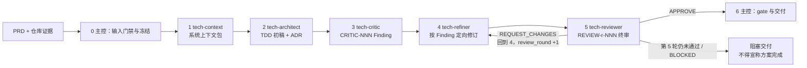

# 编写后端技术方案

根据已通过校验的 PRD 生成可评审、可实现、可验证的中文后端技术方案。五个角色子代理依次接力，**阶段顺序、Finding 闭环和交付门禁由 `scripts/tech_doc_controller.py` 强制判定，不依赖主 Agent 自律**。

**输出语言（本轮第一句回复即生效；只用 `@technical-doc` 等无自然语言方式触发时同样默认简体中文）：**面向用户的说明、状态、评审结论和交付报告使用简体中文；专有名词、参数、代码、命令、路径、DDL、JSON 字段名与状态字面量（如 `BLOCKED`）和原始日志保持英文原文；`technical-doc.md` 正文按下方“方案正文使用中文”及模板契约的既有要求执行。规则原文见 `$SKILLS_ROOT/_shared/prompts/output-language.md`，派发子代理时必须把该规则带进任务正文。

**开始时声明：**“使用 technical-doc skill 生成后端技术方案。”



| 阶段 | 负责角色 | 唯一规范源 |
|------|----------|------------|
| 0 | 主控 Agent | 本文档 |
| 1 | `tech-context` | `agents/tech-context.md` |
| 2 | `tech-architect` | `agents/tech-architect.md` |
| 3 | `tech-critic` | `agents/tech-critic.md` |
| 4 | `tech-refiner` | `agents/tech-refiner.md` |
| 5 | `tech-reviewer` | `agents/tech-reviewer.md` |
| 6 | 主控 Agent | 本文档 |

角色提示词只存在于 `agents/` 下的规范源文件；本文档不复制副本，派发时把对应文件的绝对路径交给该子代理。

## 路径与调用约定

`SKILL_DIR`、`SKILLS_ROOT` 与 `<PYTHON>` 启动器的解析方式，以及派发时必须显式传入的路径清单，见 `$SKILLS_ROOT/_shared/prompts/path-convention.md`；跨宿主具名派发规则与降级门禁见 `$SKILLS_ROOT/_shared/prompts/subagent-mandate.md`。进入阶段 0 前必须读完这两份文件。

本 Skill 的不变式（与共享规范一致，冲突时以本文档为准）：

- 五个角色都是硬性阶段门禁。主控不得代替角色下结论，也不得把自身串行自检伪装成独立审查；无法具名派发时阶段状态为 `BLOCKED`，除非按“降级模式”如实标注。
- 被派发的角色一律不再派发下一级子代理，也不因自身缺少派发能力而返回 `BLOCKED`。
- 方案正文使用中文；代码、DDL、JSON 字段名、类名、表名、接口路径和其他技术标识符保留原文。

### 调用方式

| 宿主 | 调用形式 |
|------|----------|
| Claude Code | `/codekit:technical-doc <feature-directory>` |
| Codex | `$technical-doc <feature-directory>` |
| OpenCode | `/technical-doc <feature-directory>` |
| Qoder | `/codekit:technical-doc <feature-directory>` |
| Qoder CN | `/codekit:technical-doc <feature-directory>` |

唯一输入参数是当前仓库内的 `<feature-directory>`（例如 `docs/2026-09-09-order-note-sync`）。依赖文档不从参数接收路径，只在该目录按固定文件名查找：输入 PRD `product-doc.md`，输出 TDD `technical-doc.md`；RPD `release-doc.md` 由后续 `release-doc` 生成。

## 不应使用的场景

- 小型 bug 修复或仅修改配置（不需要架构决策）；
- 单行代码修改或拼写修复；
- 仅需解释已有方案、无需形成新设计或变更记录的咨询。

## 确定性控制器

阶段 0 的第一件事是初始化运行目录，后续每一步都用控制器的退出码判定，而不是用主 Agent 的自述：

```bash
<PYTHON> "$SKILL_DIR/scripts/tech_doc_controller.py" init \
  --repo-root "<仓库根的绝对路径>" --feature-directory "$feature_directory" --run-id "$run_id"
```

`init` 会在 stdout 输出一行 `STATE=<运行状态文件的绝对路径>`。**不要用 `$(...)` / `$PWD` 之类的 shell 特性去接它**：`cmd.exe` 与 PowerShell 都不支持，Skill 会在 Windows 上直接坏掉。从这一行读出路径，替换掉后文命令里的 `<state 的绝对路径>` 即可。

`init` 的可选开关决定本次运行走哪套阶段语义，只影响本次运行，不改代码：`--context-window`（读取预算的基准窗口）、`--review-stop-policy severity|fixed`（默认 `severity`，见“严重度门停与增量终审”；`fixed` 回退为“每轮都是全量终审，直到 5 轮上限”）、`--scale-enforcement enforce|record-only`（默认 `enforce`，见“规模判定与按规模裁剪”；`record-only` 只记录探针结论，`gate` 不按规模要求章节）。

| 命令 | 用途 |
|------|------|
| `record-source` / `finalize-inputs` | 登记每项资料的 `source_id`、定位符、`READ/NOT_FOUND/NOT_ACCESSIBLE`、摘要与可信度，并给出 `input_status`；定位符会被磁盘核对，与声明不符即失败；`UPDATE` 运行必须同时用 `--prd-changes 修改数/新增数/删除数`（如 `3/1/0`）登记需求变更规模；`finalize-inputs` 顺带跑一次**规模探针**并把 `scale`/`signals`/`greenfield` 写进 `state.json`，返回值里就有，主控把它原样传给 Context Loader 与 Architect |
| `start-stage --to <STAGE>` | 推进阶段状态机；前置证据不足即失败；进入 `REVIEW` 时可带 `--review-scope full|incremental`，增量轮只能由控制器在严重度门停后推导，不接受主控自报范围（想强制全量就省略该参数，由控制器决定最小可证范围）；进入 `DELIVERY` 前每条 Finding 都必须已登记处置 |
| `record-agent` | 登记一次具名子代理调用：先用 `--status DISPATCHED`（带 `--session-id` 与 `--input-digest`）开时间窗，再用同一 `--session-id` 以 `COMPLETED`/`BLOCKED`/`ABORTED` 收口并写入墙钟耗时，收口调用可省略 `--input-digest`；派发后什么都没产出也必须用 `ABORTED` 收口；Reviewer 一旦 `DISPATCHED` 就占用本轮名额；`--scope "7.2,4.1"` 声明本次真正注入的章节，读取量由索引算出 |
| `write-artifact` | 把 `context-pack`、`draft`、`critic-findings`、`refiner-map`、`review-report` 落入运行目录 |
| `record-finding` / `record-fix` | 登记 Finding 与逐项处置（处置是 Finding 唯一的闭环入口）；`record-fix` 的常规入口是 `REFINER` 阶段，评审结论在桌上时主 Agent 不得自己给改动打分；唯一例外：通过性结论（`APPROVE`/`APPROVE_WITH_FOLLOW_UPS`）挂账后，本轮新报的非阻断 Finding 允许在 `REVIEW`/`DELIVERY` 阶段直接登记 `PENDING_CONFIRMATION`/`REJECTED`（`FIXED` 声称改了正文，仍必须走 Refiner 轮 + 全新 Reviewer） |
| `record-review` | 把终审结论与被审 TDD 的内容快照绑定，并绑定**本轮的审查范围**（`--scope` 只能复述 `start-stage` 打开的范围，不能把增量轮改写成全量）；“审查闭环记录”章节标记之间的生成台账不计入该快照 |
| `archive-history` | 把被覆盖的上一版 TDD 归档为独立文件 |
| `index` / `locate` | 重建 `doc-index.json`（章节 → 行区间、符号、Finding 归属），或把一条 Finding 的位置、一个章节号解析成行区间与读取预算；`locate`、`--scope` 派发与 `record-fix` 都会在 TDD 变化后自动重建索引，不必手动先跑 `index`；`locate` 找不到对应标题时返回 `NOT_LOCATED` 并给出兜底读法，不猜 |
| `render-ledger --state <state> --tdd-file <TDD>` | 从 `state.json` 重写 TDD “审查闭环记录”章节的生成台账（Finding 处置映射、运行元数据）与“历史版本索引”，并顺带重建索引 |
| `gate` / `show` | 交付门禁与运行状态摘要；`show` 按 `prep`/`write`/`audit` 汇总各阶段墙钟耗时，给出派发计数（`timed`/`aborted`/`open`/`scoped`/`over_budget`）、索引摘要、`review_stop` 判定与 `scale` 结论 |

状态与产物落在 `<repo>/.codekit/technical-doc/<run-id>/`（运行时证据目录，不得作为业务变更提交）。**阶段间交接只传文件路径与 digest，不传正文**：子代理自己读文件，主 Agent 不搬运大段文本。

### 读取预算与按节注入

一份 5,000 行的 TDD 约 21 万 token，超过 20 万窗口：每一轮都整篇回读，就是上一次运行把 54% 的 Refiner 时间花在“找那段在哪、现在写的是什么”上的原因。

- 草稿落盘后 Refiner 的派发**先 `locate`**，按返回的行区间读取注入，不整篇回读；索引缺失或 TDD 已变时 `locate` 自己重建，不需要手动先跑一次 `index`。`locate --finding CRITIC-007` 会连带返回该章节按编号引用到的其他章节——只改一处、漏掉引用它的那一处，是下一轮 Finding 的来源。
- 区间不足时**允许扩大读取**（`locate` 返回 `NOT_LOCATED`，或引用章节没随区间给到），不是硬门禁：Refiner 需在回报里声明多读了哪些章节。整篇可读始终是保留的退路，按节注入只是把翻页换成一次查表；Critic 与 Reviewer 做的是全量审查，不受本节约束。
- 派发时把注入的章节写进 `record-agent --scope "7.2,4.1"`：读取量、行区间和是否超预算由索引算出，不接受子代理自述；`over_budget: true` 就把这一轮拆成更小的派发，而不是让角色自己翻页。`--scope` 只在开时间窗的那次调用上声明。
- 处置只能落在**本轮**所有 `--scope` 的并集里，且 Finding 所在章节与处置落点都在并集内（缺一即拒，只核对处置落点会漏掉“没读原文就凭 Finding 描述改”的那条路）：一轮拆成多次按节派发是允许的，但上一轮声明过的章节不覆盖本轮，扩大范围靠再派发一次带 `--scope` 的 Refiner，而不是补一条旧范围外的 `record-fix`。
- `init --context-window` 填宿主的真实窗口（默认 200000）；预算 = 窗口 × 0.5，剩下的要留给角色自己的指令与产出。

### 严重度门停与增量终审

上一轮运行的 Finding 数是 Critic 26 条，随后每轮终审 12→7→5→3：**`Blocker`/`High` 只在第 1 轮出现过**，之后每轮的单条成本和第 1 轮完全一样，而每轮的 Reviewer 都把整篇重读一遍。按这份现场数据回放本节的规则，第 4、5 轮会被换成增量终审（实测推导范围约占整篇读取量的 52%），第 1～3 轮仍是全量——因为它们确实还在挖出阻断项。

- 默认策略是 `severity`：**只要本轮新增 `Blocker`/`High`，或还有未闭环的 `must_fix`，就必须继续全量终审**——门停不会提前结束循环，只会把已经不可能挖出高危的那一轮换成小范围。
- 连续两轮终审既没报出 `Blocker`/`High`、也没有未闭环 `must_fix` 时，下一轮**必须**是增量终审：控制器自己算范围（自上次全量终审以来逐节摘要变过哪些节 + 上一轮 Finding 落在哪些节），主控既不能缩小它，也不能把结论改标成全量。没报高危但也无法推导（缺上一轮快照）时，控制器自动退回全量，宁可多读不可少读。
- 增量轮仍要派发**全新 Reviewer**，只是它读的是给定的章节区间；`gate` 的 `incremental-review-covers-changes` 会把最后一次全量终审的逐节摘要和当前正文再比一次，凡是变过却没进任何一轮范围的章节即 `BLOCKED`——终审之后主控亲手补的那一段就是从这里露出来的，不需要靠“保留一次全量收尾”来兜。
- `review_round` 上限 5 保留为兜底而非目标；`init --review-stop-policy fixed` 回到“每轮全量、跑满轮次”的旧语义。
- 增量轮的 `over_budget: true` **不能靠拆派发解决**：一轮只允许一个全新 Reviewer 实例（第二个会被控制器拒绝）。上一轮那种 5,046 行的文档实测下来，推导出的范围约占整篇读取量的 52%（约 11.5 万 token），仍高于 0.5×窗口的预算——但整篇读取（约 22 万 token）本来就超出 20 万窗口。此时的正确动作是把 `--context-window` 填成宿主的真实值，或接受这一轮超预算（读取量依旧比全量轮小），而不是把一轮终审切成两个实例。`over_budget` 只是回报里的提示，`start-stage` 与 `gate` 都不因它阻塞。

### 规模判定与按规模裁剪

模板的 `方案裁剪规则` 早就写了 S/M/L 三行，但没人判定归属，于是绿地原型也按 L 填满监控大盘、告警、部署拓扑章节，每轮再被整篇读回一遍。

- `finalize-inputs` 用冻结的 PRD 正文与仓库实测判定：命中的变更类别（数据/接口/消息/定时/配置）为 0 是 `S`，1～3 是 `M`，≥4 是 `L`；`git ls-files` 里没有后端源码且没有登记到任何“已读取的系统证据/既有 TDD”时记为 `greenfield`。这是测量结果，不接受任何角色的自述。
- `gate` 的 `scale-chapters` 按这张表要求章节，分两档：**最低要求行点名的章节**（`S` 级的基础监控与告警；`M`/`L` 追加完整监控大盘、告警、部署拓扑）在任何规模下都要在位，`M`/`L` 级还必须有实质设计，写 `不涉及` 或短于一节最低标准即 `BLOCKED`——那是拿“变快”冒充“变薄”。被信号点名的 `条件必填` 章节保留模板的 `不涉及 + 原因` 退路：给得出理由就合法（上一轮那种“无 MQ、单进程、附替代方案对比”的一章实测合法），只有一句 `不涉及` 而没给原因的仍判 `BLOCKED`。
- `greenfield` 时 Context Loader 只做结构探测，**明确跳过“现有实现与可复用模式”检索**（上一次运行在这上面花 36 分钟去找不存在的代码）；缺口照旧写成“未发现证据”，不得改用例填空。
- 探针结论会进“审查闭环记录”章节“运行元数据”台账（`规模判定` 行）与 `show`，交付报告照抄；`init --scale-enforcement record-only` 只记录不生效，用于回退。

## 阶段 0：输入门禁与冻结

`init` 会拒绝缺失、不可读、无实质内容或以模板占位为主的 `product-doc.md`，并记录其 digest；目录中已有的 `technical-doc.md` 不是阻塞性输入，但会被快照并把运行标记为 `UPDATE`。

冻结每项资料后用 `record-source` 登记，至少覆盖：PRD 与变更台账、仓库规范（`AGENTS.md`、`CLAUDE.md`、README、构建与测试约定）、系统证据（代码、接口契约、Schema/迁移、部署配置、环境变量、监控）、本 Skill 资源、已确认人工决策、既有 TDD。随后 `finalize-inputs`：

- PRD 未被读取 ⇒ 只能 `BLOCKED`，立即停止并说明缺口；
- 存在未读取资料却声明 `PASS` ⇒ 控制器直接失败；
- 非关键缺口可以 `PARTIAL`，但缺口必须随派发输入传给 Architect、Critic、Reviewer 并进入交付报告；
- `UPDATE` 运行必须给出 `--prd-changes 修改数/新增数/删除数`（如 `3/1/0`）：它是“历史版本索引”里那条台账的唯一来源，缺了就无法生成，控制器直接失败。

`NOT_FOUND` / `NOT_ACCESSIBLE` 是事实，不是可推测的空位。控制器会把定位符拿到磁盘上核对：`READ` 必须指向存在且可读的文件或目录，`NOT_FOUND` 必须确实不存在，`NOT_ACCESSIBLE` 是存在但打不开；被 Git Bash 改写成 `C:/Program Files/Git/...` 的路径会在报错里被点名。**上下文不得回流**：`.codekit/` 与上一次运行产出的上下文包不属于“仓库规范”证据，不得读取后当作既有约定使用。

## 阶段 1：Context Loader

只读理解现状，输出带证据路径的**系统上下文包**，落在运行目录并作为 `context-pack` 产物登记；不设计方案、不修改任何代码或仓库配置文件。

输出至少覆盖：技术栈与版本、服务边界与上下游契约、核心领域模型与数据流、现有实现与可复用模式、技术债与瓶颈、规范与约定、约束与风险、待确认事项。每条关键结论标注证据路径或“未发现证据”，禁止臆造版本、容量和运行行为。

派发时把 `finalize-inputs` 的 `scale`/`greenfield` 结论一并交给 `tech-context`：`greenfield` 只做结构探测（语言栈、构建入口、目录与配置形态）并直接登记“现有实现：未发现证据”，不去检索不存在的服务、Schema 和监控——上一次运行的 36 分钟里有大半花在这上面。跳过的是检索动作，不是那一节内容。

规模较大时可并行启动多个 `tech-context` 实例，由主控合并；合并前必须消解冲突、保留各自证据路径并标出无法裁决的事实。

## 阶段 2：Architect

输入为冻结的 PRD 当前有效正文、`【修改】/【新增】/【删除】` 台账、系统上下文包、`references/technical-doc-template.md` 和已确认人工决策。产出 `draft` 产物（TDD 初稿）。

- 先定义 service boundary，再覆盖 PRD 功能与非功能性需求；
- 每个关键选型至少比较 2 个可行方案，说明评价维度、理由、代价与适用边界，并写入 ADR 章节；
- 每个改造点给出“现有方式 → 新方式”对比；DDL 用完整 `CREATE TABLE`（字段、索引、注释）；新 API 给完整 request/response JSON、错误码、鉴权、幂等与兼容说明；
- 未知事实写成 `[需人工确认: xxx]` 并说明它影响哪项决策，不得把推断写成确定结论；
- 模板示例与真实系统冲突时以代码证据为准并删除示例事实；
- 派发时给出 `scale`：`S` 级可以把监控大盘与告警收缩成基础项并写明原因，`M`/`L` 级的“完整监控大盘与告警”“部署拓扑”必须有实质设计；被信号点名的 `条件必填` 章节可以填 `不涉及`，但必须带原因。`gate` 按同一张表核对，不会因为“文档短一点更快”而放行。

`draft` 落盘后 Refiner 的派发按“读取预算与按节注入”执行（首次 `locate` 会自己建索引，不用先手动跑 `index`）；Critic 做全量审查，Reviewer 在全量轮也读完整篇——对这些轮次索引只是定位工具，不缩小审查范围；命中严重度门停的增量终审轮例外（见“严重度门停与增量终审”）。

`gate` 会核对以下章节锚点在 TDD 中确实存在，缺一即 `BLOCKED`：`变更记录`、`需求到设计`（追踪表）、`关键技术决策记录`（ADR）、`风险登记与工作量评估`、`审查闭环记录`；`UPDATE` 运行还必须有 `历史版本索引`。

**模板读取范围**：主控与 Architect 读取完整模板；Critic、Refiner、Reviewer 只读 `references/check-standard.md` 与被审文档，章节齐整性由 `gate` 的锚点检查承担。不得把 48 KB 模板重复注入每一轮每一个角色。

## 阶段 3：Critic

一次性红队对抗审查（红队 + SRE + 成本审计视角），只读，不改写 TDD。Finding 用 `CRITIC-<NNN>` 登记，字段包含严重度（`Blocker/High/Medium/Low`）、影响范围、具体位置、问题与证据、修复建议与验证方式。`Blocker`/`High` 默认 `must_fix`。

位置一栏写 TDD 里真实存在的章节号（如 `7.2`）：`locate` 靠它把行区间交给 Refiner。写成自由文本不会被拒，但那一轮就只能靠角色自己翻页找。

必查：PRD 全覆盖、与上下文/契约/约定冲突、最坏情况下的超时/重试/幂等/降级/限流/容灾/补偿、数据泄露/越权/注入/敏感信息落盘/合规审计、运维复杂度与不可控成本、关键选型是否真的比较过备选且 ADR 可追溯。没有问题也必须登记已检查范围与仍需人工确认项。

派发时把 `scale`/`greenfield` 一并交给 Critic，用来校准严重度而不是降低标准：模板允许 `S` 级裁剪掉的完整大盘与部署拓扑，不该变成 `Blocker`（那只会让下一轮往里灌水）；`M`/`L` 级把必需章节写成“不涉及”是真实的上线风险，按影响定级。

## 阶段 4：Refiner

只按当前轮 Finding 定向修复，不重新发起架构创作、不引入 Finding 之外的发挥、不删除问题伪造已修复。每个 Finding 必须有一条处置：`FIXED`（给位置、改法、验证方式）、`REJECTED`（仅非 `must_fix`，需证据）或 `PENDING_CONFIRMATION`（仅非 `must_fix`，保留 `[需人工确认: xxx]`）。

处置只经 `record-fix` 生效：主控按 Refiner 回报的映射逐条登记，并把映射登记为 `refiner-map` 产物。派发前先按 Finding 所在章节聚类，逐条 `locate` 后把注入的区间随 `--scope` 登记（见“读取预算与按节注入”），Refiner 不再自己翻页找位置。**TDD “审查闭环记录”章节的两个台账由 `render-ledger` 生成，任何角色都不得手写**；本轮处置登记完成后执行一次 `render-ledger`，再进入 Review——这样 Reviewer 读到的“审查闭环记录”章节与 `state.json` 一致，且“审查闭环记录”章节的刷新不会破坏终审与被审内容之间的绑定。

## 阶段 5：Independent Reviewer

`review_round` 表示**已执行的独立终审次数**，取值 1～5。一轮 = “独立 Reviewer 终审 →（`REQUEST_CHANGES` 时）Refiner 定向修订 → 重新派发全新 Reviewer”。5 是 `severity` 策略下的兜底而非目标，也是 `fixed` 策略下的固定上限。

每轮必须由主控新建一个**全新实例**（同一轮内第二个 `tech-reviewer` 实例会被控制器拒绝），并收到：冻结 PRD、上下文包路径、当前 TDD 路径、既有 Finding 清单与处置、`references/check-standard.md`、本轮 `review_round`，以及本轮范围（`full`，或 `incremental` 与 `start-stage --to REVIEW` 返回的 `sections`/行区间）。Reviewer 只读，不改 TDD、不审代码实现、不调用 `code-review`、不把自身建议直接写入方案。

审查范围：PRD 逐项追踪、模板与仓库事实一致性、图/接口/DDL/状态/正文/ADR 互相对齐、关键选型是否有备选与可执行迁移回滚、安全/容量/可靠性/可观测性/测试/发布门禁是否足够、Finding 是否逐项闭环。

前两轮（以及任何报了 `Blocker`/`High` 或留下未闭环 `must_fix` 的轮次之后）都是**全量终审**，Reviewer 读完整篇。命中“严重度门停”之后（见同名小节）改为**增量终审**：`start-stage --to REVIEW` 的返回值给出 `sections` 与行区间，主控逐节 `locate` 后把这些区间随派发交给全新 Reviewer；范围由控制器推导，主控不得缩小，Reviewer 也不得把增量结论说成全量结论——`record-review` 记录的范围与 `gate` 的覆盖证明都会留下这一轮的边界。

输出 `status: APPROVE | APPROVE_WITH_FOLLOW_UPS | REQUEST_CHANGES | BLOCKED`，新增 Finding 用 `REVIEW-<round>-<NNN>` 登记，结论用 `record-review` 与被审快照、本轮范围绑定。主控不得直接改写 TDD 后宣称 Reviewer 通过。

通过性结论不是本轮 Finding 的终点：`gate` 的 `every-finding-has-a-disposition` 与 `start-stage --to DELIVERY` 都要求每条 Finding 有处置，而第 5 轮之后已无处再开 Refiner 轮。为此控制器允许在 `REVIEW`/`DELIVERY` 阶段（仅限通过性结论挂账时）对**本轮**新报的非阻断 Finding 直接登记 `PENDING_CONFIRMATION`/`REJECTED`，处置落点必须与 Finding 位置一致；`FIXED` 声称改过正文，仍只能由 Refiner 轮产生并配一次全新终审。这个例外是给 follow-up 收口的，不是给主控免审改文档开后门。

第 5 轮后仍有 `Blocker`/`High`、状态为 `BLOCKED` 或独立 Reviewer 无法启动时，停止循环并交付阻塞报告，不得继续循环或宣称 TDD 已完成。

## 需求变更识别与 TDD 历史

读取 PRD 后先解析当前有效正文和本轮醒目的 `【修改】/【新增】/【删除】` 台账（`## 变更历史` 只用于追溯），逐项建立 `PRD 变更项 → TDD 章节/模块/API/数据/发布影响` 映射：修改项更新现有设计并保留原需求编号，新增项补充完整设计并使用新编号，删除项从当前有效设计移除或明确兼容/清理方案并保留原编号、删除原因和影响。

PRD 当前版本中用户最新明确的方案和逻辑优先于旧 PRD、旧 TDD、旧评审意见和模型推断。若最新 PRD 与旧 TDD 冲突，以最新 PRD 重算设计、兼容、迁移、测试和发布影响；若代码、接口契约或安全约束使新逻辑不可安全实现，记录 `[需人工确认: ...]` 及证据，不得静默回退旧方案。

`UPDATE` 运行必须在写入新版本前用 `archive-history` 把上一版有效 TDD 归档为运行目录下的独立文件，“历史版本索引”由 `render-ledger` 依据归档记录与 `finalize-inputs --prd-changes` 的台账生成（版本、归档日期、修改/新增/删除数量、归档文件），任何角色都不得手写索引行。渲染时 `render-ledger` 会先读出文档里上一次运行留下的索引行（按 版本+归档文件 去重、按时间顺序重排序号）再接上本 run 的新行——跨 run 的索引同样只追加、不覆盖。**禁止把旧版正文内嵌进 markdown 围栏**（嵌套围栏会提前截断，且会让文档随每次变更成倍膨胀）；`gate` 会拒绝含嵌套文档围栏的产物。当前正文只保留最新有效方案，历史只追加、不覆盖、不重排。

## 降级模式

宿主确实无法具名派发时，主控可以按阶段串行完成，但必须：

1. 对每个无法派发的角色执行 `degrade --role <name> --reason <原因>`；
2. 交付前执行 `render-ledger`——“运行元数据”台账会写明降级范围、未闭环的 `must_fix` 与交付门禁结论，不得手写该章节；
3. 交付状态只能是 `PARTIAL_DEGRADED`，交付报告必须声明“独立审查门禁未满足，结论需人工复核”，不得写成“方案已完成并已通过独立评审”。

## 交付

写入 `<feature-directory>/technical-doc.md`（文件名固定；目录不存在则创建），包含方案正文、ADR、风险登记与工作量评估、审查闭环记录与运行元数据、（变更时）历史版本索引。“审查闭环记录”章节的台账由 `render-ledger` 生成，交付前必须先刷新，再跑门禁：

```bash
<PYTHON> "$SKILL_DIR/scripts/tech_doc_controller.py" render-ledger --state "<state 的绝对路径>" \
  --tdd-file "$feature_directory/technical-doc.md"
```

```bash
<PYTHON> "$SKILL_DIR/scripts/tech_doc_controller.py" gate --state "<state 的绝对路径>" \
  --tdd-file "$feature_directory/technical-doc.md"
```

`gate` 是确定性的，覆盖：输入可用性、五个阶段产物是否落盘、独立终审是否执行、**最后一轮终审是否覆盖当前内容**（终审之后改动手写章节的任何一个字都会被判 `BLOCKED`；“审查闭环记录”章节标记之间的生成台账不计入该比对）、**增量终审是否覆盖了自最后一次全量终审以来变过的每一节（`incremental-review-covers-changes`，变过却没进任何一轮范围即 `BLOCKED`）**、轮次是否越界、`must_fix` Finding 是否全部闭环、每个 Finding 是否有处置、**“审查闭环记录”章节生成台账是否存在（`ledger-blocks-present`）且与 `state.json` 逐字一致（`ledger-matches-state`，手改标记内内容、漏行、或在标记之外另抄一份台账都算失败）**、是否仍含模板占位符（`TBD`/`TODO`/`待定`/`待补充`/`后续补充`/`similar to`/`refer to`/`【填写】`/`【链接】`/`YYYY-MM-DD`；唯一允许的未知表达是 `[需人工确认: xxx]`）、必需章节锚点是否齐备、**按 `state.json` 的规模判定要求的章节是否齐备且有实质内容（`scale-chapters`，M/L 级用 `不涉及` 或短正文收缩即 `BLOCKED`）**、代码围栏是否闭合且语言合法、变更运行是否已归档上一版、是否残留把上下文写回仓库 `AGENTS.md`/`CLAUDE.md` 的痕迹。

`gate` 退出码非 0 时不得写入“方案已完成”，应输出阻塞报告与缺口；退出码 0 且无降级才是“已通过独立终审”。`gate` 通过后再执行一次 `render-ledger`，让“审查闭环记录”章节的“交付门禁”行记录本次结论，然后才能进入 `CLOSED`；关闭后文档冻结，`render-ledger` 会被拒绝。图示一律使用模板规定的 Mermaid fenced code block，简单目录树和数据流用 ASCII art；不依赖任何外部渲染服务。

完成后输出交付报告：方案路径、运行目录、`input_status` 与缺口、需求变更三类数量及映射、旧/新 TDD 版本与归档文件、Critic 与 Reviewer 的 Finding 数量和最高严重度、`review_round` 与最终状态、各轮终审范围（全量/增量）与 `gate` 报告里的 `review_stop`、`finalize-inputs` 的规模判定（`scale`/`greenfield`/命中信号）、仍需人工确认事项、`gate` 结果。然后给出下一步：

```text
方案已生成并保存到 `<feature-directory>/technical-doc.md`（gate: PASS）。建议的下一步：

1. `/codekit:release-doc <feature-directory>` — 基于 PRD + TDD 生成发布方案
2. 人工评审 — 先确认 ADR、`[需人工确认: ...]` 项和发布风险
3. `/codekit:code-impl <feature-directory>` — 仅在 PRD/TDD/RPD 三份文档齐备后启动 multi-agent 并行编码
```
