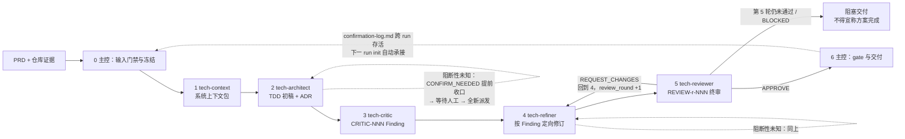

# 编写后端技术方案

根据已通过校验的 PRD 生成可评审、可实现、可验证的中文后端技术方案。五个角色子代理依次接力，**阶段顺序、Finding 闭环和交付门禁由 `scripts/tech_doc_controller.py` 强制判定，不依赖主 Agent 自律**。各规则的设计依据与现场数据见 `references/rationale.md`（维护者文档，运行时不读）。

**输出语言（本轮第一句回复即生效；只用 `@technical-doc` 等无自然语言方式触发时同样默认简体中文）：**面向用户的说明、状态、评审结论和交付报告使用简体中文；专有名词、参数、代码、命令、路径、DDL、JSON 字段名与状态字面量（如 `BLOCKED`）和原始日志保持英文原文；`technical-doc.md` 正文按下方“方案正文使用中文”及模板契约的既有要求执行。规则原文见 `$SKILLS_ROOT/_shared/prompts/output-language.md`，派发子代理时必须把该规则带进任务正文。

**开始时声明：**“使用 technical-doc skill 生成后端技术方案。”



| 阶段 | 负责角色 | 唯一规范源 |
|------|----------|------------|
| 0 | 主控 Agent | 本文档 |
| 1 | `tech-context` | `agents/tech-context.md` |
| 2 | `tech-architect` | `agents/tech-architect.md` |
| 3 | `tech-critic` | `agents/tech-critic.md` |
| 4 | `tech-refiner` | `agents/tech-refiner.md` |
| 5 | `tech-reviewer` | `agents/tech-reviewer.md` |
| 6 | 主控 Agent | 本文档 |

角色提示词只存在于 `agents/` 下的规范源文件；本文档不复制副本，派发时把对应文件的绝对路径交给该子代理。

## 路径与调用约定

`SKILL_DIR`、`SKILLS_ROOT` 与 `<PYTHON>` 启动器的解析方式，以及派发时必须显式传入的路径清单，见 `$SKILLS_ROOT/_shared/prompts/path-convention.md`；跨宿主具名派发规则与降级门禁见 `$SKILLS_ROOT/_shared/prompts/subagent-mandate.md`。进入阶段 0 前必须读完这两份文件。

本 Skill 的不变式（与共享规范一致，冲突时以本文档为准）：

- 五个角色都是硬性阶段门禁。主控不得代替角色下结论，也不得把自身串行自检伪装成独立审查；无法具名派发时阶段状态为 `BLOCKED`，除非按“降级模式”如实标注。
- 被派发的角色一律不再派发下一级子代理，也不因自身缺少派发能力而返回 `BLOCKED`。
- 方案正文使用中文；代码、DDL、JSON 字段名、类名、表名、接口路径和其他技术标识符保留原文。

### 调用方式

| 宿主 | 调用形式 |
|------|----------|
| Claude Code | `/codekit:technical-doc <feature-directory>` |
| Codex | `$technical-doc <feature-directory>` |
| OpenCode | `/technical-doc <feature-directory>` |
| Qoder | `/codekit:technical-doc <feature-directory>` |
| Qoder CN | `/codekit:technical-doc <feature-directory>` |

唯一输入参数是当前仓库内的 `<feature-directory>`（例如 `docs/2026-09-09-order-note-sync`）。依赖文档不从参数接收路径，只在该目录按固定文件名查找：输入 PRD `product-doc.md`，输出 TDD `technical-doc.md`，人工确认账本 `confirmation-log.md`（跨 run 存活的活账，见“人工确认循环”）；RPD `release-doc.md` 由后续 `release-doc` 生成。

## 不应使用的场景

- 小型 bug 修复或仅修改配置（不需要架构决策）；
- 单行代码修改或拼写修复；
- 仅需解释已有方案、无需形成新设计或变更记录的咨询。

## 确定性控制器

阶段 0 的第一件事是初始化运行目录，后续每一步都用控制器的退出码判定，而不是用主 Agent 的自述：

```bash
<PYTHON> "$SKILL_DIR/scripts/tech_doc_controller.py" init \
  --repo-root "<仓库根的绝对路径>" --feature-directory "$feature_directory" --run-id "$run_id"
```

`init` 会在 stdout 输出一行 `STATE=<运行状态文件的绝对路径>`。**不要用 `$(...)` / `$PWD` 之类的 shell 特性去接它**：`cmd.exe` 与 PowerShell 都不支持。从这一行读出路径，替换掉后文命令里的 `<state 的绝对路径>` 即可。

`init` 的可选开关只影响本次运行，不改代码：`--context-window`（读取预算的基准窗口）、`--review-stop-policy severity|fixed`（默认 `severity`，见“严重度门停与增量终审”；`--review-stop-policy fixed` 回退为每轮全量终审直到 5 轮上限）、`--scale-enforcement enforce|record-only`（默认 `enforce`，见“规模判定与按规模裁剪”；`--scale-enforcement record-only` 只记录探针结论，`gate` 不按规模要求章节）。

命令的必填参数、可复制示例和**拒绝语义**全部在 `references/controller-contract.md`；下表只承载每条命令的用途与该步需要主控自己拿的主意，拒绝理由不在这里复述。**不要在 run 中途回读 `scripts/tech_doc_controller.py` 去凑参数**——卡住时的第一问是 `show --next`，它回的就是下一步该跑的完整命令。

| 命令 | 用途 |
|------|------|
| `record-source` / `finalize-inputs` | 逐份登记资料的 `source_id`、定位符、`READ/NOT_FOUND/NOT_ACCESSIBLE`、摘要与可信度，并给出 `input_status`；`UPDATE` 运行必须同时登记 `--prd-changes 修改数/新增数/删除数`（如 `3/1/0`）。`finalize-inputs` 顺带跑规模探针，返回值里的 `scale`/`signals`/`greenfield`（连同 `basis`）原样传给 Context Loader 与 Architect |
| `record-sources --from-file` | 一次原子登记整份 JSON 资料清单，逐条走与 `record-source` 相同的磁盘核对；任一条失败整批不落盘，逐条 `failed` 点名原因 |
| `start-stage --to <STAGE>` | 推进阶段状态机，前置证据不足即失败。需要主控拿主意的判据：`--to REFINER` 看台账上还有没有未登记处置的 Finding（往轮遗留的同样算），`--to DELIVERY` 要求每条都已闭环；`DELIVERY` 回 `REFINER` 是落地回退，只受轮次预算约束（见“门禁挂钩”）。`--review-scope` 只能复述控制器自己推导的范围 |
| `record-agent` | 用 `--status DISPATCHED`（带 `--session-id` 与 `--input-digest`）开时间窗，再用同一 `--session-id` 收口。两处易错：子代理以 `CONFIRM_NEEDED` 提前收口时登记 `COMPLETED`（那半份草稿是下一阶段要查的证据）；`tech-refiner` 派发必须带 `--scope`（它是唯一改正文的角色，处置落点的量尺就是这份声明） |
| `settle-agent` | 一次完成收口三连：收口同一 `--session-id`，`--artifact <kind>:<路径>` 走 `write-artifact` 同一套校验，`--register <回报>` 按 `@@FIND`/`@@FIX` 分流批量登记；某步失败停在该步，已完成步骤保持生效 |
| `write-artifact` | 把 `context-pack`、`draft`、`critic-findings`、`refiner-map`、`review-report` 登记进运行目录：产物由角色自己写盘，主控只 `--file` 登记它回报的那个路径，不代抄正文。`draft` 同时把当时的正文行数冻结为本次运行的体积参照 |
| `record-finding` / `record-fix` / `record-findings --from-file` / `record-fixes --from-file` | 登记 Finding 与逐项处置（处置是 Finding 唯一的闭环入口）。两边都可用 `--from-file` 吃角色回报里的 `@@FIND`/`@@FIX` 行，一次交回整批，逐条仍走同一条校验路径，不是绕过。`record-fix` 的常规入口是 `REFINER` 阶段，唯一例外见“阶段 5”的默认策略 |
| `record-review` | 把终审结论与被审 TDD 的内容快照绑定，并绑定本轮的审查范围（只能复述 `start-stage` 打开的范围）；“审查闭环记录”章节标记之间的生成台账不计入该快照 |
| `archive-history` | 把被覆盖的上一版 TDD 归档为独立文件（`UPDATE` 运行必须在覆写前调用） |
| `index` / `locate` / `dump` | 把一条 Finding 的位置或一个章节号解析成行区间与读取预算，或从 `state.json` 回一条 Finding 的当前状态；是主控侧不整读原文的唯一回读面（见“读取预算与按节注入”） |
| `render-ledger --state <state> --tdd-file <TDD>` | 从 `state.json` 重写 TDD “审查闭环记录”章节的生成台账（Finding 处置映射、运行元数据、人工确认台账、人工决定台账）与“历史版本索引”，并顺带重建索引；它只读确认文件、不写它 |
| `sync-confirmations` / `skip-to-default` / `mark-confirmation-applied` / `confirmations` | 确认文件的四个面：解析登记（分配 `CONF-<NNN>`，回计数与三份清单）、按用户显式指令收口为 SKIPPED-DEFAULT、登记已收口决定已落进正文、只读对账。“确认完毕”只以 `sync-confirmations` 的 `blocking_open` 与退出码判定，不接受任何自述 |
| `gate` / `show` / `show --next` | 交付门禁与运行状态摘要（耗时、派发计数、门停与规模结论、待答与待落地清单）。状态推导只有一条：`failures` 非空即 `BLOCKED`（退出码 2），降级不参与这一步；带 `warn` 的是软检查，只进 `warnings`，交付报告强制照抄。`show --next` 回下一步命令，但不推进任何东西，给出的命令照样可能被门禁拒绝 |
| `deliver` | 一次走完固定交付序列：（REVIEW 时）`--to DELIVERY` → `render-ledger` → `gate` → `render-ledger` → `CLOSED`；gate 失败即停在 gate 并原样返回报告，与手动四连拒绝语义一致 |
| `apply-mechanical-patch` | 交付门禁失败后，用只删行的校验 diff 直修两类纯删除缺陷（手抄 Finding 表行、已 APPLIED 条目残留的整行 marker）；不消耗轮次，补丁进台账强制照抄 |
| `waive-growth` | `document-growth-hard` 拒绝后，登记一条 Reviewer 裁定豁免无主增长：只在 `DELIVERY`、必须引用最新终审轮的 REVIEWER Finding 且该 Finding 真实出现在终审报告里，并给理由；豁免进台账与交付报告强制照抄，新一轮终审自动作废旧豁免 |

状态与产物落在 `<repo>/.codekit/technical-doc/<run-id>/`（运行时证据目录，不得作为业务变更提交）。**阶段间交接只传文件路径与 digest，不传正文**：子代理自己读文件，主 Agent 不搬运大段文本。角色回报后的收口优先用 `settle-agent` 一次完成（收口 + 产物登记 + 批量注册，逐条校验不减）；`gate`/`show` 默认紧凑输出（failures/warnings 全文保留），需要逐项细节时加 `--verbose`。

### 读取预算与按节注入

- 草稿落盘后 Refiner 的派发**先 `locate`**，按返回的行区间读取注入，不整篇回读；索引缺失或 TDD 已变时 `locate` 自己重建，不需要手动先跑一次 `index`。`locate --finding CRITIC-007` 会连带返回该章节按编号引用到的其他章节——只改一处、漏掉引用它的那一处，是下一轮 Finding 的来源。
- 区间不足时**允许扩大读取**（`locate` 返回 `NOT_LOCATED`，或引用章节没随区间给到），不是硬门禁：Refiner 需在回报里声明多读了哪些章节。整篇可读始终是保留的退路；Critic 与 Reviewer 做的是全量审查，不受本节约束。
- 派发时把注入的章节写进 `record-agent --scope "7.2,4.1"`：读取量、行区间和是否超预算由索引算出，不接受子代理自述；`over_budget: true` 就把这一轮拆成更小的派发，而不是让角色自己翻页。`--scope` 只在开时间窗的那次调用上声明。Refiner 的派发**必须**带这一项；确实整篇注入就写 `--scope all`，照旧按整篇度量并回报 `over_budget`，度量不因写法而放宽。
- 处置只能落在**本轮**所有 `--scope` 的并集里，且 Finding 所在章节与处置落点都在并集内（缺一即拒）：一轮拆成多次按节派发是允许的，但上一轮声明过的章节不覆盖本轮，扩大范围靠再派发一次带 `--scope` 的 Refiner，而不是补一条旧范围外的 `record-fix`。
- `init --context-window` 填宿主的真实窗口（默认 200000）；预算 = 窗口 × 0.5，剩下的要留给角色自己的指令与产出。
- **主控侧不整读原文**：PRD、`context-pack`、TDD 正文只在角色自己的上下文里整篇读；主控要 TDD 的某一段用 `locate`（行区间）或 `locate --batch`（一簇），要一条 Finding 用 `dump`（默认连 `evidence` 都不回，只给 `evidence_chars`），要状态用 `show` 与 `confirmations`，要台账用 `render-ledger` 的返回值照抄。整读进来的大文档（实测 PRD 达 58K 字符）会留在主控上下文里直到 run 结束。要核对 PRD 里的一句话，就把它写成确认文件的待答条目，或让已经在读它的角色在回报里引用原文位置——不是自己翻页。

### 严重度门停与增量终审

- 默认策略是 `severity`：**只要本轮新增 `Blocker`/`High`，或还有未闭环的 `must_fix`，就必须继续全量终审**——门停不会提前结束循环，只会把已经不可能挖出高危的那一轮换成小范围。
- 上一轮终审既没报出 `Blocker`/`High`、也没有未闭环 `must_fix` 时，下一轮**必须**是增量终审：控制器自己算范围（自上次全量终审以来逐节摘要变过哪些节 + 上一轮 Finding 落在哪些节），主控既不能缩小它，也不能把结论改标成全量。没报高危但也无法推导（缺上一轮快照）时，控制器自动退回全量，宁可多读不可少读。**增量轮不得连续**：上一轮是增量则本轮强制全量；**交付轮必须全量**：最后一次终审是增量的不得进 `DELIVERY`，须经 `--to REFINER` 回退（REVIEW/DELIVERY 均可，即使没有未处置 Finding 也放行）补一轮全量终审，预算耗尽时只能出阻塞报告。**唯一例外：落地回退后的补审轮可以是增量**（上一轮全量且通过、范围由修复 diff 推导，补审默认增量），其增量结论可直接交付，`gate` 覆盖证明照旧生效。
- 增量轮仍要派发**全新 Reviewer**，只是它读的是给定的章节区间；`gate` 的 `incremental-review-covers-changes` 会把最后一次全量终审的逐节摘要和当前正文再比一次，凡是变过却没进任何一轮范围的章节即 `BLOCKED`——终审之后主控亲手补的那一段就是从这里露出来的。
- `review_round` 上限 5 保留为兜底而非目标；`init --review-stop-policy fixed` 回到“每轮全量、跑满轮次”的旧语义。
- 增量轮的 `over_budget: true` **不能靠拆派发解决**：一轮只允许一个全新 Reviewer 实例（第二个会被控制器拒绝）。正确动作是把 `--context-window` 填成宿主的真实值，或接受这一轮超预算（读取量依旧比全量轮小）。`over_budget` 只是回报里的提示，`start-stage` 与 `gate` 都不因它阻塞。

### 人工确认循环

确认载体是 `<feature-directory>/confirmation-log.md`（下称**确认文件**）：跨 run 存活的“活账”，随 feature 目录提交，与运行目录 `.codekit/` 的“证据不入库”约束无关。TDD 正文里的每个 需人工确认 方括号标记都必须在这里有条目，问答过程留在文件与运行目录，结论只经 `render-ledger` 的托管台账进正文。

**条目格式**：字段为 来源/阻断/位置/问题/影响/选项/推荐/决定/应用，完整形状与字段约束见 `agents/tech-architect.md` 与 `agents/tech-refiner.md` 的“确认文件条目”节。追加式，只追加不删除、不重排；ID 由控制器首次 `sync-confirmations` 时按 `CONF-<NNN>` 分配并只回写 ID 行。「问题」≤80 字符、单行、不含 `]` 与换行，登记后不可改写、本 run 内唯一——它是 marker 与条目配对的键。控制器对该文件只有三种写动作：`sync-confirmations` 补 ID 行、`skip-to-default` 写 `决定:` 行、`mark-confirmation-applied` 写 `应用:` 行；`render-ledger` 只读不写。其余都是用户与角色的编辑面（主控代录只编辑 `决定:` 行）。解析容忍 CRLF，UTF-8 解码失败即报错并要求转 UTF-8。

**阻断判据（唯一的暂停理由）**：`此项不拍板，本轮剩余工作（含其余非阻断 Finding 的处置）是否无法继续？` 是 ⇒ 阻断，触发暂停；否 ⇒ 照常挂账走人。由产出角色按该判断式裁决并写进 `阻断:` 栏；单 run 内 Architect/Refiner 的提前收口次数最多与轮次同数，且每次都必须是阻断项。

**暂停协议**：子代理遇到阻断性未知时，先把部分产物落盘（至少 ADR 候选比较与受影响章节骨架；Refiner 先做完本轮其余 Finding，回报“已完成映射 + 未处理清单”两段），再追加条目并以 `CONFIRM_NEEDED` 收口返回。`CONFIRM_NEEDED` 是**回报里的约定，不是控制器状态**：这样的派发用 `--status COMPLETED` 登记——交回的部分产物与确认条目正是下一阶段要查的证据；用 `ABORTED` 收口会把已落盘的草稿判成“什么都没发生”。主控随后：

1. `sync-confirmations` 登记新条目，核对 stdout 计数；
2. 向用户发出通知，必须含：确认文件的仓库相对路径、未答阻断条目表（CONF-ID | 问题 | 选项 | 推荐）、作答方式三条：
   - 通道①：编辑对应条目的 `决定:` 行后回复“继续”；
   - 通道②：会话内直接回复 `确认 CONF-007: <决定>`，由主控代录进文件再 sync；
   - “不答但要走完”仅限用户显式指令，由主控 `skip-to-default` 按推荐选项登记 SKIPPED-DEFAULT——不允许静默跳过；
3. 等待。`sync-confirmations` 的 `blocking_open` 计数与退出码是“确认完毕”的唯一判定，不接受任何自述；收口只认 ANSWERED / SKIPPED-DEFAULT。

**恢复协议**：“继续”= 全新派发，磁盘产物与 `state.json` 是唯一进度，不复活旧会话。恢复派发把确认文件与 state 中的已答决定作为最高优先级输入（高于模型推断，冲突时按决策落并在正文留痕）；角色逐条把正文 marker 改写为 `[已人工确认: 问题 → 决定]` 或删除该段，回报落点，主控 `mark-confirmation-applied` 把落点写进该条目的 `应用:` 行（ANSWERED 与 SKIPPED-DEFAULT 同为收口态，都可且必须被登记落地）。

**marker 书写规则**：正文 marker 与条目「问题」归一化（全半角冒号、空白折叠）后逐字相等；单行；不写进代码围栏（对账时围栏内一律视为示例文本，双向忽略）。产出角色的动作顺序固定：**先追加条目，再写 marker**。`mark-confirmation-applied` 登记过落地的条目，其 marker 必须已从正文消失；OPEN 与本 run 挂账（已裁定待落地）的条目保留 marker 才如实。

**台账入库**：`render-ledger` 在“审查闭环记录”章渲染“人工确认台账”（未收口条目摘要 + 作答指引）与“人工决定台账”（收口条目 | 决定 | 落点）两个生成小节：手写或漏行会被 `ledger-matches-state` 拒；正文 marker 与条目另过 `markers-match-confirmations` 双向对账（孤儿 marker、条目已收口而 marker 残留，都 `BLOCKED`；围栏内与生成块内的字面量一律视为示例文本，双向忽略）。块内引用 Finding ID 是安全的——手写镜像检查只扫标记之外的行。

**跨 run 承接**：`init` 发现 feature 目录已有确认文件时自动 ingest——OPEN 条目全部导入（`来源` 的 Finding 引用只作溯源，不做本 run 存在性校验；in-run 的 sync 照常校验）；ANSWERED/SKIPPED-DEFAULT 未 APPLIED 的列入“待落地”，作为阶段 2 Architect 的最高优先级输入强制先消费，并登记为 `HUMAN_DECISION` 输入证据（下一 run 生效；同 run 内新收口的条目由恢复派发直接消费，不回补冻结输入）。存量文档首跑：正文里无条目对应的 bare marker 由 init 按 `来源: LEGACY-MARKER`、`阻断: false` 自动补登。

**门禁挂钩**：`start-stage --to CRITIC / REVIEW` 拒绝阻断态未完成条目（blocking 且 OPEN、或已收口未落地）与**任何**已收口未落地条目；`--to DELIVERY` 只拒绝阻断态未完成条目，并要求 must_fix Finding 关联条目不为 OPEN。终审之后才收口的非阻断决定可从 `DELIVERY` **落地回退**到 `REFINER`，只在轮次预算还够时放行——需要改动正文才能通过的门禁失败（`scale-chapters` 太薄、`project-structure-branch` 走错分支、未知围栏语言）同样只能走这条回退。回退后必须先落地再补一次全新终审（`--to REVIEW` 前拒收未落地条目，`--to DELIVERY` 只认本轮结论；上一轮全量且通过时补审默认增量，见“严重度门停与增量终审”），代价是一整轮预算；预算耗尽时回退被拒，这几条交回挂账。不付这个代价就照旧挂账：`start-stage --to DELIVERY` 的返回值用 `pending_landing` 把它们交出来，第 16 章台账标注“待落地”，交付报告必须照抄，下一次 `init` 把它们当作必须消费的已确认决策承接。`gate` 侧另有两项：`markers-match-confirmations` 双向对账（孤儿 marker、**已落地**条目残留的 marker 判 `BLOCKED`；OPEN 与挂账条目的 marker 保留合法），`confirmations-file-persisted` 要求确认文件在交付时存在、可解析、并与 `state.json` 逐条一致（本 run 无条目时不强制空文件）。

**残留限制（明示，不藏）**：① 暂停的“等待”依赖宿主会话存活，跨会话恢复靠下次 run 的 init ingest（只补问新产生的阻断项，已答的不重问）；② 终审之后收口的条目落地必须回退补一轮全新终审（`mark-confirmation-applied` 只在 ARCHITECT/REFINER 阶段可执行，终审结论已与快照绑定），非阻断的已裁定条目二选一——付那一轮落地，或以 `pending_landing` 挂账交付；第 5 轮之后只剩挂账与阻塞报告两条出路；③ 第 5 轮之后与交付后挂账项（含 `PENDING_CONFIRMATION` 处置与非阻断 OPEN 条目）本 run 无写回通道，由下次 run 消费；④ 并行多实例 `tech-context` 与确认循环无交集，context 阶段不设暂停；⑤ 配对按文本相等，改写问题措辞而不同步条目会被 `markers-match-confirmations` 挡下，按报错恢复原文或重新登记条目，禁止静默绕过；⑥ 对账都发生在 `gate`（交付时），派发途中不做；命令面、三处 `start-stage` 阻断门禁与两项 `gate` 检查均已由控制器强制，主控不再按本节文字人工代行。

### 规模判定与按规模裁剪

- `finalize-inputs` 用冻结的 PRD 正文与仓库实测判定：命中的变更类别（数据/接口/消息/定时/配置）为 0 是 `S`，1～3 是 `M`，≥4 是 `L`；`git ls-files` 里既没有源码（后端与 Node/Swift 等语言后缀，`.jsx`/`.tsx` 这类纯 UI 文件不算）、也没有工程清单（`pyproject.toml`、`pom.xml`、`go.mod`、`Cargo.toml`、`*.csproj` 等），并且没有登记到任何“已读取的系统证据/既有 TDD”时，才记为 `greenfield`。**枚举时跳过仓库根下的 `doc/`、`docs/` 目录**（`src/docs/` 这类非根目录不算跳过）。这是测量结果，不接受任何角色的自述；判定依据（代码文件数、清单文件、证据条数、文档目录内被排除的个数）随结论一起给出，`scale.basis`、`show`、`gate` 报告和第 16 章台账都能看到。
- `gate` 的 `scale-chapters` 分两档：**最低要求行点名的章节**在任何规模下都要在位，`M`/`L` 级的可观测设计（完整监控大盘与告警）必须有实质设计，写 `不涉及` 或短于一节最低标准即 `BLOCKED`；`部署拓扑` 只按 `L` 级要求。被信号点名的 `条件必填` 章节保留模板的 `不涉及 + 原因` 退路：给得出理由就合法，只有一句 `不涉及` 而没给原因的仍判 `BLOCKED`。
- 模板在 `工程与模块` 一章留了两条互斥分支，由 `greenfield` 选定，`gate` 的 `project-structure-branch` 照它核对：绿地必须给出本项目的目录结构方案（≥3 行目录条目，照抄模板示例的 `my-project`/`my_project` 不算，仓库里有 `.standard/` 规范树时还须点名所依据的规范文件，如 `02-stack/<语言>/05-project-structure.md`）；既有实现必须给全模块表（`仓库`/`模块`/`包路径`/`职责`/`变更类型` 五列齐、无空格子无占位），且不得把本章推回“待初始化”。`init --scale-enforcement record-only` 一并豁免这两项。
- `greenfield` 时 Context Loader 只做结构探测，**明确跳过“现有实现与可复用模式”检索**；缺口照旧写成“未发现证据”，不得改用例填空。跳过的是检索动作，不是那一节内容。
- 探针结论进“审查闭环记录”章节“运行元数据”台账（`规模判定` 行与 `工程结构分支` 行）与 `show`，交付报告照抄；`init --scale-enforcement record-only` 只记录不生效，用于回退。

## 阶段 0：输入门禁与冻结

`init` 会拒绝缺失、不可读、无实质内容或以模板占位为主的 `product-doc.md`，并记录其 digest；目录中已有的 `technical-doc.md` 不是阻塞性输入，但会被快照并把运行标记为 `UPDATE`。

冻结每项资料后用 `record-source` 登记（资料多时用 `record-sources --from-file` 一次原子登记整份清单，逐条校验一条不少），至少覆盖：PRD 与变更台账、仓库规范（`AGENTS.md`、`CLAUDE.md`、README、`.standard/` 规范索引与其 `02-stack/<语言>/05-project-structure.md` 工程结构规范、构建与测试约定）、系统证据（代码、接口契约、Schema/迁移、部署配置、环境变量、监控）、本 Skill 资源、已确认人工决策、既有 TDD。随后 `finalize-inputs`：

- PRD 未被读取 ⇒ 只能 `BLOCKED`，立即停止并说明缺口；
- 存在未读取资料却声明 `PASS` ⇒ 控制器直接失败；
- 非关键缺口可以 `PARTIAL`，但缺口必须随派发输入传给 Architect、Critic、Reviewer 并进入交付报告；
- `UPDATE` 运行必须给出 `--prd-changes 修改数/新增数/删除数`（如 `3/1/0`）：它是“历史版本索引”里那条台账的唯一来源，缺了控制器直接失败。

`NOT_FOUND` / `NOT_ACCESSIBLE` 是事实，不是可推测的空位。控制器会把定位符拿到磁盘上核对：`READ` 必须指向存在且可读的文件或目录，`NOT_FOUND` 必须确实不存在，`NOT_ACCESSIBLE` 是存在但打不开；被 Git Bash 改写成 `C:/Program Files/Git/...` 的路径会在报错里被点名。**上下文不得回流**：`.codekit/` 与上一次运行产出的上下文包不属于“仓库规范”证据，不得读取后当作既有约定使用。

## 阶段 1：Context Loader

只读理解现状，输出带证据路径的**系统上下文包**，落在运行目录并作为 `context-pack` 产物登记；不设计方案、不修改任何代码或仓库配置文件。上下文包由 `tech-context` 自己写进派发时给出的产物路径（它的 `Write` 只开给这一个文件），主控只 `write-artifact --file <该路径>` 登记，不代抄正文。

输出至少覆盖：技术栈与版本、服务边界与上下游契约、核心领域模型与数据流、现有实现与可复用模式、技术债与瓶颈、规范与约定、约束与风险、待确认事项。每条关键结论标注证据路径或“未发现证据”，禁止臆造版本、容量和运行行为。

派发时把 `finalize-inputs` 的 `scale`/`greenfield` 结论一并交给 `tech-context`：`greenfield` 只做结构探测（语言栈、构建入口、目录与配置形态）并直接登记“现有实现：未发现证据”，不去检索不存在的服务、Schema 和监控。跳过的是检索动作，不是那一节内容。

规模较大时可并行启动多个 `tech-context` 实例，由主控合并；合并前必须消解冲突、保留各自证据路径并标出无法裁决的事实。

## 阶段 2：Architect

输入为冻结的 PRD 当前有效正文、`【修改】/【新增】/【删除】` 台账、系统上下文包、`references/technical-doc-template.md` 和已确认人工决策（含上一 run 承接来的“待落地”收口决定；其优先级高于模型推断，冲突时按决策落进设计并留痕）。产出 `draft` 产物（TDD 初稿）。

- 先定义 service boundary，再覆盖 PRD 功能与非功能性需求；
- 每个关键选型至少比较 2 个可行方案，说明评价维度、理由、代价与适用边界，并写入 ADR 章节；
- 每个改造点给出“现有方式 → 新方式”对比；DDL 用完整 `CREATE TABLE`（字段、索引、注释）；新 API 给完整 request/response JSON、错误码、鉴权、幂等与兼容说明；
- 未知事实写成 `[需人工确认: xxx]` 并说明它影响哪项决策，不得把推断写成确定结论；写 marker 前先按“人工确认循环”追加确认文件条目；
- 命中阻断判据的未知不硬写结论再往下走：先落部分产物（ADR 候选比较、受影响章节骨架），按 `CONFIRM_NEEDED` 提前收口，回报携带 `confirmation_items`（CONF-ID | 问题 | 阻断）供主控 sync；恢复派发是全新实例，已答决定为其最高优先级输入；
- 模板示例与真实系统冲突时以代码证据为准并删除示例事实；
- 派发时给出 `scale`：`S` 级可以把监控大盘与告警收缩成基础项并写明原因，`M`/`L` 级的“完整监控大盘与告警”必须有实质设计，`部署拓扑` 按 `L` 级要求；被信号点名的 `条件必填` 章节可以填 `不涉及`，但必须带原因。`gate` 按同一张表核对，不会因为“文档短一点更快”而放行。

`draft` 落盘后 Refiner 的派发按“读取预算与按节注入”执行（首次 `locate` 会自己建索引）；Critic 做全量审查，Reviewer 在全量轮也读完整篇——对这些轮次索引只是定位工具，不缩小审查范围；命中严重度门停的增量终审轮例外（见“严重度门停与增量终审”）。

`gate` 会核对以下章节锚点在 TDD 中确实存在，缺一即 `BLOCKED`：`变更记录`、`影响范围`（需求落点追踪表）、`关键技术决策`（ADR）、`里程碑规划`（风险登记与工作量）、`审查闭环记录`；`UPDATE` 运行还必须有 `变更历史`（历史版本索引）。

**模板读取范围**：只有 Architect 读取完整模板；主控不读模板正文——章节齐整性由 `gate` 的锚点清单（`template-anchors`，报错逐条点名缺哪一节）判定，命令语义由 `references/controller-contract.md` 判定。Critic、Refiner、Reviewer 只读 `references/check-standard.md` 与被审文档。不得把模板重复注入每一轮每一个角色。

## 阶段 3：Critic

一次性红队对抗审查（红队 + SRE + 成本审计视角），只读审查 TDD（`Write` 只用于落它自己的 Finding 报告），不改写 TDD。Finding 用 `CRITIC-<NNN>` 登记，字段包含严重度（`Blocker/High/Medium/Low`）、影响范围、具体位置、问题与证据、修复建议。`Blocker`/`High` 默认 `must_fix`。

回报文件本身就是登记表：Critic 按 `@@FIND id=… sev=… loc=…` 一行一条写（格式见 `references/controller-contract.md`），并把它写进派发时给出的产物路径——同一份文件既登记为 `critic-findings` 产物，又直接喂给 `record-findings --from-file`，一次调用注册全部 Finding，主控不再逐条转抄。注册结果里 `already_registered` 让重跑是安全的，`failed` 让分歧必须被看见。

位置一栏写 TDD 里真实存在的章节号（如 `7.2`）：`locate` 靠它把行区间交给 Refiner。写成自由文本不会被拒，但那一轮就只能靠角色自己翻页找。

必查：PRD 全覆盖、与上下文/契约/约定冲突、最坏情况下的超时/重试/幂等/降级/限流/容灾/补偿、数据泄露/越权/注入/敏感信息落盘/合规审计、运维复杂度与不可控成本、关键选型是否真的比较过备选且 ADR 可追溯。没有问题也必须登记已检查范围与仍需人工确认项。

派发时把 `scale`/`greenfield` 一并交给 Critic，用来校准严重度而不是降低标准：模板允许 `S` 级裁剪掉的完整大盘与告警、以及 `M` 级不要求的部署拓扑，不该变成 `Blocker`；`M`/`L` 级把必需章节写成“不涉及”是真实的上线风险，按影响定级。已登记为开放问题的固有缺口按 `references/check-standard.md` 的“固有缺口分流”处理：三条件同时满足才记 `Medium` 非阻塞并附 `gap_ref` 引用（CONF 条目或 PRD 章节），缺任一条件照常按影响定级；Reviewer 会复核分流合法性，引用不存在或 marker 缺失的按原严重度重报。

## 阶段 4：Refiner

只按当前轮 Finding 定向修复，不重新发起架构创作、不引入 Finding 之外的发挥、不删除问题伪造已修复。每个 Finding 必须有一条处置：`FIXED`（给位置与改法）、`REJECTED`（仅非 `must_fix`，需证据）或 `PENDING_CONFIRMATION`（仅非 `must_fix`，保留 `[需人工确认: xxx]`）。

处置只经 `record-fix` 生效（一次 `record-fixes --from-file` 注册整份 Refiner 回报，逐条仍走同一套阶段与 `--scope` 校验，不是绕过）：主控按 Refiner 回报的映射登记，并把映射登记为 `refiner-map` 产物。派发前先按 Finding 所在章节聚类，逐条 `locate` 后把注入的区间随 `--scope` 登记，Refiner 不再自己翻页找位置；**Refiner 派发缺 `--scope` 会被 `record-agent` 直接拒绝**，整篇注入就写 `--scope all`，照整篇度量。**TDD “审查闭环记录”章节的两个台账由 `render-ledger` 生成，任何角色都不得手写**：`record-fix`/`record-fixes` 与登记 `refiner-map` 时就做镜像检测，生成台账标记之外出现**手抄的 Finding 表**（一行 `|` 开头的表格行，其最近的表头同时具备“Finding / CRITIC / REVIEW”一列与处置台账那组列名）即整条拒绝，不等交付。判据在表头不在字样：模板自带的 `评审人意见`、`检查清单` 这类人工表没有引用 Finding ID 的那一列，不是镜像，不要为了过门禁去删人家填好的表；`--from-file` 对整批只判一次，一份带镜像的回报回一个原因。命中时轮内只能把这一处退回 Refiner 清掉冗余表，不要自己删了代登记；交付门禁才发现的镜像走 `apply-mechanical-patch`（只删行的校验 diff，不烧终审轮，见“交付”）；本轮处置登记完成后执行一次 `render-ledger`，再进入 Review——这样 Reviewer 读到的“审查闭环记录”章节与 `state.json` 一致，且台账刷新不会破坏终审与被审内容之间的绑定。

派发输入固定包含“已确认人工决策”槽（含上一 run 待落地条目）：Refiner 按已登记决策修订正文**不属于**“Finding 之外的发挥”；落点后回报章节与摘要，由主控 `mark-confirmation-applied` 登记——落点越出本轮 `--scope` 并集即被拒绝。新增 需人工确认 标记只允许用于“证据不足无法裁决”，必须先追加确认文件条目（`来源` 挂本轮 Finding）并在回报中给出处置不能进行的理由；不得以新增 marker 代替应做的 `FIXED`。命中阻断判据时先完成本轮其余 Finding，再以 `CONFIRM_NEEDED` 收口。

**一轮之内可以并行派发多个 Refiner 实例**：按 Finding 所在章节聚簇，每簇一个实例。聚簇与并行不放松任何校验：`--scope` 按**实例**分别声明，控制器取本轮并集，某簇的处置只能落在该簇被注入的章节里；一个实例的 `over_budget` 只说明那一簇太大，拆细即可，不必整轮回退成串行。

**断连或 `ABORTED` 后不做整轮回放**：`show` 的 `findings.undisposed` 就是还欠处置的那批，重派只带这个子集及其章节区间；已 `FIXED` 并登记过的处置留在 `state.json` 与磁盘上，重跑一遍只会让 Reviewer 看到同一处改动被描述两次。收口为 `ABORTED` 的派发本身不留名额（开窗与收口的语义见 `references/controller-contract.md` 的 `record-agent`），重派同一角色是允许的——被拒绝的是同一轮的第二个 Reviewer 实例。

## 阶段 5：Independent Reviewer

`review_round` 表示**已执行的独立终审次数**，取值 1～5。一轮 = “独立 Reviewer 终审 →（`REQUEST_CHANGES` 时）Refiner 定向修订 → 重新派发全新 Reviewer”。5 是 `severity` 策略下的兜底而非目标，也是 `fixed` 策略下的固定上限。

每轮必须由主控新建一个**全新实例**（同一轮内第二个 `tech-reviewer` 实例会被控制器拒绝），并收到：冻结 PRD、上下文包路径、当前 TDD 路径、既有 Finding 清单与处置、`references/check-standard.md`、本轮 `review_round`、本轮报告的产物路径（运行目录内，报告由它自己写，`record-review --report` 吃的就是这一份），以及本轮范围（`full`，或 `incremental` 与 `start-stage --to REVIEW` 返回的 `sections`/行区间）。Reviewer 只读审查，不改 TDD、不写确认文件、不审代码实现、不调用 `code-review`、不把自身建议直接写入方案。

审查范围：PRD 逐项追踪、模板与仓库事实一致性、图/接口/DDL/状态/正文/ADR 互相对齐、关键选型是否有备选与可执行迁移、Finding 是否逐项闭环。

第 1 轮、任何报了 `Blocker`/`High` 或留下未闭环 `must_fix` 的轮次之后、以及增量轮的下一轮（增量轮不得连续），都是**全量终审**，Reviewer 读完整篇；交付轮必须全量。命中“严重度门停”之后改为**增量终审**：`start-stage --to REVIEW` 的返回值给出 `sections` 与行区间，主控逐节 `locate` 后把这些区间随派发交给全新 Reviewer；范围由控制器推导，主控不得缩小，Reviewer 也不得把增量结论说成全量结论——`record-review` 记录的范围与 `gate` 的覆盖证明都会留下这一轮的边界。

输出 `status: APPROVE | APPROVE_WITH_FOLLOW_UPS | REQUEST_CHANGES | BLOCKED`，新增 Finding 用 `REVIEW-<round>-<NNN>` 登记，结论用 `record-review` 与被审快照、本轮范围绑定。主控不得直接改写 TDD 后宣称 Reviewer 通过。Review 阶段不设暂停派发：Reviewer 发现必须人类拍板才能裁决的问题时，照常登记 Finding，并在回报中给出建议的确认条目文本（问题、选项、推荐、是否阻断），由主控 `sync-confirmations` 代录进确认文件；Reviewer 本人不写确认文件、不代人类裁决。该条目要真正落进正文只有回退补一轮全新终审一条路；非阻断的可以一进 `DELIVERY` 就以 `pending_landing` 挂账交付，阻断的不落——本 run 只能出阻塞报告。回报里的 `阻断` 一栏要如实：它表达的是“不拍板这份方案就不成立”，不是“建议尽快定”。

通过性结论不是本轮 Finding 的终点：`gate` 的 `every-finding-has-a-disposition` 与 `start-stage --to DELIVERY` 都要求每条 Finding 有处置，而第 5 轮之后已无处再开 Refiner 轮。为此控制器允许在 `REVIEW`/`DELIVERY` 阶段（仅限通过性结论挂账时）对**本轮**新报的非阻断 Finding 直接登记 `PENDING_CONFIRMATION`/`REJECTED`，处置落点必须与 Finding 位置一致；`FIXED` 声称改过正文，仍只能由 Refiner 轮产生并配一次全新终审。这个例外是给 follow-up 收口的，不是给主控免审改文档开后门。

**默认策略（写死，不留给主控临场判断）**：通过性结论之后新报的**非阻断、非 `must_fix`** Finding，默认就地收口——`record-fix` 登记 `PENDING_CONFIRMATION` 或以“不阻断交付”为理由 `REJECTED`，连同理由进第 16 章台账与交付报告的“非阻断待办”表；**只有用户明确要求，或该 Finding 触及正确性、安全、数据一致性，才开新一轮 Refiner + 全新 Reviewer。**`start-stage --to REVIEW` 会把这批 Finding 以 `followups.open_non_blocking_followups` 交出来，`show` 的 `findings` 同一批字段常驻——待办清单从这两个字段照抄，不靠记忆。`must_fix` 与 `Blocker`/`High` 不在豁免范围内，严重度门停与全量终审的规则一字不改：本节只免除“为已裁定不改的东西再读一遍全文”，从不放松“还有阻断项就没交付”。

等终审结论的那段时间不用于改写文档：台账刷新必须发生在派发 Reviewer **之前**（见阶段 4），Reviewer 正在读第 16 章时再 `render-ledger` 会让它读到一半换页；可以做的是与结论无关的准备——`locate` 出下一轮的候选区间、`confirmations` 对账、把交付报告里 `input_status`/`scale`/派发计数这几栏先填好。

第 5 轮后仍有 `Blocker`/`High`、状态为 `BLOCKED` 或独立 Reviewer 无法启动时，停止循环并交付阻塞报告，不得继续循环或宣称 TDD 已完成。

## 需求变更识别与 TDD 历史

读取 PRD 后先解析当前有效正文和本轮醒目的 `【修改】/【新增】/【删除】` 台账（`## 变更历史` 只用于追溯），逐项建立 `PRD 变更项 → TDD 章节/模块/API/数据/发布影响` 映射：修改项更新现有设计并保留原需求编号，新增项补充完整设计并使用新编号，删除项从当前有效设计移除或明确兼容/清理方案并保留原编号、删除原因和影响。

PRD 当前版本中用户最新明确的方案和逻辑优先于旧 PRD、旧 TDD、旧评审意见和模型推断。若最新 PRD 与旧 TDD 冲突，以最新 PRD 重算设计、兼容、迁移、测试和发布影响；若代码、接口契约或安全约束使新逻辑不可安全实现，记录 `[需人工确认: ...]` 及证据，不得静默回退旧方案。

`UPDATE` 运行必须在写入新版本前用 `archive-history` 把上一版有效 TDD 归档为运行目录下的独立文件，“历史版本索引”由 `render-ledger` 依据归档记录与 `finalize-inputs --prd-changes` 的台账生成（版本、归档日期、修改/新增/删除数量、归档文件），任何角色都不得手写索引行。渲染时 `render-ledger` 会先读出文档里上一次运行留下的索引行（按 版本+归档文件 去重、按时间顺序重排序号）再接上本 run 的新行——跨 run 的索引同样只追加、不覆盖。**禁止把旧版正文内嵌进 markdown 围栏**（嵌套围栏会提前截断，且会让文档随每次变更成倍膨胀）；`gate` 会拒绝含嵌套文档围栏的产物。当前正文只保留最新有效方案，历史只追加、不覆盖、不重排。确认文件同守这条纪律：条目只追加不删除，已应用（APPLIED）的条目保留作决策史，由下一次 run 的 `init` 一并承接。

## 降级模式

宿主确实无法具名派发时，主控可以按阶段串行完成，但必须：

1. 对每个无法派发的角色执行 `degrade --role <name> --reason <原因>`；
2. 交付前执行 `render-ledger`——“运行元数据”台账会写明降级范围、未闭环的 `must_fix` 与交付门禁结论，不得手写该章节；
3. 交付状态只能是 `PARTIAL_DEGRADED`——**且只在 `gate` 没有 `failures` 时成立**：降级把“独立审查”这一项从通过里拿掉，不拿掉其余任何一项检查，锚点缺失、台账与 `state.json` 不一致、marker 孤儿照旧是 `BLOCKED`（退出码 2）。交付报告必须声明“独立审查门禁未满足，结论需人工复核”，不得写成“方案已完成并已通过独立评审”。

## 交付

写入 `<feature-directory>/technical-doc.md`（文件名固定；目录不存在则创建），包含方案正文、ADR、里程碑规划（风险登记与工作量）、审查闭环记录与运行元数据、（变更时）变更历史索引。“审查闭环记录”章节的台账由 `render-ledger` 生成，交付前必须先刷新，再跑门禁：

```bash
<PYTHON> "$SKILL_DIR/scripts/tech_doc_controller.py" render-ledger --state "<state 的绝对路径>" \
  --tdd-file "$feature_directory/technical-doc.md"
```

```bash
<PYTHON> "$SKILL_DIR/scripts/tech_doc_controller.py" gate --state "<state 的绝对路径>" \
  --tdd-file "$feature_directory/technical-doc.md"
```

`gate` 是确定性的，逐项覆盖：

- 输入可用性、五个阶段产物是否落盘、独立终审是否执行、轮次是否越界；
- **最后一轮终审是否覆盖当前内容**（`review-report-matches-delivered-tdd`：终审之后改动手写章节的任何一个字都会被判 `BLOCKED`；“审查闭环记录”章节标记之间的生成台账不计入该比对）；
- **增量终审是否覆盖了自最后一次全量终审以来变过的每一节**（`incremental-review-covers-changes`，变过却没进任何一轮范围即 `BLOCKED`）；
- `must_fix` Finding 是否全部闭环、每个 Finding 是否有处置（`every-finding-has-a-disposition`）；
- **“审查闭环记录”章节生成台账是否存在（`ledger-blocks-present`）且与 `state.json` 逐字一致（`ledger-matches-state`）**——手改标记内内容、漏行、或在标记之外另抄一份台账都算失败；
- **是否仍含模板占位符（`no-template-placeholders`）**，分两类：**槽位字面量**是写给作者的填写指令，正文与代码围栏里都算未填写——三个槽位词 `待定`/`待补充`/`后续补充`，加上任何残留的 `【…】` 方括号（判定按“还剩下方括号”而不是枚举括号里的字：`【填写/不涉及】`、`【通过/不通过/不涉及】`、`【服务名称】` 带着括号交付都算未填写；唯一算内容的是 PRD 变更标记 `【新增】`/`【修改】`/`【删除】`——「影响范围」要逐字引用它们）；**取值字面量** `TBD`/`TODO`/`YYYY-MM-DD`/`similar to`/`refer to` 与真实数据或普通英文散文同形，只在手写正文的散文里算占位符，落在代码围栏或行内代码里按数据放行。“审查闭环记录”章节的生成台账块整体豁免（块内手写内容另由 `ledger-matches-state` 逐字核对）；唯一允许的未知表达是 `[需人工确认: xxx]`，且该豁免只对**手写正文里**的 marker 生效；
- 必需章节锚点是否齐备（`template-anchors`）；
- **按 `state.json` 的规模判定要求的章节是否齐备且有实质内容**（`scale-chapters`，M/L 级用 `不涉及` 或短正文收缩即 `BLOCKED`）；
- **`工程与模块` 是否走了探针选定的那条分支**（`project-structure-branch`：绿地没有目录结构方案、照抄模板示例、仓库有 `.standard/` 却不点名规范文件，或既有实现缺模块表、有空格子、把本章推给“待初始化”，即 `BLOCKED`；失败详情会给出探针实测的代码文件数与清单文件，质疑分支时先反驳这组数字）；
- 代码围栏是否闭合且语言合法（`diagram-fences`）、变更运行是否已归档上一版、是否残留把上下文写回仓库 `AGENTS.md`/`CLAUDE.md` 的痕迹（`no-repo-agent-config-writeback`）；
- 正文 需人工确认 marker 与确认条目是否双向对得上（`markers-match-confirmations`，围栏内一律视为示例文本双向忽略；孤儿 marker、以及**已登记落地**的条目残留的 marker 即 `BLOCKED`，OPEN 与本 run 挂账条目的 marker 保留合法）；
- 确认文件是否持久并与 `state.json` 逐条一致（`confirmations-file-persisted`）。

另有**一项软检查**（`document-growth`）只写进 `warnings`，永远不会让 `gate` 变成 `BLOCKED`：TDD 正文（不含生成台账）行数相对**冻结参照**（即 `write-artifact` 在 `draft` 落盘时留下的体积参照；`UPDATE` 取被重写的那一版）增长超过 8%，且触发本轮增长的 Finding 全是 Medium/Low 时给 WARN——「每轮往里灌水」的代价信号，不进报告就等于没人看见。

同一测量另有一项**硬检查**（`document-growth-hard`）：增长超过 **25%** 且本轮没有 `Blocker`/`High` 替它买单时直接 `BLOCKED`——软检查记账，硬检查拒交付。唯一出路是 Reviewer 裁定：`waive-growth --finding-id <最新轮的 REVIEW-…> --reason <为何这些增长是必要的>`，它只在 `DELIVERY` 可跑、必须引用最新终审轮的 REVIEWER Finding（Critic 的或往轮的都不行），且被引 Finding 必须真实出现在最新终审报告的 `@@FIND` 行里（报告 digest 绑定，终审后补登或篡改的报告都拒）；理由进第 16 章“体积豁免”台账行与交付报告；被豁免的增长仍带 `warn` 进 `warnings` 强制照抄。回退开新一轮终审会自动作废旧豁免（裁定针对的是那一轮读过的文档，不是之后又涨出来的部分）。压缩优先于豁免：`show` 的 `large_sections` 点名超过 300 行的章节，Refiner 应重写该节而非追加段落（见阶段 4）。

`gate` 退出码非 0 时不得写入“方案已完成”，应输出阻塞报告与缺口；退出码 0 且无降级才是“已通过独立终审”，退出码 0 且已登记 `degrade` 才是 `PARTIAL_DEGRADED`——**状态推导只有这一条：`failures` 非空即 `BLOCKED`（退出码 2），无论是否降级**，`PARTIAL_DEGRADED` 只顶替“无降级 + 无失败”的 PASS 位置，从不顶替 `BLOCKED`。`gate` 通过后再执行一次 `render-ledger`，让“审查闭环记录”章节的“交付门禁”行记录本次结论，然后才能进入 `CLOSED`；关闭后文档冻结，`render-ledger` 会被拒绝。这条固定序列可用 `deliver` 一次走完（gate 失败即停在 gate，拒绝语义与手动逐条完全一致）。gate 失败若是两类纯删除缺陷（手抄 Finding 表行、已 APPLIED 条目残留的整行 marker），用 `apply-mechanical-patch --check <检查名> --patch <只删行的 unified diff>` 直修：所声明检查必须在 gate 真的失败过、正文必须仍与终审快照一致、每条被删行必须命中所声明检查的谓词（marker 只删围栏与生成台账外的手写行），通过后重绑快照并重跑 `deliver`，不消耗轮次；白名单之外的失败照旧走落地回退。补丁记入第 16 章“机械补丁”台账行，交付报告强制照抄。图示一律使用模板规定的 Mermaid fenced code block，简单目录树和数据流用 ASCII art；不依赖任何外部渲染服务。

完成后输出交付报告：方案路径、运行目录、`input_status` 与缺口、需求变更三类数量及映射、旧/新 TDD 版本与归档文件、Critic 与 Reviewer 的 Finding 数量和最高严重度、`review_round` 与最终状态、各轮终审范围（全量/增量）与 `gate` 报告里的 `review_stop`、`finalize-inputs` 的规模判定（`scale`/`greenfield`/命中信号，连同 `basis` 实测依据与由此选定的 `工程与模块` 分支）、`gate` 结果。三张**强制表格/照抄**，不得凭记忆重写：① 仍需人工确认事项——从 `confirmations` 与“人工确认台账”照抄；`start-stage --to DELIVERY` 返回的 `pending_landing` 里的每一行都必须在表内（它们已经有答案而本 run 没有把它写进正文），落点栏写“本 run 未落地，落地回退需补一轮终审，下一次 run 承接”；② 非阻断待办——`show` 的 `findings.open_non_blocking_followups` 与 `undisposed_blocking` 逐条照抄（ID、严重度、位置、处置与理由），空表也要写“无”；③ `gate` 的 `warnings` **强制照抄**——`document-growth` 报出的正文行数、冻结参照行数、增幅百分比与参照种类（`draft` / `previous-version`）逐项写进报告，并说明增长由哪几条 Finding 换来；WARN 不改变门禁结论，省掉它等于把灌水记录从报告里抹掉；若 `document-growth-hard` 经 `waive-growth` 放行，连同豁免引用的 Finding ID 与理由一并照抄；④ 第 16 章“机械补丁”与“体积豁免”台账行照抄（无补丁/无豁免时写“无”）——主控改过正文的每一处、每一次豁免都必须可见：

```text
| CONF-ID | 问题 | 阻断 | 状态 | 落点 / 作答指引 |
```

表格后必须附作答方式三条：在哪答（确认文件的仓库相对路径）、怎么答（编辑 `决定:` 行，或会话内回复 `确认 CONF-<NNN>: <决定>`；不答要走完需显式指令，按推荐登记 SKIPPED-DEFAULT）、答完怎么继续（回复“继续”，主控先 `sync-confirmations` 再全新派发落地）。然后给出下一步：

```text
方案已生成并保存到 `<feature-directory>/technical-doc.md`（gate: PASS）。建议的下一步：

1. `/codekit:release-doc <feature-directory>` — 基于 PRD + TDD 生成发布方案
2. 人工评审 — 先确认 ADR、`[需人工确认: ...]` 项和发布风险
3. `/codekit:code-impl <feature-directory>` — 仅在 PRD/TDD/RPD 三份文档齐备后启动 multi-agent 并行编码
```