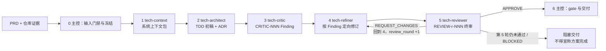

# 编写后端技术方案

根据已通过校验的 PRD 生成可评审、可实现、可验证的中文后端技术方案。五个角色子代理依次接力，**阶段顺序、Finding 闭环和交付门禁由 `scripts/tech_doc_controller.py` 强制判定，不依赖主 Agent 自律**。

**输出语言（本轮第一句回复即生效；只用 `@technical-doc` 等无自然语言方式触发时同样默认简体中文）：**面向用户的说明、状态、评审结论和交付报告使用简体中文；专有名词、参数、代码、命令、路径、DDL、JSON 字段名与状态字面量（如 `BLOCKED`）和原始日志保持英文原文；`technical-doc.md` 正文按下方“方案正文使用中文”及模板契约的既有要求执行。规则原文见 `$SKILLS_ROOT/_shared/prompts/output-language.md`，派发子代理时必须把该规则带进任务正文。

**开始时声明：**“使用 technical-doc skill 生成后端技术方案。”



| 阶段 | 负责角色 | 唯一规范源 |
|------|----------|------------|
| 0 | 主控 Agent | 本文档 |
| 1 | `tech-context` | `agents/tech-context.md` |
| 2 | `tech-architect` | `agents/tech-architect.md` |
| 3 | `tech-critic` | `agents/tech-critic.md` |
| 4 | `tech-refiner` | `agents/tech-refiner.md` |
| 5 | `tech-reviewer` | `agents/tech-reviewer.md` |
| 6 | 主控 Agent | 本文档 |

角色提示词只存在于 `agents/` 下的规范源文件；本文档不复制副本，派发时把对应文件的绝对路径交给该子代理。

## 路径与调用约定

`SKILL_DIR`、`SKILLS_ROOT` 与 `<PYTHON>` 启动器的解析方式，以及派发时必须显式传入的路径清单，见 `$SKILLS_ROOT/_shared/prompts/path-convention.md`；跨宿主具名派发规则与降级门禁见 `$SKILLS_ROOT/_shared/prompts/subagent-mandate.md`。进入阶段 0 前必须读完这两份文件。

本 Skill 的不变式（与共享规范一致，冲突时以本文档为准）：

- 五个角色都是硬性阶段门禁。主控不得代替角色下结论，也不得把自身串行自检伪装成独立审查；无法具名派发时阶段状态为 `BLOCKED`，除非按“降级模式”如实标注。
- 被派发的角色一律不再派发下一级子代理，也不因自身缺少派发能力而返回 `BLOCKED`。
- 方案正文使用中文；代码、DDL、JSON 字段名、类名、表名、接口路径和其他技术标识符保留原文。

### 调用方式

| 宿主 | 调用形式 |
|------|----------|
| Claude Code | `/codekit:technical-doc <feature-directory>` |
| Codex | `$technical-doc <feature-directory>` |
| OpenCode | `/technical-doc <feature-directory>` |

唯一输入参数是当前仓库内的 `<feature-directory>`（例如 `docs/2026-09-09-order-note-sync`）。依赖文档不从参数接收路径，只在该目录按固定文件名查找：输入 PRD `product-doc.md`，输出 TDD `technical-doc.md`；RPD `release-doc.md` 由后续 `release-doc` 生成。

## 不应使用的场景

- 小型 bug 修复或仅修改配置（不需要架构决策）；
- 单行代码修改或拼写修复；
- 仅需解释已有方案、无需形成新设计或变更记录的咨询。

## 确定性控制器

阶段 0 的第一件事是初始化运行目录，后续每一步都用控制器的退出码判定，而不是用主 Agent 的自述：

```bash
STATE=$(<PYTHON> "$SKILL_DIR/scripts/tech_doc_controller.py" init \
  --repo-root "$PWD" --feature-directory "$feature_directory" --run-id "$run_id")
```

| 命令 | 用途 |
|------|------|
| `record-source` / `finalize-inputs` | 登记每项资料的 `source_id`、定位符、`READ/NOT_FOUND/NOT_ACCESSIBLE`、摘要与可信度，并给出 `input_status` |
| `start-stage --to <STAGE>` | 推进阶段状态机；前置证据不足即失败 |
| `record-agent` | 登记一次具名子代理调用（角色、会话标识、输入 digest、状态） |
| `write-artifact` | 把 `context-pack`、`draft`、`critic-findings`、`refiner-map`、`review-report` 落入运行目录 |
| `record-finding` / `record-fix` | 登记 Finding 与逐项处置 |
| `record-review` | 把终审结论与**被审 TDD 的字节快照**绑定 |
| `archive-history` | 把被覆盖的上一版 TDD 归档为独立文件 |
| `gate` / `show` | 交付门禁与运行状态摘要 |

状态与产物落在 `<repo>/.codekit/technical-doc/<run-id>/`（运行时证据目录，不得作为业务变更提交）。**阶段间交接只传文件路径与 digest，不传正文**：子代理自己读文件，主 Agent 不搬运大段文本。

## 阶段 0：输入门禁与冻结

`init` 会拒绝缺失、不可读、无实质内容或以模板占位为主的 `product-doc.md`，并记录其 digest；目录中已有的 `technical-doc.md` 不是阻塞性输入，但会被快照并把运行标记为 `UPDATE`。

冻结每项资料后用 `record-source` 登记，至少覆盖：PRD 与变更台账、仓库规范（`AGENTS.md`、`CLAUDE.md`、README、构建与测试约定）、系统证据（代码、接口契约、Schema/迁移、部署配置、环境变量、监控）、本 Skill 资源、已确认人工决策、既有 TDD。随后 `finalize-inputs`：

- PRD 未被读取 ⇒ 只能 `BLOCKED`，立即停止并说明缺口；
- 存在未读取资料却声明 `PASS` ⇒ 控制器直接失败；
- 非关键缺口可以 `PARTIAL`，但缺口必须随派发输入传给 Architect、Critic、Reviewer 并进入交付报告。

`NOT_FOUND` / `NOT_ACCESSIBLE` 是事实，不是可推测的空位。**上下文不得回流**：`.codekit/` 与上一次运行产出的上下文包不属于“仓库规范”证据，不得读取后当作既有约定使用。

## 阶段 1：Context Loader

只读理解现状，输出带证据路径的**系统上下文包**，落在运行目录并作为 `context-pack` 产物登记；不设计方案、不修改任何代码或仓库配置文件。

输出至少覆盖：技术栈与版本、服务边界与上下游契约、核心领域模型与数据流、现有实现与可复用模式、技术债与瓶颈、规范与约定、约束与风险、待确认事项。每条关键结论标注证据路径或“未发现证据”，禁止臆造版本、容量和运行行为。

规模较大时可并行启动多个 `tech-context` 实例，由主控合并；合并前必须消解冲突、保留各自证据路径并标出无法裁决的事实。

## 阶段 2：Architect

输入为冻结的 PRD 当前有效正文、`【修改】/【新增】/【删除】` 台账、系统上下文包、`references/technical-doc-template.md` 和已确认人工决策。产出 `draft` 产物（TDD 初稿）。

- 先定义 service boundary，再覆盖 PRD 功能与非功能性需求；
- 每个关键选型至少比较 2 个可行方案，说明评价维度、理由、代价与适用边界，并写入 ADR 章节；
- 每个改造点给出“现有方式 → 新方式”对比；DDL 用完整 `CREATE TABLE`（字段、索引、注释）；新 API 给完整 request/response JSON、错误码、鉴权、幂等与兼容说明；
- 未知事实写成 `[需人工确认: xxx]` 并说明它影响哪项决策，不得把推断写成确定结论；
- 模板示例与真实系统冲突时以代码证据为准并删除示例事实。

`gate` 会核对以下章节锚点在 TDD 中确实存在，缺一即 `BLOCKED`：`变更记录`、`需求到设计`（追踪表）、`关键技术决策记录`（ADR）、`风险登记与工作量评估`、`审查闭环记录`；`UPDATE` 运行还必须有 `历史版本索引`。

**模板读取范围**：主控与 Architect 读取完整模板；Critic、Refiner、Reviewer 只读 `references/check-standard.md` 与被审文档，章节齐整性由 `gate` 的锚点检查承担。不得把 48 KB 模板重复注入每一轮每一个角色。

## 阶段 3：Critic

一次性红队对抗审查（红队 + SRE + 成本审计视角），只读，不改写 TDD。Finding 用 `CRITIC-<NNN>` 登记，字段包含严重度（`Blocker/High/Medium/Low`）、影响范围、具体位置、问题与证据、修复建议与验证方式。`Blocker`/`High` 默认 `must_fix`。

必查：PRD 全覆盖、与上下文/契约/约定冲突、最坏情况下的超时/重试/幂等/降级/限流/容灾/补偿、数据泄露/越权/注入/敏感信息落盘/合规审计、运维复杂度与不可控成本、关键选型是否真的比较过备选且 ADR 可追溯。没有问题也必须登记已检查范围与仍需人工确认项。

## 阶段 4：Refiner

只按当前轮 Finding 定向修复，不重新发起架构创作、不引入 Finding 之外的发挥、不删除问题伪造已修复。每个 Finding 必须有一条处置：`FIXED`（给位置、改法、验证方式）、`REJECTED`（仅非 `must_fix`，需证据）或 `PENDING_CONFIRMATION`（仅非 `must_fix`，保留 `[需人工确认: xxx]`）。处置结果落入 TDD 的“审查闭环记录”章节，并登记为 `refiner-map` 产物。

## 阶段 5：Independent Reviewer

`review_round` 表示**已执行的独立终审次数**，取值 1～5。一轮 = “独立 Reviewer 终审 →（`REQUEST_CHANGES` 时）Refiner 定向修订 → 重新派发全新 Reviewer”。

每轮必须由主控新建一个**全新实例**（同一轮内第二个 `tech-reviewer` 实例会被控制器拒绝），并收到：冻结 PRD、上下文包路径、当前 TDD 路径、既有 Finding 清单与处置、`references/check-standard.md`、本轮 `review_round`。Reviewer 只读，不改 TDD、不审代码实现、不调用 `code-review`、不把自身建议直接写入方案。

审查范围：PRD 逐项追踪、模板与仓库事实一致性、图/接口/DDL/状态/正文/ADR 互相对齐、关键选型是否有备选与可执行迁移回滚、安全/容量/可靠性/可观测性/测试/发布门禁是否足够、Finding 是否逐项闭环。

输出 `status: APPROVE | APPROVE_WITH_FOLLOW_UPS | REQUEST_CHANGES | BLOCKED`，新增 Finding 用 `REVIEW-<round>-<NNN>` 登记，结论用 `record-review` 与被审快照绑定。主控不得直接改写 TDD 后宣称 Reviewer 通过。

第 5 轮后仍有 `Blocker`/`High`、状态为 `BLOCKED` 或独立 Reviewer 无法启动时，停止循环并交付阻塞报告，不得继续循环或宣称 TDD 已完成。

## 需求变更识别与 TDD 历史

读取 PRD 后先解析当前有效正文和本轮醒目的 `【修改】/【新增】/【删除】` 台账（`## 变更历史` 只用于追溯），逐项建立 `PRD 变更项 → TDD 章节/模块/API/数据/发布影响` 映射：修改项更新现有设计并保留原需求编号，新增项补充完整设计并使用新编号，删除项从当前有效设计移除或明确兼容/清理方案并保留原编号、删除原因和影响。

PRD 当前版本中用户最新明确的方案和逻辑优先于旧 PRD、旧 TDD、旧评审意见和模型推断。若最新 PRD 与旧 TDD 冲突，以最新 PRD 重算设计、兼容、迁移、测试和发布影响；若代码、接口契约或安全约束使新逻辑不可安全实现，记录 `[需人工确认: ...]` 及证据，不得静默回退旧方案。

`UPDATE` 运行必须在写入新版本前用 `archive-history` 把上一版有效 TDD 归档为运行目录下的独立文件，并在 TDD 文末 `## 变更历史（只追加，不覆盖）` 的“历史版本索引”表中登记归档路径、版本、日期与三类台账摘要。**禁止把旧版正文内嵌进 markdown 围栏**（嵌套围栏会提前截断，且会让文档随每次变更成倍膨胀）；`gate` 会拒绝含嵌套文档围栏的产物。当前正文只保留最新有效方案，历史只追加、不覆盖、不重排。

## 降级模式

宿主确实无法具名派发时，主控可以按阶段串行完成，但必须：

1. 对每个无法派发的角色执行 `degrade --role <name> --reason <原因>`；
2. 在 TDD 的“审查闭环记录”章节写明降级范围与未满足的独立性门禁；
3. 交付状态只能是 `PARTIAL_DEGRADED`，交付报告必须声明“独立审查门禁未满足，结论需人工复核”，不得写成“方案已完成并已通过独立评审”。

## 交付

写入 `<feature-directory>/technical-doc.md`（文件名固定；目录不存在则创建），包含方案正文、ADR、风险登记与工作量评估、审查闭环记录、Finding 处置映射、`review_round` 与最终评审状态，以及（变更时）历史版本索引。

```bash
<PYTHON> "$SKILL_DIR/scripts/tech_doc_controller.py" gate --state "$STATE" \
  --tdd-file "$feature_directory/technical-doc.md"
```

`gate` 是确定性的，覆盖：输入可用性、五个阶段产物是否落盘、独立终审是否执行、**最后一轮终审是否覆盖当前文件字节**（终审之后再改一个字都会被判 `BLOCKED`）、轮次是否越界、`must_fix` Finding 是否全部闭环、每个 Finding 是否有处置、是否仍含模板占位符（`TBD`/`TODO`/`待定`/`待补充`/`后续补充`/`similar to`/`refer to`/`【填写】`/`【链接】`/`YYYY-MM-DD`；唯一允许的未知表达是 `[需人工确认: xxx]`）、必需章节锚点是否齐备、代码围栏是否闭合且语言合法、变更运行是否已归档上一版、是否残留把上下文写回仓库 `AGENTS.md`/`CLAUDE.md` 的痕迹。

`gate` 退出码非 0 时不得写入“方案已完成”，应输出阻塞报告与缺口；退出码 0 且无降级才是“已通过独立终审”。图示一律使用模板规定的 Mermaid fenced code block，简单目录树和数据流用 ASCII art；不依赖任何外部渲染服务。

完成后输出交付报告：方案路径、运行目录、`input_status` 与缺口、需求变更三类数量及映射、旧/新 TDD 版本与归档文件、Critic 与 Reviewer 的 Finding 数量和最高严重度、`review_round` 与最终状态、仍需人工确认事项、`gate` 结果。然后给出下一步：

```text
方案已生成并保存到 `<feature-directory>/technical-doc.md`（gate: PASS）。建议的下一步：

1. `/codekit:release-doc <feature-directory>` — 基于 PRD + TDD 生成发布方案
2. 人工评审 — 先确认 ADR、`[需人工确认: ...]` 项和发布风险
3. `/codekit:code-impl <feature-directory>` — 仅在 PRD/TDD/RPD 三份文档齐备后启动 multi-agent 并行编码
```
