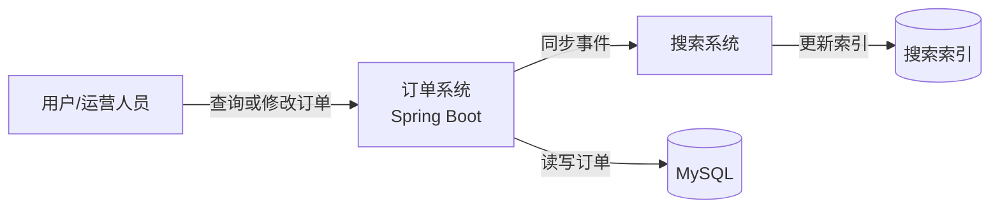
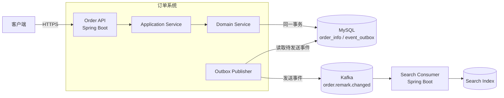
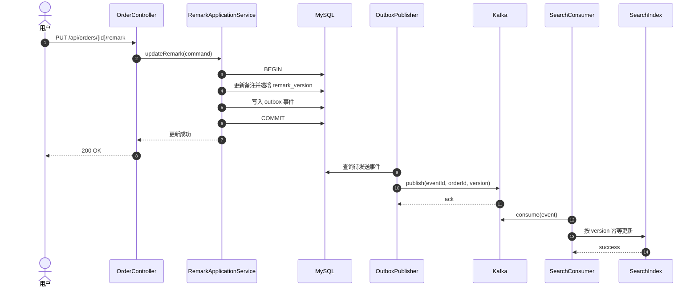
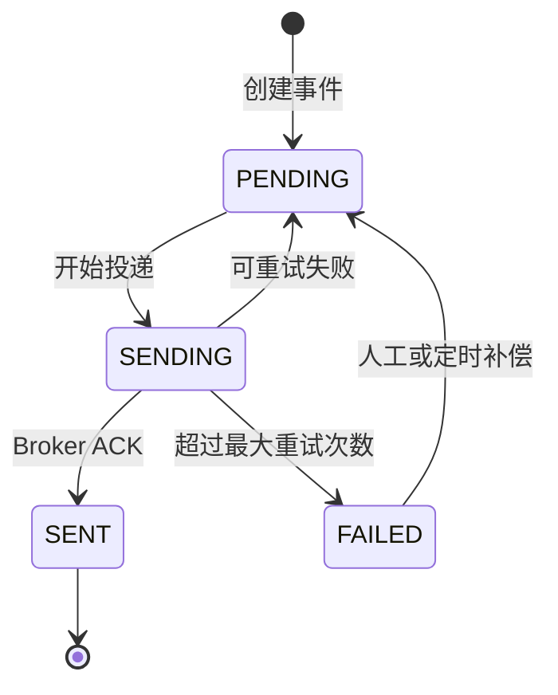
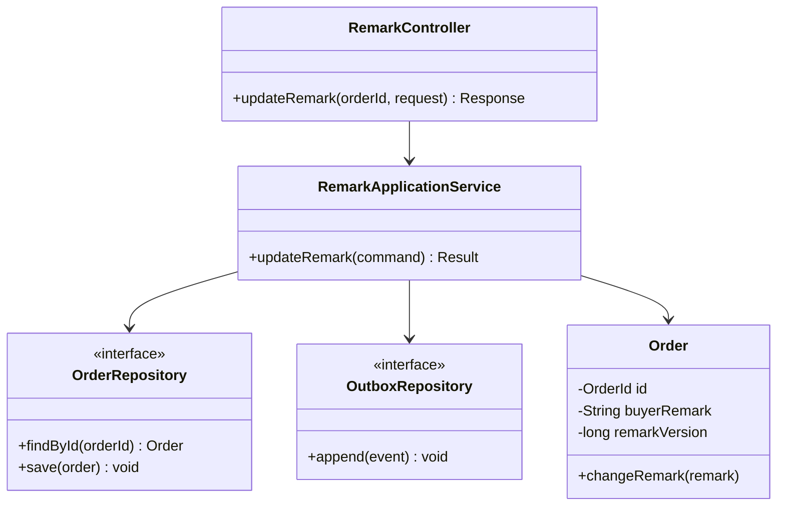
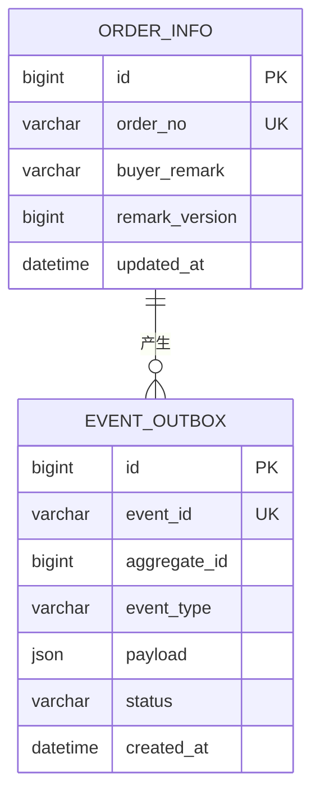
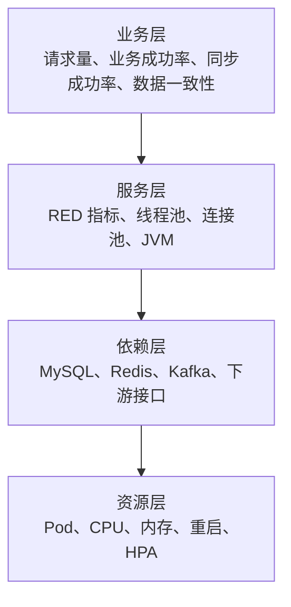
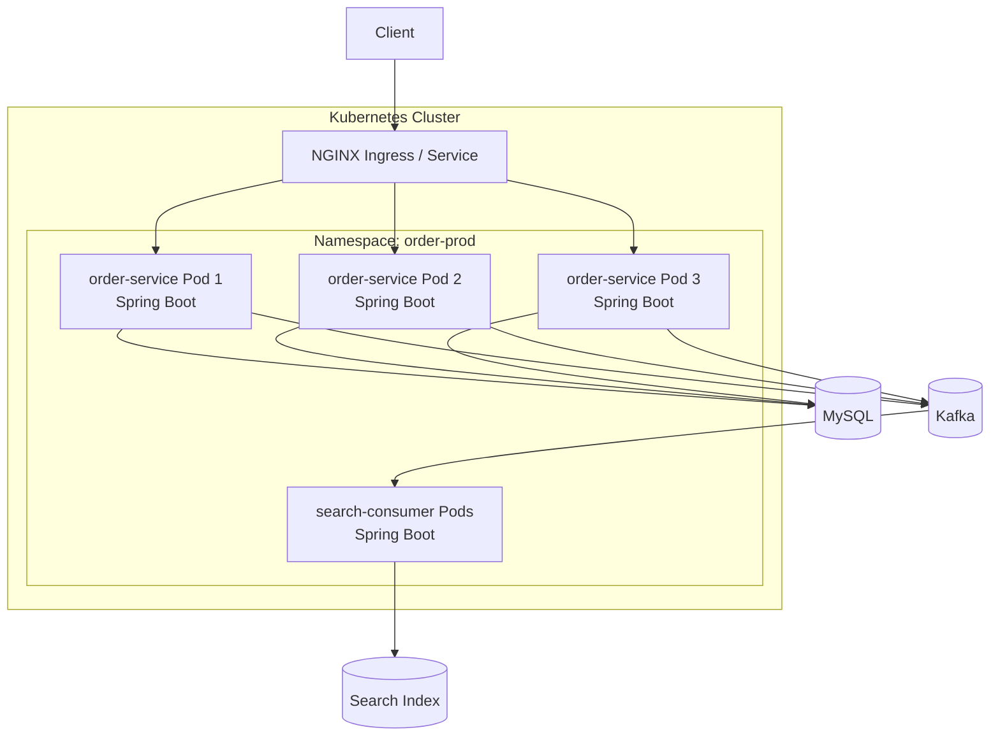

# 后端服务技术方案模板

> 适用范围：互联网项目中采用 Java 技术栈的需求迭代、服务改造、接口变更、数据与中间件变更。
>
> 本文档用于说明“为什么这样设计、如何实现、如何评估以及如何稳定运行”，不重复 Product Requirements Document 中的完整业务需求，也不替代测试方案。
>
> **填写规则：**
> 1. 标记为“必填”的章节不得删除；条件必填章节不涉及时，应保留并填写“**不涉及**”及原因；
> 2. 结论必须可以追溯到需求、代码、接口契约、数据模型或监控证据；
> 3. 图表中的组件、接口和数据名称必须与正文一致；
> 4. 示例内容仅用于说明写法，正式提交时必须替换或删除；
> 5. 方案评审通过后发生关键设计变更，必须更新变更记录并重新评审受影响章节；变更记录必须区分“修改 / 新增 / 删除”。
> 6. 需求变更不得覆盖旧方案：先在运行目录归档上一版正文（`archive-history`），再在文末「变更历史」只追加版本索引与变更台账；不得把旧版正文内嵌进文档围栏。

---

# 文档信息（必填）

| 项目                          | 内容                         |
|-------------------------------|------------------------------|
| 需求名称                      | 【填写】                     |
| Product Requirements Document | 【链接】                     |
| 需求/任务工单                 | 【链接】                     |
| 技术负责人                    | 【填写】                     |
| 参与开发                      | 【填写】                     |
| 测试负责人                    | 【填写】                     |
| 评审人                        | 【填写】                     |
| 文档状态                      | 草稿 / 评审中 / 已通过       |
| 方案规模                      | S / M / L                    |
| 风险等级                      | P1 / P2 / P3                 |
| 计划迭代                      | 【填写】                     |
| 创建日期                      | YYYY-MM-DD                   |
| 最后更新日期                  | YYYY-MM-DD                   |

## 方案裁剪规则

| 规模 | 典型范围                                      | 最低要求                                                                                 |
|------|-----------------------------------------------|------------------------------------------------------------------------------------------|
| S    | 单服务、小范围逻辑调整、无数据结构变化        | 文档信息与变更记录、需求与范围、核心流程、详细设计、ADR、基础兼容性与安全性、基础监控与告警、风险登记与工作量评估、审查闭环记录、评审结论 |
| M    | 跨模块或跨服务、接口/数据库/缓存/MQ 任一变化 | S 级全部内容，并补充总体架构、时序图、完整兼容性矩阵、容量、完整监控大盘与告警、部署拓扑   |
| L    | 核心链路、架构调整、大规模迁移或高风险变更    | M 级全部内容，并补充容量测算、故障处置、安全专项设计、数据演进和跨团队关键技术决策依据       |

规模归属不是作者偏好：`finalize-inputs` 用冻结 PRD 正文与仓库实测判定命中的变更类别（数据 / 接口 / 消息 / 定时 / 配置），0 类为 `S`、1～3 类为 `M`、≥4 类为 `L`，结论写入 `state.json` 并登记在第 16 章“运行元数据”台账，文档信息表的“方案规模”一格照抄该结论。`gate` 的 `scale-chapters` 按上表机械核对，分两档：任何规模下“最低要求”点名的章节都要在位；`M`/`L` 级的监控大盘设计、告警设计、部署拓扑必须有实质设计，写“不涉及”或短于一节最低标准即 `BLOCKED`。被命中类别对应的 `条件必填` 章节（§6 接口与契约、§7 数据库、§8 消息、§9 定时任务、§10 配置与依赖）保留“不涉及 + 原因”的退路——只写结论不给原因同样阻塞。判定确实错了时写 `[需人工确认: 规模应为 X，理由…]` 并照常按判定的规模写，不要自行下调后交付。

## 技术栈适配规则

本模板以 Java / Dubbo / Nacos / XXL-JOB / Prometheus 举例，但章节语义与技术栈无关：

| 模板章节 | 必填语义 | 非 Java 仓库的处理 |
|----------|----------|--------------------|
| 5. Java 详细设计 | 分层与职责、核心类型、事务边界、并发与幂等、异常模型 | 替换为实际语言栈的等价章节名（如 Go 包与接口设计、Python 模块与依赖注入），**语义仍为必填** |
| 6. 接口与契约设计 | 契约差异、请求/响应、错误码、鉴权、幂等 | HTTP 部分不变；Dubbo/RPC/WebSocket 子节按实际中间件替换或填“不涉及”及原因 |
| 9. 定时任务设计 | 调度、并发保护、失败重试、可观测 | 无定时任务时填“不涉及”及原因 |
| 10. 配置与依赖设计 | 配置来源、灰度开关、依赖与漏洞治理 | 用实际的配置中心/依赖管理工具替换 Nacos、Maven 表述 |

替换后必须把章节标题写回真实技术栈，并删除与本仓库无关的示例事实；不得为了套用模板而引入不存在的组件。

## 变更记录

| 版本 | 日期       | 修改人   | 变更类型 | 变更内容 | 评审影响             |
|------|------------|----------|----------|----------|----------------------|
| 0.1  | YYYY-MM-DD | 【填写】 | 新增     | 初稿     | 首次评审             |
| 0.2  | YYYY-MM-DD | 【填写】 | 修改 / 新增 / 删除 | 【填写】 | 无 / 需要重新评审    |

## 图表使用规范

| 图表 | 推荐规范 | 用途 | 适用条件 | 本模板示例 |
|------|----------|------|----------|------------|
| 系统上下文图 | C4 System Context | 说明用户、目标系统和外部系统边界 | M/L 必填，S 按需 | 2.2 |
| 目标架构图 | C4 Container/Component | 说明服务、组件、存储和中间件关系 | M/L 必填 | 3.3 |
| 时序图 | UML Sequence Diagram | 说明跨组件调用顺序、事务边界和异常分支 | 存在跨组件调用时必填 | 4.1 |
| 状态图 | UML State Machine | 说明有限状态及合法迁移 | 存在业务状态机时必填 | 4.3 |
| 业务流程图 | UML Activity/Flowchart | 说明复杂规则、判断和业务分支 | 分支复杂时填写 | 4.4 |
| 类图 | UML Class Diagram | 说明核心类型、接口及依赖关系 | M/L 或核心模型调整时填写 | 5.3 |
| 数据模型图 | ER Diagram（Crow's Foot） | 说明实体、字段及基数关系 | 涉及数据模型时必填 | 7.1 |
| 部署图 | UML Deployment/C4 Deployment | 说明运行单元、网络边界和基础设施 | M/L 必填 | 14 |

> C4 是一种分层描述软件架构的方法：System Context 说明系统与用户、外部系统的关系；Container 说明应用、服务、数据库和消息中间件；Component 说明单个服务内部的主要组件；Code 才进入类和代码细节。本模板主要使用前三层，并用 Mermaid 表达。图表应便于在 Git 中评审和追踪变更；架构图不混入方法级细节，时序图不代替业务流程图，ER 图中的字段名必须与数据库设计一致。复杂图应拆分，不使用一张图同时表达系统上下文、部署拓扑和调用时序。

---

# 1. 需求理解与范围（必填）

## 1.1 背景与问题

> 用 1～3 段描述当前问题、业务价值和为什么需要在本迭代解决。避免复制完整需求原文。

【填写】

## 1.2 目标

> 目标应具体且可衡量，优先使用量化指标。

- 【目标 1，例如：订单备注更新后 5 秒内同步至搜索索引，成功率不低于 99.9%】
- 【目标 2】

## 1.3 非目标

> 明确本次不解决的内容，控制敏捷迭代边界。

- 【非目标 1】
- 【非目标 2】

## 1.4 影响范围

| 类型         | 对象                          | 影响说明     | 是否兼容 | 负责人   |
|--------------|-------------------------------|--------------|----------|----------|
| 服务         | 【服务名称】                  | 【填写】     | 是 / 否  | 【填写】 |
| HTTP/Dubbo   | 【接口名称/URL】              | 【填写】     | 是 / 否  | 【填写】 |
| 数据库       | 【库表】                      | 【填写】     | 是 / 否  | 【填写】 |
| Redis        | 【Key】                       | 【填写】     | 是 / 否  | 【填写】 |
| Kafka/MQ     | 【Topic / Consumer Group】    | 【填写】     | 是 / 否  | 【填写】 |
| 配置/任务    | 【Nacos Data ID / XXL-JOB】   | 【填写】     | 是 / 否  | 【填写】 |
| 外部依赖     | 【系统/服务】                 | 【填写】     | 是 / 否  | 【填写】 |

## 1.5 约束与假设

- Java/JDK 版本：【填写，例如：JDK 21】
- Spring Boot 版本：【填写】
- 构建工具：【Maven / Gradle】
- 运行环境：【Kubernetes / VM / 其他】
- 合规、安全或数据约束：【填写/不涉及】
- 已确认假设：【填写】
- 待确认事项：【填写/无】

---

# 2. 现状分析（必填）

## 2.1 当前流程

【填写当前实现、痛点和限制】

## 2.2 当前系统上下文图

> 推荐使用 C4 System Context 的表达方式：突出系统边界、用户和外部依赖，不展开类或方法细节。



> 示例说明：正式方案应将节点替换为真实系统，并标明关键协议，例如 HTTPS、Dubbo、Kafka。

## 2.3 现状问题与根因

| 问题 | 现象/证据 | 根因 | 影响 | 本次是否解决 |
|------|-----------|------|------|--------------|
| 【填写】 | 【日志、指标或工单】 | 【填写】 | 【填写】 | 是 / 否 |

---

# 3. 方案概述（必填）

## 3.1 设计摘要

> 用 3～8 条说明核心设计，不在此展开代码级细节。

1. 【核心设计 1】
2. 【核心设计 2】
3. 【核心设计 3】

## 3.2 设计原则

- 向后兼容：新旧版本并存期间，接口、数据和消息可互操作；
- 单一职责：领域逻辑、应用编排和基础设施访问边界清晰；
- 失败可恢复：明确超时、重试、幂等、补偿和降级；
- 可观测：关键路径具备日志、Metrics、Trace 和业务指标；
- 可测试：核心逻辑可单测，外部契约可集成或契约测试；
- 可演进：接口、数据库及消息结构支持兼容性演进，避免一次性破坏性变更。

## 3.3 目标架构图

> 推荐使用 C4 Container/Component 风格。图中应表达服务、存储、中间件和外部依赖，不要绘制无关基础设施。



## 3.4 需求到设计追踪

| 需求点 | 设计决策 | 代码模块 | 数据/接口影响 | 设计依据 |
|--------|----------|----------|---------------|----------|
| STORY-001     | 【填写】 | 【填写】 | 【填写】      | 【填写】 |

## 3.5 关键技术决策记录（ADR）（必填）

> 每个新增框架、中间件、存储、协议、异步模型或数据一致性方案都必须有一条 ADR。
> 至少比较 2 个可行方案，写清评价维度、选择理由、代价和适用边界；被放弃的选项同样要记录，
> 便于后续复盘“当时为什么没选另一条路”。证据不足时写成假设，不要写成确定结论。

| 编号 | 背景 | 决策 | 候选方案与对比 | 后果与代价 | 证据或假设 | 需人工确认 |
|------|------|------|----------------|------------|------------|------------|
| ADR-001 | 【填写】 | 【填写】 | 方案 A：优点/缺点；方案 B：优点/缺点 | 【填写】 | 【代码路径/契约/监控或显式假设】 | 【无 / 具体事项】 |

---

# 4. 核心流程设计（必填）

## 4.1 主流程时序图

> 时序图用于表达跨对象或跨服务调用顺序、事务边界和失败分支。参与者名称应与架构图一致。



## 4.2 异常与补偿流程

| 异常点 | 检测方式 | 超时 | 重试策略 | 幂等依据 | 最终失败处理 | 告警 |
|--------|----------|------|----------|----------|--------------|------|
| 【填写】 | 【填写】 | 【填写】 | 【次数/退避】 | 【业务键】 | 【DLQ/异常表/人工补偿】 | 【规则】 |

## 4.3 状态机（条件必填）

> 存在明确业务状态和状态迁移时必须提供。状态名称应与代码枚举和数据库字段一致。



## 4.4 业务决策流程图（条件必填）

> 分支较多或规则复杂时使用流程图；简单判断不必为了画图而画图。


---

# 5. Java 详细设计（必填）

## 5.1 工程与模块

| 仓库 | Maven/Gradle 模块 | 包路径 | 职责 | 变更类型 |
|------|-------------------|--------|------|----------|
| 【填写】 | 【填写】 | `com.example.order.application` | 【填写】 | 新增 / 修改 / 删除 |

## 5.2 分层与职责

| 层/组件 | 类或接口 | 职责 | 依赖约束 |
|---------|----------|------|----------|
| Adapter/API | `RemarkController` | 参数校验、协议转换 | 不包含领域规则 |
| Application | `RemarkApplicationService` | 用例编排、事务边界 | 调用领域和端口 |
| Domain | `Order` / `RemarkPolicy` | 领域状态与规则 | 不依赖 Spring 基础设施实现 |
| Infrastructure | `OrderRepositoryImpl` | MySQL 持久化 | 实现领域端口 |

## 5.3 核心类图

> 类图只展示本次设计的核心类、接口和关系，不要复制完整代码结构。



## 5.4 核心方法与伪代码

```java
@Transactional
public UpdateRemarkResult updateRemark(UpdateRemarkCommand command) {
    Order order = orderRepository.findById(command.orderId())
            .orElseThrow(OrderNotFoundException::new);
    order.changeRemark(command.buyerRemark());
    orderRepository.save(order);
    outboxRepository.append(OrderRemarkChanged.from(order));
    return UpdateRemarkResult.from(order);
}
```

> 示例说明：正式方案优先描述关键约束、事务和异常语义，不需要粘贴可从 MR 直接阅读的大段实现代码。

## 5.5 事务边界

| 用例 | 事务入口 | 事务内操作 | 事务外操作 | 隔离级别 | 失败行为 |
|------|----------|------------|------------|----------|----------|
| 【填写】 | 【方法】 | 【DB 操作】 | 【RPC/MQ】 | 【填写】 | 【事务回滚/业务补偿】 |

## 5.6 并发、幂等与一致性

| 场景 | 并发风险 | 控制方式 | 幂等键/版本号 | 一致性模型 | 冲突处理 |
|------|----------|----------|---------------|------------|----------|
| 备注重复请求 | 重复写入和重复事件 | 乐观锁 + Outbox | requestId / eventId / remarkVersion | 最终一致 | 旧版本事件丢弃并记录 |

## 5.7 异常模型

| 异常类型 | Java 异常 | 错误码 | HTTP/RPC 状态 | 是否重试 | 日志级别 | 对外信息 |
|----------|-----------|--------|---------------|----------|----------|----------|
| 参数错误 | `InvalidRemarkException` | `INVALID_REMARK` | HTTP 400 | 否 | WARN | 不暴露内部实现 |

---

# 6. 接口与契约设计（条件必填）

## 6.1 HTTP API

> 推荐维护 OpenAPI 3.x 契约，并在此处提供链接和关键差异。不得只写 Controller 方法名。

| 类型 | Method | Path | 调用方 | 鉴权 | 幂等 | 超时 | 兼容性 |
|------|--------|------|--------|------|------|------|----------|
| 新增 | PUT | `/api/orders/{orderId}/remark` | Web/App | 登录态 | `requestId` | 1s | 新增接口 |

### 请求示例

```json
{
  "buyerRemark": "请在工作日配送",
  "requestId": "req-20260825-0001"
}
```

### 响应示例

```json
{
  "success": true,
  "orderId": "O202608250001",
  "remarkVersion": 3
}
```

### 接口语义

- 字段缺失、`null`、空字符串的含义：【填写】
- 长度、格式与枚举约束：【填写】
- 重复请求处理：【填写】
- 错误码及调用方处理：【填写】
- 新旧客户端兼容策略：【填写】

## 6.2 Dubbo/RPC（条件必填）

| 接口 | 方法 | Maven 坐标/版本 | 调用方 | 超时 | 重试 | 兼容与降级 |
|------|------|-----------------|--------|------|------|------------|
| 【填写/不涉及】 | 【填写】 | 【填写】 | 【填写】 | 【填写】 | 【填写】 | 【填写】 |

## 6.3 WebSocket（条件必填）

| Endpoint | 消息方向 | 消息类型 | 鉴权 | 心跳 | 重连/补偿 | 兼容策略 |
|----------|----------|----------|------|------|-----------|----------|
| 【填写/不涉及】 | 上行 / 下行 | 【填写】 | 【填写】 | 【填写】 | 【填写】 | 【填写】 |

---

# 7. 数据库设计（条件必填）

## 7.1 数据模型与 ER 图



## 7.2 MySQL 变更

| 库表 | 变更类型 | 字段/索引 | 数据量/增长量 | 读写路径 | 兼容策略 |
|------|----------|-----------|---------------|----------|----------|
| `order_info` | ADD COLUMN | `buyer_remark varchar(256) NULL` | 【填写】 | 订单读写 | 旧版本忽略新增列 |

### DDL 示例

```sql
ALTER TABLE order_info
    ADD COLUMN buyer_remark VARCHAR(256) NULL COMMENT '买家备注',
    ADD COLUMN remark_version BIGINT NOT NULL DEFAULT 0 COMMENT '备注版本号';
```


## 7.3 Redis 设计

| Key 模式 | Type | Value 结构 | TTL | 一致性策略 | 大 Key/热 Key 风险 | 失效与异常处理 |
|----------|------|------------|-----|------------|-------------------|----------|
| 【填写/不涉及】 | 【填写】 | 【填写】 | 【填写】 | Cache Aside / 其他 | 【填写】 | 【填写】 |

## 7.4 数据生命周期

| 数据 | 来源 | 保存位置 | 保留期限 | 归档/清理 | 脱敏/加密 | 数据负责人 |
|------|------|----------|----------|-----------|-----------|------------|
| 【填写】 | 【填写】 | 【填写】 | 【填写】 | 【填写】 | 【填写/不涉及】 | 【填写】 |

---

# 8. 消息设计（条件必填）

## 8.1 Producer

| Topic | Key/分区键 | 消息版本 | Ack | 顺序要求 | 发送可靠性 | 停止生产方式 |
|-------|------------|----------|-----|----------|------------|--------------|
| `order.remark.changed` | `orderId` | v1 | all | 同订单有序 | Transactional Outbox | 关闭投递任务 |

## 8.2 Consumer

| Topic | Consumer Group | 起始位置 | 幂等依据 | 重试 | DLQ | 堆积处理 | 停止/恢复方式 |
|-------|----------------|----------|----------|------|-----|----------|---------------|
| `order.remark.changed` | `order-search-remark-sync` | 已提交 offset | eventId + remarkVersion | 3 次指数退避 | 保留 14 天 | 扩容并定点重放 | 保存 offset 后暂停 |

## 8.3 消息契约示例

```json
{
  "schemaVersion": 1,
  "eventId": "evt-20260825-0001",
  "orderId": "O202608250001",
  "buyerRemark": "请在工作日配送",
  "remarkVersion": 3,
  "occurredAt": "2026-08-25T10:30:00+08:00"
}
```

---

# 9. 定时任务设计（条件必填）

## 9.1 XXL-JOB/定时任务

| 任务 | Handler | Cron | 分片/并发策略 | 幂等 | 超时 | 重试 | 正常运行状态 |
|------|---------|------|---------------|------|------|------|--------------|
| 【填写/不涉及】 | 【填写】 | 【填写】 | 【填写】 | 【填写】 | 【填写】 | 【填写】 | 开启 / 暂停 |

---

# 10. 配置与依赖设计（条件必填）

## 10.1 Nacos/环境配置

| Data ID/变量 | 所属服务 | 配置项 | 默认值 | 生效方式 | 敏感信息 | 确认方式 | 恢复方式 |
|-------------|----------|--------|--------|----------|----------|----------|----------|
| 【填写/不涉及】 | 【填写】 | 【填写】 | 【填写】 | 动态刷新 / 重启 | 是 / 否 | 【填写】 | 【填写】 |

## 10.2 Maven/Gradle 依赖

| 坐标 | 原版本 | 目标版本 | 引入原因 | License/CVE | 兼容性 |
|------|--------|----------|----------|-------------|--------|
| 【填写/不涉及】 | 【填写】 | 【填写】 | 【填写】 | 【填写】 | 【填写】 |

## 10.3 外部服务依赖

| 依赖方 | 协议 | 用途 | SLA | 超时 | 重试 | 熔断/降级 | 依赖不可用影响 |
|--------|------|------|-----|------|------|-----------|----------------|
| 【服务/不涉及】 | HTTP / Dubbo | 【填写】 | 【填写】 | 【填写】 | 【填写】 | 【填写】 | 【填写】 |

---

# 11. 非功能设计（必填）

## 11.1 性能与容量

| 指标 | 当前基线 | 预计增量 | 设计目标 | 测算依据 | 评估方式 |
|------|----------|----------|----------|----------|----------|
| QPS/TPS | 【填写】 | 【填写】 | 【填写】 | 【流量数据】 | 压测/监控 |
| P95/P99 | 【填写】 | 【填写】 | 【填写】 | 【填写】 | 压测/监控 |
| 数据增长 | 【填写】 | 【填写】 | 【填写】 | 【填写】 | SQL/容量看板 |
| Kafka Lag | 【填写/不涉及】 | 【填写】 | 【填写】 | 【填写】 | 压测/监控 |

### 容量计算

```text
峰值 QPS = 历史峰值 QPS × 业务增长系数 × 活动放大系数
所需实例数 = ceil(峰值 QPS / 单实例安全 QPS) + 冗余实例数
Kafka 日增量 = 峰值消息速率 × 平均消息大小 × 有效运行时间
```

## 11.2 可用性与韧性

| 故障场景 | 预防措施 | 检测方式 | 自动恢复 | 降级/补偿 | RTO/RPO |
|----------|----------|----------|----------|-----------|---------|
| 下游超时 | 超时、隔离线程池、熔断 | Metrics/Trace | 熔断恢复 | 返回缓存或受控失败 | 【填写】 |
| Pod 重启 | readiness、优雅停机 | K8S/Actuator | Deployment 拉起 | 重试/幂等 | 【填写】 |

## 11.3 安全性设计

> S 级方案至少说明认证、授权、输入校验和敏感信息处理；涉及用户资产、资金、管理后台、个人信息或跨租户数据时，按 L 级补充安全专项设计。

| 安全域 | 设计内容 | Java/Spring 实现 | 威胁与边界 | 设计依据 |
|--------|----------|------------------|------------|----------|
| 身份认证 | 【登录态、Token、服务身份/不涉及】 | Spring Security / OAuth2 Resource Server / 其他 | 伪造身份、凭据泄漏 | 【填写】 |
| 权限控制 | 【角色、资源归属、数据权限】 | Method Security / Filter / Domain Policy | 越权、跨租户访问 | 【填写】 |
| 输入安全 | 长度、格式、枚举、文件及表达式限制 | Jakarta Validation + 业务规则 | 注入、反序列化、资源耗尽 | 【填写】 |
| 输出安全 | 错误信息收敛、字段过滤、安全响应头 | ExceptionHandler / Jackson View / Header | 内部信息泄漏 | 【填写】 |
| 敏感数据 | 传输加密、存储加密、展示与日志脱敏 | TLS、KMS、脱敏组件 | 隐私和密钥泄漏 | 【填写/不涉及】 |
| 凭据管理 | 密钥、证书和密码只从受控 Secret 获取 | K8S Secret / Vault / 其他 | 硬编码、误提交 | 【填写】 |
| 依赖安全 | JDK、Spring、Maven 依赖漏洞和 License 管理 | SCA/SBOM/依赖锁定 | 已知漏洞、供应链风险 | 【填写】 |
| 审计 | 记录操作者、对象、动作、结果和时间 | 审计事件/审计表 | 抵赖、无法追踪 | 【填写/不涉及】 |

### 安全数据流

| 数据 | 来源 | 信任边界 | 处理方式 | 存储位置 | 日志策略 | 保留期限 |
|------|------|----------|----------|----------|----------|----------|
| 【填写】 | 【填写】 | 内部 / 外部 / 跨租户 | 【校验、脱敏、加密】 | 【填写】 | 【记录字段与禁止字段】 | 【填写】 |

## 11.4 兼容性设计

> 兼容性从调用方向和数据方向分别说明。只写“兼容”不构成设计结论，必须说明字段、默认值、版本或降级语义。

| 对象 | 旧调用方/旧数据 → 新实现 | 新调用方/新数据 → 旧实现 | 兼容结论 | 兼容策略与依据 |
|------|--------------------------|--------------------------|----------|----------------|
| HTTP API | 【填写】 | 【填写】 | 兼容 / 不兼容 / 不涉及 | 新增字段可选、默认值、错误码语义等 |
| Dubbo/RPC | 【填写】 | 【填写】 | 兼容 / 不兼容 / 不涉及 | 接口签名、DTO、枚举、Maven 版本等 |
| WebSocket | 【填写】 | 【填写】 | 兼容 / 不兼容 / 不涉及 | 消息类型、字段及客户端能力协商等 |
| MySQL Schema | 【填写】 | 【填写】 | 兼容 / 不兼容 / 不涉及 | Expand/Contract、NULL/默认值、读写路径等 |
| Redis | 【填写】 | 【填写】 | 兼容 / 不兼容 / 不涉及 | Key 版本、Value 新旧格式、TTL 等 |
| Kafka/MQ | 【填写】 | 【填写】 | 兼容 / 不兼容 / 不涉及 | schemaVersion、可选字段、枚举和顺序规则等 |
| Nacos/环境变量 | 【填写】 | 【填写】 | 兼容 / 不兼容 / 不涉及 | 默认值、动态刷新和缺失配置行为等 |
| Maven/第三方依赖 | 【填写】 | 【填写】 | 兼容 / 不兼容 / 不涉及 | API/ABI、传递依赖和运行时版本等 |

### 不兼容项处理

| 不兼容项 | 影响对象 | 技术原因 | 隔离或演进方式 | 负责人 |
|----------|----------|----------|----------------|--------|
| 【填写/无】 | 【填写】 | 【填写】 | 版本化接口 / 双读写 / 适配层 / 其他 | 【填写】 |


---

# 12. 监控大盘设计（必填）

> 监控大盘用于持续回答“系统是否健康、用户是否受影响、问题位于哪里”。大盘必须同时覆盖业务、应用和依赖层，不能只展示 CPU、内存等资源指标。

## 12.1 可观测性信号

| 类型 | 名称/字段/维度 | 用途 | 数据源 | 保留时间 | 负责人 |
|------|----------------|------|--------|----------|--------|
| Metrics | `order_remark_update_total{result,version}` | 计算备注更新量与成功率 | Micrometer/Prometheus | 【填写】 | 【填写】 |
| Metrics | `order_remark_sync_delay_seconds` | 观察端到端同步延迟 | Micrometer/Prometheus | 【填写】 | 【填写】 |
| Logging | requestId、traceId、orderId、eventId、remarkVersion | 定位单次请求和消息链路，备注正文必须脱敏 | ELK/Loki | 【填写】 | 【填写】 |
| Tracing | HTTP → MySQL → Kafka → Consumer → Index | 定位跨服务耗时和错误节点 | OpenTelemetry/Tempo/Jaeger | 【填写】 | 【填写】 |
| Profiling | CPU、锁、分配、热点方法 | 定位持续性能问题 | Arthas/async-profiler/其他 | 【填写/不涉及】 | 【填写】 |

## 12.2 大盘基本信息

| 项目 | 内容 |
|------|------|
| 大盘名称 | 【填写，例如：订单备注链路监控】 |
| 平台 | Grafana / 其他 |
| 大盘链接 | 【链接/待创建】 |
| 适用环境 | 生产 / 预发 / 测试 |
| 默认时间范围 | 【例如：最近 6 小时】 |
| 默认刷新间隔 | 【例如：30 秒】 |
| 数据延迟 | 【填写，例如：Prometheus ≤ 30 秒，日志 ≤ 2 分钟】 |

## 12.3 大盘分层



## 12.4 大盘面板

| 分组 | 面板 | 指标/查询 | 聚合与维度 | 正常基线/SLO | 展示方式 | 下钻链接 |
|------|------|-----------|------------|--------------|----------|----------|
| 业务 | 备注更新成功率 | `sum by (service, version) (rate(order_remark_update_total{result="success"}[5m])) / sum by (service, version) (rate(order_remark_update_total[5m]))` | service、version | ≥ 99.9% | Stat + Time series | 【日志/Trace】 |
| 业务 | 端到端同步延迟 P99 | `histogram_quantile(0.99, sum by (le, service, version) (rate(order_remark_sync_delay_seconds_bucket[5m])))` | service、version | ≤ 5s | Time series | 【Trace】 |
| HTTP | 请求量/错误率/P99 | Spring Boot HTTP Server Metrics | URI 模板、status、version | 【填写】 | Time series | 【Trace】 |
| JVM | Heap/GC/线程 | JVM Micrometer Metrics | pod、version | 【填写】 | Time series | 【Pod】 |
| 线程池 | Active/Queue/Rejected | 自定义 Executor Metrics | pool、pod | 【填写】 | Time series | 【日志】 |
| 数据库 | 连接池/慢 SQL/锁等待 | HikariCP + MySQL Exporter | instance、schema | 【填写】 | Time series/Table | 【DB 看板】 |
| Kafka | 发送失败/Lag/重试/DLQ | Producer/Consumer Metrics | topic、group、partition | 【填写】 | Time series/Table | 【消息平台】 |
| K8S | Pod Ready/重启/CPU/内存 | kube-state-metrics/cAdvisor | namespace、workload、pod、version | 【填写】 | Time series | 【K8S】 |

> PromQL 示例中的指标名和 Label 必须以项目实际埋点为准。HTTP 指标必须按 URI 模板聚合，禁止使用 orderId、userId、requestId 等高基数字段作为 Metric Label。

## 12.5 SLI/SLO

> **SLI（Service Level Indicator，服务水平指标）**是系统实际测得的服务质量，例如请求成功率、P99 延迟或规定时间内完成同步的比例。
>
> **SLO（Service Level Objective，服务水平目标）**是指定统计窗口内期望 SLI 达到的目标，例如“滚动 30 天内，订单备注同步成功率不低于 99.9%”。
>
> **Error Budget（错误预算）**是 SLO 允许未达到目标的空间，用于衡量服务质量余量：

```text
允许失败比例 = 100% - SLO
允许失败数量 = 有效请求或事件总数 × 允许失败比例

示例：SLO = 99.9%，30 天内共有 1,000,000 次有效请求
允许失败比例 = 0.1%
Error Budget = 1,000 次
```

| 概念 | 回答的问题 | 示例 |
|------|------------|------|
| 监控指标 | 当前运行数据是多少？ | 当前成功率 99.95%、P99 180ms |
| SLI | 用户实际获得的服务质量是多少？ | 5 秒内完成同步的事件占比为 99.95% |
| SLO | 指定周期内服务质量至少应达到多少？ | 滚动 30 天内同步及时率 ≥ 99.9% |
| Error Budget | 允许消耗多少未达目标的空间？ | 100 万次有效事件最多允许 1,000 次未及时同步 |

| 服务能力 | SLI 定义 | SLO | 统计窗口 | 排除项 | Error Budget |
|----------|----------|-----|----------|--------|--------------|
| 备注更新接口 | 成功请求数 / 有效请求总数 | 成功率 ≥ 99.9% | 滚动 30 天 | 明确的客户端参数错误 | 有效请求总数 × 0.1% |
| 备注同步 | 5 秒内完成同步的事件数 / 有效事件总数 | 及时率 ≥ 99.9% | 滚动 30 天 | 经审批的数据修复任务 | 有效事件总数 × 0.1% |

### 适用范围

- 核心接口、资金链路、高流量服务：应定义明确的 SLI、SLO、统计窗口和 Error Budget；
- 普通业务功能：可只定义成功率、延迟或处理及时率等简化目标；
- 后台工具、低频管理接口：确实不需要独立服务目标时填写“**不涉及**”并说明原因；
- SLI/SLO 描述的是持续运行质量，不等同于测试结论或方案评审结论。

---

# 13. 告警设计（必填）

> 告警必须可行动：接收人看到告警后，应能判断影响、定位入口并执行 Runbook。单次瞬时抖动、没有负责人或没有处理动作的信号不应直接发送人员告警。

## 13.1 告警分级

| 级别 | 定义 | 通知方式 | 响应目标 | 示例 |
|------|------|----------|----------|------|
| P1 | 核心业务不可用、数据严重错误或影响快速扩大 | 电话/值班系统 + IM | 立即响应 | 核心接口大面积失败、数据持续错写 |
| P2 | 关键能力明显降级，存在用户影响但可暂时运行 | 值班系统 + IM | 【例如：10 分钟】 | 成功率持续下降、Kafka Lag 持续增长 |
| P3 | 容量趋势或局部异常，需要工作时间处理 | IM/工单 | 【例如：1 个工作日】 | 磁盘容量趋势、低频重试增加 |

## 13.2 告警规则

| 告警名称 | 级别 | 监控对象 | 条件 | 持续时间 | 恢复条件 | 接收人 | Runbook | 大盘 |
|----------|------|----------|------|----------|----------|--------|---------|------|
| 备注更新成功率下降 | P2 | order-service | 按 service、version 计算的成功率 < 99.5%，且请求速率 ≥ 1 req/s | 5m | 连续 10m ≥ 99.9% | 【团队】 | 【链接】 | 【链接】 |
| 备注同步延迟超标 | P2 | 同步链路 | P99 > 5s | 10m | 连续 10m ≤ 5s | 【团队】 | 【链接】 | 【链接】 |
| Consumer Lag 持续增长 | P2 | Topic/Group | Lag >【阈值】且增长率 > 0 | 10m | Lag 回落至【阈值】以下 | 【团队】 | 【链接】 | 【链接】 |
| DLQ 新增 | P2 | DLQ | 5m 增量 > 0 | 1m | 明确停止新增且完成处置 | 【团队】 | 【链接】 | 【链接】 |
| DLQ 快速增长 | P1 | DLQ | 5m 增量 ≥【数量】 | 1m | 明确停止新增且完成处置 | 【团队】 | 【链接】 | 【链接】 |
| Pod 不可用 | P2 | K8S Workload | Ready 副本数 < 期望副本数 | 5m | 副本数恢复 | 【团队】 | 【链接】 | 【链接】 |
| JVM 内存风险 | P3/P2 | Spring Boot Pod | Old Gen/Heap >【阈值】并伴随 Full GC | 【时间】 | 连续【时间】恢复 | 【团队】 | 【链接】 | 【链接】 |

## 13.3 Prometheus 告警规则示例

```yaml
groups:
  - name: order-remark
    rules:
      - alert: OrderRemarkSuccessRateLow
        expr: |
          (
            sum by (service, version) (
              rate(order_remark_update_total{result="success"}[5m])
            )
            /
            sum by (service, version) (
              rate(order_remark_update_total[5m])
            ) < 0.995
          )
          and on (service, version)
          (
            sum by (service, version) (
              rate(order_remark_update_total[5m])
            ) >= 1
          )
        for: 5m
        labels:
          severity: P2
          team: order
        annotations:
          summary: "{{ $labels.service }} {{ $labels.version }} 订单备注更新成功率低于 99.5%"
          dashboard: "【Grafana 链接】"
          runbook: "【Runbook 链接】"
```

> 示例以 1 req/s 作为最低流量门槛。正式规则应根据业务基线调整门槛，SLO 场景可改用 Error Budget Burn Rate。Label 中不得包含用户数据或动态业务 ID。

## 13.4 告警路由、聚合与抑制

### 告警标签规范

告警规则应提供稳定、可路由的标签；Pod 名、实例 IP、orderId、userId 等动态值只放在通知详情中，不作为聚合键。

| 标签 | 是否必填 | 用途 | 示例 |
|------|----------|------|------|
| `alertname` | 是 | 标识告警类型 | `OrderRemarkSuccessRateLow` |
| `severity` | 是 | 决定通知渠道和响应优先级 | `P1`、`P2`、`P3` |
| `team` | 是 | 路由到责任团队 | `order` |
| `service` | 应用告警必填 | 标识受影响服务 | `order-service` |
| `environment` | 是 | 区分生产、预发等环境 | `prod` |
| `cluster` | K8S 告警必填 | 标识 K8S 集群 | `sh-prod-01` |
| `namespace` | 工作负载告警必填 | 标识 K8S Namespace | `order-prod` |
| `version` | 条件必填 | 定位是否集中于特定应用版本 | `2026.08.25-1` |
| `dependency` | 依赖告警必填 | 标识 MySQL、Kafka 等依赖对象 | `mysql-order-primary` |
| `node` | 节点告警必填 | 标识 K8S Node | `worker-01` |
| `topic` | Kafka Topic 告警必填 | 标识 Topic | `order-remark-changed` |

> `environment`、`cluster` 等公共标签可由监控平台统一注入；`service`、`version` 等业务标签由指标或告警规则提供。送达告警平台前必须保证路由所需标签齐全。

### 路由与通知策略

| 级别 | 首次通知 | 通知渠道 | 未恢复重复通知 | 升级条件 | 接收人 |
|------|----------|----------|----------------|----------|--------|
| P1 | 立即 | 电话/值班系统 + IM | 【例如：10 分钟】 | 【例如：5 分钟未确认则升级至团队负责人】 | 【主值班/备值班/负责人】 |
| P2 | 【例如：1 分钟内】 | 值班系统 + IM | 【例如：30 分钟】 | 【例如：10 分钟未确认或影响扩大则升级】 | 【值班组】 |
| P3 | 【例如：5 分钟内】 | IM/工单 | 【例如：4 小时】 | 【例如：持续 24 小时或趋势恶化则升级】 | 【责任团队】 |

> 路由顺序应从具体到通用：环境 → 级别 → 团队 → 服务，最后进入默认兜底接收组。任何生产告警都不得因标签缺失而被丢弃。

### 聚合策略

| 项目 | 设计 |
|------|------|
| 聚合键 | `cluster`、`namespace`、`team`、`service`、`alertname` |
| 不参与聚合 | `pod`、`instance`、`container`、动态业务 ID |
| 首次等待 `group_wait` | 【例如：30 秒；P1 可缩短】 |
| 同组新增通知 `group_interval` | 【例如：5 分钟】 |
| 重复通知 `repeat_interval` | 按 P1/P2/P3 分别配置，见路由表 |
| 通知详情 | 展示受影响实例数量和列表，保留单实例下钻入口 |

### 抑制关系

| 根因告警（source） | 被抑制的症状告警（target） | 相等标签 | 解除条件 |
|--------------------|----------------------------|----------|----------|
| K8S 集群不可用 | 同集群内的节点、Pod 不可用和探针失败 | cluster | 根因告警恢复 |
| K8S 节点不可用 | 同节点上的 Pod 不可用和探针失败 | cluster、node | 根因告警恢复 |
| MySQL 实例不可用 | 同实例引发的连接池耗尽、数据库超时 | environment、dependency | 根因告警恢复 |
| Kafka 集群或 Topic 不可用 | Producer 发送失败、Consumer Lag 增长 | environment、cluster、topic | 根因告警恢复 |
| 同一对象的 P1 告警 | 同一对象的 P2/P3 症状告警 | environment、cluster、namespace、service | P1 告警恢复 |

> 抑制只减少重复通知，不应改变告警状态或隐藏大盘数据。无法可靠确认根因关联时，不配置抑制。

### 静默与恢复通知

| 项目 | 要求 |
|------|------|
| 创建静默 | 必须填写原因、精确匹配范围、负责人、关联工单和截止时间 |
| 静默范围 | 禁止仅按 `severity`、`team` 等宽泛标签静默；优先精确到 alertname、service、environment、cluster |
| 最长时限 | 【填写，例如：P1/P2 最长 2 小时，P3 最长 24 小时】 |
| 到期处理 | 默认自动到期；仍需静默时重新评估并创建新记录 |
| 恢复通知 | 包含开始/恢复时间、持续时长、峰值、受影响范围、大盘和事件记录链接 |
| 状态闭环 | 告警确认、转派、升级、静默和恢复均保留操作记录 |

### 通知内容规范

每条人员告警至少包含：告警名称与级别、当前值与阈值、首次触发时间、持续时长、影响对象、环境/集群/服务/版本、可能的用户影响、大盘链接、日志或 Trace 入口、Runbook 链接、静默入口和责任团队。通知标题应能在不打开详情的情况下区分环境、服务和问题类型。

## 13.5 告警 Runbook

> 每一条 P1/P2 人员告警必须关联可访问的 Runbook。Runbook 面向当班人员编写，应使用明确的查询入口和操作命令，不能只写“联系开发”或“查看日志”。所有止损操作都应注明适用条件、风险、权限要求和恢复方式。

### Runbook 基本信息

| 项目 | 内容 |
|------|------|
| Runbook 名称 | 【与告警名称一致】 |
| 关联告警 | 【alertname/告警规则链接】 |
| 适用环境 | 【生产/预发/其他】 |
| 服务与负责人 | 【service/team/Owner】 |
| 最后维护时间 | 【yyyy-MM-dd】 |
| 大盘/日志/Trace/K8S | 【填写可直接访问的链接】 |
| 依赖平台 | 【MySQL/Kafka/Redis/搜索引擎/其他】 |
| 所需权限 | 【只读权限/运维操作权限/其他】 |

### Runbook 维护要求

| 项目 | 要求 |
|------|------|
| 存放方式 | 纳入版本管理或知识库，保留修改记录并使用稳定链接 |
| 更新触发 | 告警指标、阈值、应用架构、依赖、平台入口或权限发生变化时同步更新 |
| 事件反馈 | 每次实际处置后补充缺失步骤、无效查询、异常分支和风险提示 |
| 定期演练 | 【填写周期】选择代表性的 P1/P2 Runbook 进行桌面推演或预发演练 |
| 失效处理 | 链接不可访问、操作已失效或负责人缺失时创建任务并限期修复 |

### 标准处置流程

| 阶段 | 必须回答的问题 | 操作要求 | 产出 |
|------|----------------|----------|------|
| 1. 确认 | 告警是否仍在持续？谁负责处理？ | 确认告警并指定单一负责人；P1 建立事件协作群 | 负责人、事件链接 |
| 2. 判断影响 | 哪些用户、接口、版本、Pod 或数据受到影响？ | 查看业务 SLI、请求量、错误率、延迟和受影响对象 | 影响范围与开始时间 |
| 3. 定位 | 问题位于应用、K8S 资源还是外部依赖？ | 按大盘 → 日志 → Trace → Pod → 依赖顺序缩小范围 | 初步根因与证据 |
| 4. 止损 | 如何在不扩大影响的前提下降低损失？ | 仅执行 Runbook 预定义动作；记录操作人、时间、参数和结果 | 止损动作记录 |
| 5. 恢复 | 指标是否达到本告警的恢复条件？是否仍有积压或错误数据？ | 持续观察规定时间，处理积压、DLQ 或待补偿数据 | 恢复时间与遗留项 |
| 6. 跟进 | 是否需要修复缺陷、调整阈值或更新 Runbook？ | 关联事件记录和后续任务，补充本次新增的定位经验 | 任务负责人和期限 |

### Runbook 操作项模板

| 序号 | 判断条件 | 查询/操作 | 预期结果 | 异常分支 | 风险与恢复方式 |
|------|----------|-----------|----------|----------|----------------|
| 1 | 【填写】 | 【大盘、日志查询或只读命令】 | 【填写】 | 【不符合时转到步骤 N】 | 无状态变更 |
| 2 | 【填写】 | 【止损操作；注明权限和审批要求】 | 【填写】 | 【失败时的升级路径】 | 【副作用及恢复操作】 |
| 3 | 【填写】 | 【积压或错误数据处置】 | 【填写】 | 【人工介入条件】 | 【重复执行和幂等要求】 |

### 示例：订单备注更新成功率下降

**告警信息**

| 项目 | 内容 |
|------|------|
| 告警 | `OrderRemarkSuccessRateLow`（P2） |
| 触发条件 | 按 service、version 计算成功率低于 99.5%，请求速率不低于 1 req/s，持续 5 分钟 |
| 恢复条件 | 成功率连续 10 分钟不低于 99.9% |
| 主要影响 | 用户可能无法新增或修改订单备注；数据库与搜索索引可能出现短时不一致 |
| 处置负责人 | order 团队值班人员 |

**处置步骤**

| 序号 | 判断与操作 | 预期结果 | 异常分支/止损动作 |
|------|------------|----------|-------------------|
| 1 | 打开订单备注大盘，按 `service`、`version`、状态码和异常类型查看成功率、请求量与 P99 | 确认告警仍在持续，并识别是否集中于特定版本或错误类型 | 若请求速率低于门槛，检查指标缺失或规则计算问题，转交监控平台负责人 |
| 2 | 查看 Spring Boot 异常日志和 Trace，使用 requestId/traceId 关联 HTTP、MySQL、Kafka 和搜索同步链路 | 找到主要异常类型及首次出现时间 | 无统一异常时，按 URI、Pod 和版本继续拆分 |
| 3 | 查看 K8S Workload 的 Ready 副本、重启次数、CPU、内存、GC、线程池和连接池 | 排除或确认 Pod 资源、进程和连接池问题 | 单 Pod 异常时，先从流量中隔离该 Pod；操作需遵循平台权限和变更记录要求 |
| 4 | 查看 MySQL 连接、慢 SQL、锁等待及 Kafka 发送失败指标 | 确认是否由外部依赖引起 | 依赖故障时转交对应负责人，并通过抑制规则减少下游重复通知 |
| 5 | 若失败请求会造成数据库已写入但消息未发送，查询补偿记录、发送重试和 DLQ | 得到待补偿 orderId/eventId 清单 | 暂停自动补偿仅限持续产生错误数据的情况，并记录位点、数量和恢复条件 |
| 6 | 在根因消除后恢复被隔离实例或被暂停能力，处理待补偿记录并观察成功率、同步延迟、Lag 和 DLQ | 达到恢复条件，且积压持续下降、DLQ 不再新增 | 指标再次恶化时撤销最近操作并升级为 P1/P2 事件 |
| 7 | 记录影响范围、根因、操作时间线和遗留数据，创建后续任务 | 告警、事件和后续任务形成闭环 | 发现步骤缺失时同步更新 Runbook |

**禁止事项**

- 未确认影响范围前，不批量删除 Pod、不清空 Kafka offset、不跳过消息；
- 未保存清单和位点前，不丢弃重试、补偿或 DLQ 数据；
- 不在日志、IM 或事件记录中粘贴备注正文、令牌、密码等敏感信息；
- 不通过无限延长静默代替故障处置。


---

# 14. 部署拓扑（M/L 必填）

> 部署图只展示运行单元、网络边界和基础设施关系。



---

# 15. 风险登记与工作量评估（必填）

> 风险不少于 2 条，且必须是本方案上线后真实可能发生的后果，不是通用风险清单的复读。
> 工作量按模块拆分并标注前后依赖，供排期与 code-impl 任务拆分直接引用。

## 15.1 风险登记

| 编号 | 风险与最坏后果 | 触发条件 | 等级 | 缓解措施 | 止损与恢复方式 | 责任方 |
|------|----------------|----------|------|----------|----------------|--------|
| RISK-001 | 【填写】 | 【填写】 | P1 / P2 / P3 | 【填写】 | 【填写】 | 【填写】 |

## 15.2 工作量与依赖

| 模块 | 工作内容 | 工作量（人日） | 前置依赖 | 验证方式 |
|------|----------|----------------|----------|----------|
| 【填写】 | 【填写】 | 【填写】 | 【无 / 依赖项】 | 【填写】 |

---

# 16. 审查闭环记录（必填）

> 本章的两个台账由确定性控制器生成，不要手写、也不要把 `state.json` 的内容复制进来：
> 每次 `record-finding`／`record-fix` 之后，由主控执行 `tech_doc_controller.py render-ledger`
> （见 `SKILL.md` 命令表），它会在下列标记之间写入 Finding 处置映射与运行元数据。
>
> - 门禁 `ledger-blocks-present` 要求标记存在，`ledger-matches-state` 要求标记之间的内容与
>   `.codekit/technical-doc/<run-id>/state.json` 完全一致；手改标记内内容、漏掉一条 Finding、
>   或在标记之外另抄一份台账，都会阻塞交付。
> - 标记不能被放进代码围栏，也不要在本章重复给出 Finding 列表。
> - 正文仍由各角色撰写：处置理由写进对应设计章节，本章只回答“哪些 Finding、如何处置、如何验证”。

<!-- codekit:technical-doc:ledger:findings:start -->
（由 `render-ledger` 生成，勿手改）
<!-- codekit:technical-doc:ledger:findings:end -->

<!-- codekit:technical-doc:ledger:run-metadata:start -->
（由 `render-ledger` 生成，勿手改）
<!-- codekit:technical-doc:ledger:run-metadata:end -->

---

# 评审检查与结论（必填）

## 评审检查清单

| 检查项 | 结论 | 证据/说明 |
|--------|------|-----------|
| 需求目标、范围和非目标明确 | 【通过/不通过】 | 【填写】 |
| 核心流程和异常流程完整 | 【通过/不通过】 | 【填写】 |
| Java 模块、事务、异常和并发设计明确 | 【通过/不通过】 | 【填写】 |
| HTTP、RPC、数据、消息、配置和依赖的双向兼容性已说明 | 【通过/不通过/不涉及】 | 【填写】 |
| 认证、授权、输入输出、敏感数据、凭据和依赖安全设计完整 | 【通过/不通过/不涉及】 | 【填写】 |
| 性能、容量和可用性目标明确且可衡量 | 【通过/不通过】 | 【填写】 |
| 日志、Metrics、Trace 和告警设计完整 | 【通过/不通过】 | 【填写】 |
| 关键选型均有 ADR，且记录了被放弃的选项、代价与证据或假设 | 【通过/不通过】 | 【填写】 |
| Critic 与独立 Reviewer 的 Finding 已逐项闭环，无挂起的阻断/高危项 | 【通过/不通过】 | 【填写】 |
| 监控大盘、告警规则和 Runbook 完整可用 | 【通过/不通过】 | 【填写】 |

## 评审意见

| 序号 | 意见 | 级别 | 提出人 | 负责人 | 处理结论 | 状态 |
|-----:|------|------|--------|--------|----------|------|
| 1 | 【填写】 | 阻断 / 建议 | 【填写】 | 【填写】 | 【填写】 | 待处理 / 已关闭 |

## 评审结论

| 项目 | 内容 |
|------|------|
| 评审结论 | 通过 / 有条件通过 / 不通过 |
| 遗留条件 | 【填写/无】 |
| 技术负责人确认 | 【填写】 |
| 架构/资深开发确认 | 【填写/不涉及】 |
| 确认日期 | YYYY-MM-DD |

> 只有阻断意见全部关闭，且技术设计、监控和告警内容完整时，方案才能进入“已通过”状态。

---

## 变更历史（只追加，不覆盖；需求变更时必填）

> 需求变更时，先把上一版有效 TDD 归档为运行目录下的独立文件
> （`tech_doc_controller.py archive-history`），并在 INPUT 阶段用
> `finalize-inputs --prd-changes 修改数/新增数/删除数`（如 `3/1/0`）登记这次需求变更的规模；
> 本节索引由 `tech_doc_controller.py render-ledger` 依据这两条记录生成。
> **不要**把旧版正文粘贴进本文档——包裹旧正文的 markdown 围栏会被旧版内的 mermaid/sql
> 围栏提前截断，且文档会随每次变更成倍膨胀。不得覆盖、删除或重排已有历史、评审处理记录和发布结果。

### 历史版本索引

索引是本节唯一的一份；不要在别处再抄一份归档清单，也不要手改标记之间的表格。

<!-- codekit:technical-doc:ledger:history-index:start -->
（由 `render-ledger` 生成，只追加不手改；未发生需求变更时保留“无历史版本”）
<!-- codekit:technical-doc:ledger:history-index:end -->

---
