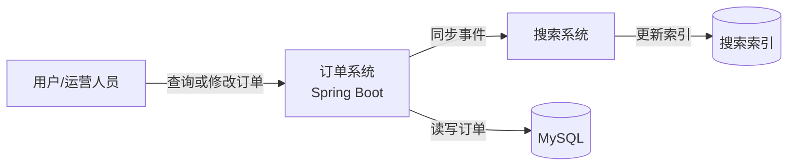
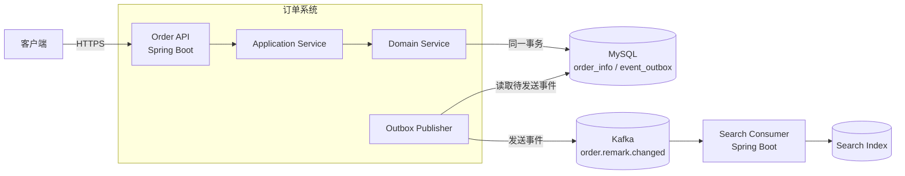
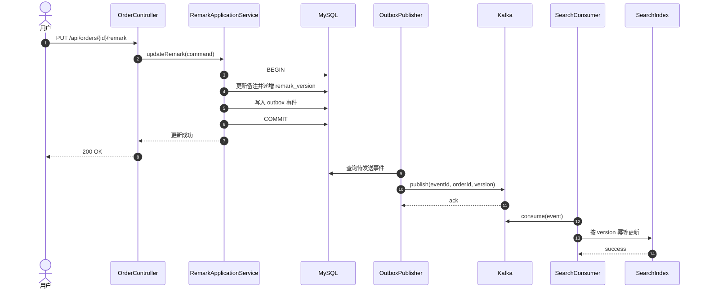
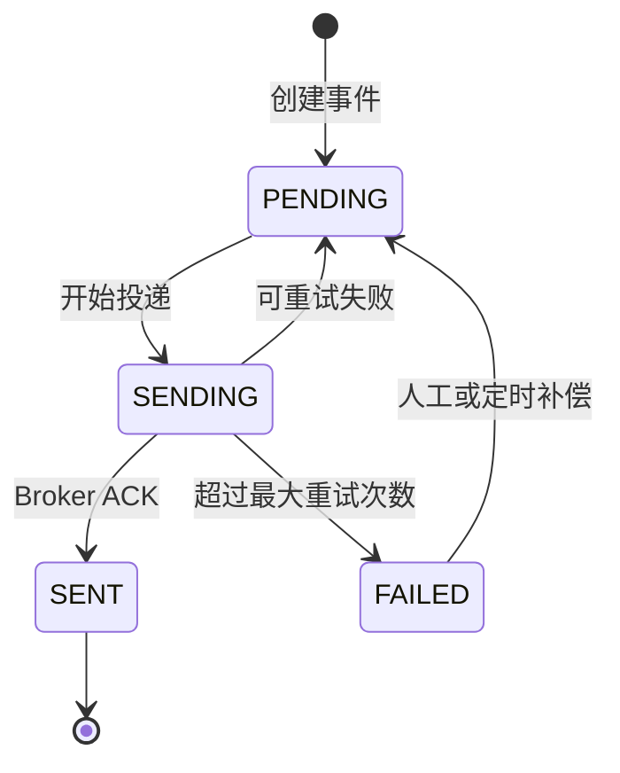
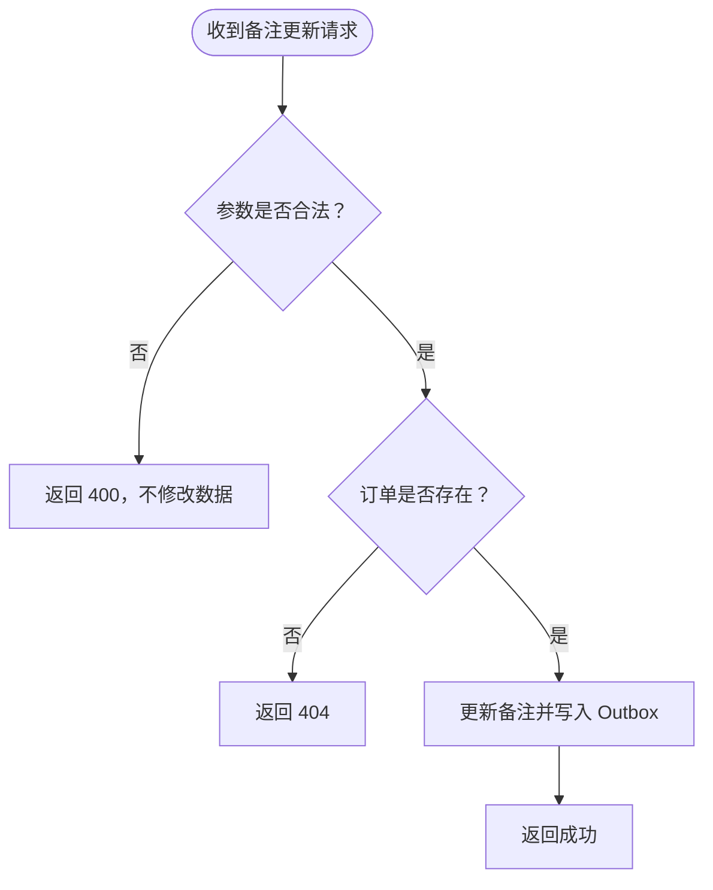
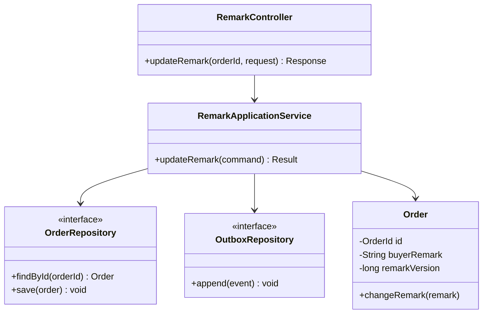
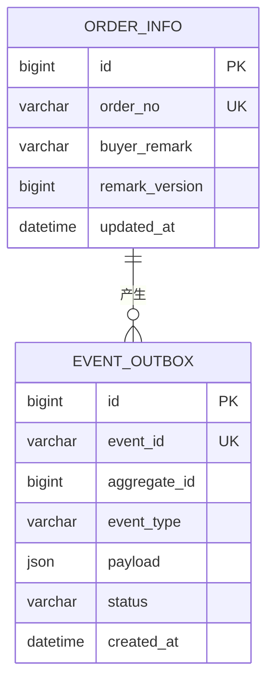
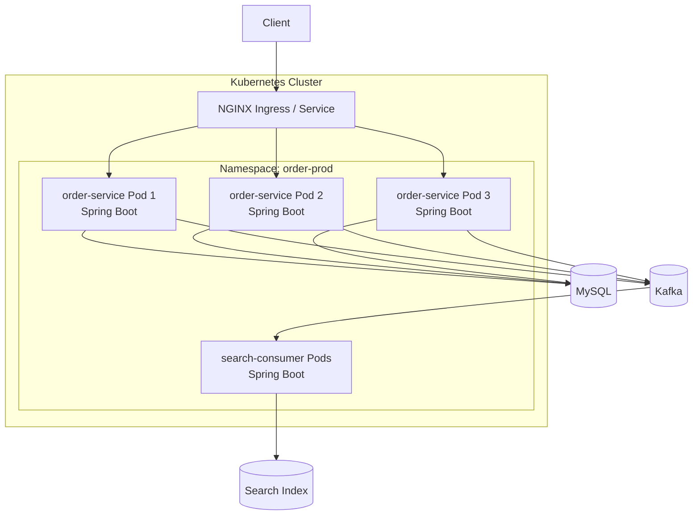

# 后端服务技术方案模板

> 适用范围：互联网项目的需求迭代、服务改造、接口变更、数据与中间件变更。
>
> 本文档用于说明“为什么这样设计、如何实现、如何评估以及如何稳定运行”，不重复 Product Requirements Document 中的完整业务需求，也不替代测试方案。
>
> **填写规则：**
> 1. 标记为“必填”的章节不得删除；标题未标注必填/条件必填/级别必填的章节，默认按必填处理；条件必填章节按需求实际情况判定——确实涉及的必填，不涉及时保留章节并填写“**不涉及**”及原因；
> 2. 结论必须可以追溯到需求、代码、接口契约、数据模型或监控证据；
> 3. 图表中的组件、接口和数据名称必须与正文一致；
> 4. 示例内容仅用于说明写法，正式提交时必须替换或删除；
> 5. 方案评审通过后发生关键设计变更，必须更新变更记录并重新评审受影响章节；变更记录必须区分“修改 / 新增 / 删除”。
> 6. 需求变更不得覆盖旧方案：先在运行目录归档上一版正文（`archive-history`），再在文末「变更历史」只追加版本索引与变更台账；不得把旧版正文内嵌进文档围栏。

---

# 文档信息

| 项目          | 内容                   |
|---------------|------------------------|
| 需求名称      | 【填写】               |
| 产品设计文档  | 【链接】               |
| 需求/任务工单 | 【链接】               |
| 技术负责人    | 【填写】               |
| 参与开发      | 【填写】               |
| 测试负责人    | 【填写】               |
| 评审人        | 【填写】               |
| 文档状态      | 草稿 / 评审中 / 已通过 |
| 方案规模      | S / M / L              |
| 风险等级      | P1 / P2 / P3           |
| 计划迭代      | M1 、M2 、 M3 、 M4    |
| 创建日期      | YYYY-MM-DD             |
| 最后更新日期  | YYYY-MM-DD             |

## 方案裁剪规则

| 规模 | 典型范围                                      | 最低要求                                                                                 |
|------|-----------------------------------------------|------------------------------------------------------------------------------------------|
| S    | 单服务、小范围逻辑调整、无数据结构变化        | 文档信息与变更记录、需求与范围、核心流程、详细设计、ADR、基础兼容性与安全性、基础监控与告警、里程碑规划（风险登记与工作量）、审查闭环记录、评审结论 |
| M    | 跨模块或跨服务、接口/数据库/缓存/MQ 任一变化 | S 级全部内容，并补充总体架构、时序图、完整兼容性矩阵、容量、完整监控大盘与告警   |
| L    | 核心链路、架构调整、大规模迁移或高风险变更    | M 级全部内容，并补充部署拓扑、容量测算、故障处置、安全专项设计、数据演进和跨团队关键技术决策依据       |

规模归属不是作者偏好：`finalize-inputs` 用冻结 PRD 正文与仓库实测判定命中的变更类别（数据 / 接口 / 消息 / 定时 / 配置），0 类为 `S`、1～3 类为 `M`、≥4 类为 `L`，结论写入 `state.json` 并登记在“审查闭环记录”章节的“运行元数据”台账，文档信息表的“方案规模”一格照抄该结论。`gate` 的 `scale-chapters` 按上表机械核对，分两档：任何规模下“最低要求”点名的章节都要在位；`M`/`L` 级的可观测设计必须有实质设计，`L` 级的部署拓扑同样，写“不涉及”或短于一节最低标准即 `BLOCKED`。被命中类别对应的 `条件必填` 章节（接口与契约设计、数据库设计、消息设计、定时任务设计、环境配置设计）保留“不涉及 + 原因”的退路——只写结论不给原因同样阻塞。判定确实错了时挂一条 `需人工确认` marker（写法与登记见 SKILL 的“人工确认循环”：正文一行、条目先登记进 `confirmation-log.md`）并照常按判定的规模写，不要自行下调后交付；正文里出现没有条目对应的 marker，`gate` 的 `markers-match-confirmations` 会直接判 `BLOCKED`，所以本模板不把该格式的示例原样写在这里。


## 变更记录

| 版本 | 日期       | 修改人   | 变更类型 | 变更内容 | 评审影响             |
|------|------------|----------|----------|----------|----------------------|
| 0.1  | YYYY-MM-DD | 【填写】 | 新增     | 初稿     | 首次评审             |
| 0.2  | YYYY-MM-DD | 【填写】 | 修改 / 新增 / 删除 | 【填写】 | 无 / 需要重新评审    |

## 图表使用规范

| 图表 | 推荐规范 | 用途 | 适用条件 | 本模板示例 |
|------|----------|------|----------|------------|
| 系统上下文图 | C4 System Context | 说明用户、目标系统和外部系统边界 | M/L 必填，S 按需 | 现状分析·当前系统上下文图 |
| 目标架构图 | C4 Container/Component | 说明服务、组件、存储和中间件关系 | M/L 必填 | 方案概述·目标架构图 |
| 时序图 | UML Sequence Diagram | 说明跨组件调用顺序、事务边界和异常分支 | 存在跨组件调用时必填 | 核心流程设计·主流程时序图 |
| 状态图 | UML State Machine | 说明有限状态及合法迁移 | 存在业务状态机时必填 | 核心流程设计·状态机 |
| 业务流程图 | UML Activity/Flowchart | 说明复杂规则、判断和业务分支 | 分支复杂时填写 | 核心流程设计·业务决策流程图 |
| 类图 | UML Class Diagram | 说明核心类型、接口及依赖关系 | M/L 或核心模型调整时填写 | 详细设计·核心类图 |
| 数据模型图 | ER Diagram（Crow's Foot） | 说明实体、字段及基数关系 | 涉及数据模型时必填 | 数据库设计·相关ER 图 |
| 部署图 | UML Deployment/C4 Deployment | 说明运行单元、网络边界和基础设施 | M/L 必填 | 部署拓扑 |

> C4 是一种分层描述软件架构的方法：System Context 说明系统与用户、外部系统的关系；Container 说明应用、服务、数据库和消息中间件；Component 说明单个服务内部的主要组件；Code 才进入类和代码细节。本模板主要使用前三层，并用 Mermaid 表达。图表应便于在 Git 中评审和追踪变更；架构图不混入方法级细节，时序图不代替业务流程图，ER 图中的字段名必须与数据库设计一致。复杂图应拆分，不使用一张图同时表达系统上下文、部署拓扑和调用时序。

---

# 需求理解与范围
## 背景与问题
> 用 1～3 段描述当前问题、业务价值和为什么需要在本迭代解决。避免复制完整需求原文。

【填写】

## 范围与边界
> 用 1～3 段描述当前问题边界。

【填写】

## 约束与假设
- 合规、安全或数据约束：【填写/不涉及】
- 已确认假设：【填写】
- 待确认事项：【填写/无】

---

# 现状分析

## 当前流程
> 填写当前实现、痛点和限制

【填写】

## 当前系统上下文图
> 推荐使用 C4 System Context 的表达方式：突出系统边界、用户和外部依赖，不展开类或方法细节。
> 示例说明：正式方案应将节点替换为真实系统，并标明关键协议，例如 HTTPS、Dubbo、Kafka。

示例：




## 当前问题与根因
示例：

| 问题            | 现象/证据 | 根因 | 影响 | 本次是否解决 |
|-----------------|-----------|------|------|--------------|
| 【填写/不涉及】 | 【日志、指标或工单】 | 【填写】 | 【填写】 | 是 / 否 |

---

# 方案概述

## 技术栈
- 编程语言及版本（比如jdk25、python3.12.0）；
- 语言框架及版本（比如Spring Boot 3.1.2、FastAPI）；
- 构建工具及版本（比如Maven 3.8.4、Poetry）；
- 运行环境（比如Kubernetes 1.23.4、VMware 6.5、Docker 20.10.7）；
- 数据库及版本（比如MySQL 5.7、SQLLite 7）；
- 中间件及版本（比如Redis 6.2.6、Kafka 3.0.0）；
- 其他有必要列出的技术工具；

## 影响范围
示例：

| 类型                 | 对象                       | 影响说明     | 是否兼容 | 负责人   |
|----------------------|----------------------------|--------------|----------|----------|
| 服务                 | 【服务名称】               | 【填写】     | 是 / 否  | 【填写】 |
| HTTP/Dubbo/Websocket | 【接口名称/URL】           | 【填写】     | 是 / 否  | 【填写】 |
| 数据库               | 【库表】                   | 【填写】     | 是 / 否  | 【填写】 |
| 缓存                 | 【Key】                    | 【填写】     | 是 / 否  | 【填写】 |
| 消息队列             | 【Topic / Consumer Group】 | 【填写】     | 是 / 否  | 【填写】 |
| 环境配置             | 【Nacos Data ID】          | 【填写】     | 是 / 否  | 【填写】 |
| 定时任务             | 【XXL-JOB】                | 【填写】     | 是 / 否  | 【填写】 |
| 外部依赖             | 【系统/服务】              | 【填写】     | 是 / 否  | 【填写】 |


## 设计摘要

> 按以下原则进行设计。不在此展开代码级细节。
>   - 向后兼容：新旧版本并存期间，接口、数据和消息可互操作；
>   - 单一职责：领域逻辑、应用编排和基础设施访问边界清晰；
>   - 失败可恢复：明确超时、重试、幂等、补偿和降级；
>   - 可观测：关键路径具备日志、Metrics、Trace 和业务指标；
>   - 可测试：核心逻辑可单测，外部契约可集成或契约测试；
>   - 可演进：接口、数据库及消息结构支持兼容性演进，避免一次性破坏性变更。

1. 【核心设计 1】
2. 【核心设计 2】
3. 【核心设计 3】


## 目标架构图
> 推荐使用 C4 Container/Component 风格。图中应表达服务、存储、中间件和外部依赖，不要绘制无关基础设施。

示例：




## 关键技术决策
> 每个新增框架、中间件、存储、协议、异步模型或数据一致性方案都必须有一条 ADR。
> 至少比较 2 个可行方案，写清评价维度、选择理由、代价和适用边界；被放弃的选项同样要记录，
> 便于后续复盘“当时为什么没选另一条路”。证据不足时写成假设，不要写成确定结论。

示例：

| 编号 | 背景 | 决策 | 候选方案与对比 | 后果与代价 | 证据或假设 | 需人工确认 |
|------|------|------|----------------|------------|------------|------------|
| ADR-001 | 【填写】 | 【填写】 | 方案 A：优点/缺点；方案 B：优点/缺点 | 【填写】 | 【代码路径/契约/监控或显式假设】 | 【无 / 具体事项】 |

---

# 核心流程设计

## 主流程时序图

> 时序图用于表达跨对象或跨服务调用顺序、事务边界和失败分支。参与者名称应与架构图一致。

示例：


## 失败补偿流程（条件必填）
示例：

| 异常点 | 检测方式 | 超时 | 重试策略 | 幂等依据 | 最终失败处理 | 告警 |
|--------|----------|------|----------|----------|--------------|------|
| 【填写】 | 【填写】 | 【填写】 | 【次数/退避】 | 【业务键】 | 【DLQ/异常表/人工补偿】 | 【规则】 |

## 状态机（条件必填）
> 存在明确业务状态和状态迁移时必须提供。状态名称应与代码枚举和数据库字段一致。

示例：



## 业务决策流程图（条件必填）

> 分支较多或规则复杂时使用流程图；简单判断不必为了画图而画图。

示例：



---

# 详细设计

## 工程与模块

本章只有两条分支，走哪条不由撰写者自选：`finalize-inputs` 的规模探针按 `git ls-files` 实测给出
`greenfield`（跳过仓库根下的 `doc/`、`docs/` 之后，既无源码也无工程清单，且未登记已读取的系统证据/
既有 TDD），`gate` 的 `project-structure-branch` 按该结论核对本章，判错分支或缺少分支要求的产物即
`BLOCKED`。文档目录里的示例工程不算现有实现，本章要设计的是本项目真正落地的骨架。

**绿地分支（`greenfield`）**：这是一个新工程，先给出初始化后的目录结构，并点名所依据的工程结构规范
文件（仓库带 `.standard/` 规范树时写实际路径，如 `.standard/02-stack/<语言>/05-project-structure.md`；
没有该目录时写清依据来自哪里）。下面的示例只说明形态，照抄 `my-project`/`my_project` 会被判为未做决定，
必须按本项目改名并补全：

```
my-project/
├── pyproject.toml          # 依赖管理 + 构建配置（替代 setup.py + requirements.txt）
├── README.md               # 项目说明入口
├── .gitignore
├── .env.example            # 环境变量模板
├── docs/                   # 架构设计、API 文档
├── scripts/                # 初始化脚本、数据填充脚本
├── tests/                  # 测试套件
│   ├── conftest.py         # 公共 fixture
│   └── test_main.py
├── src/
│   └── my_project/         # 你的包（所有业务代码在这里）
│       ├── __init__.py
│       ├── __main__.py     # 入口点：python -m my_project
│       ├── config.py       # 配置加载
│       ├── models/         # 数据模型
│       ├── services/       # 业务逻辑
│       ├── api/            # 对外接口（HTTP 路由等）
│       └── utils/          # 工具函数
└── docker/
    └── docker-compose.yml
```

**既有实现分支（非 `greenfield`）**：仓库已有代码，本章按下面的格式逐行列出本次要改动的模块，
五列都要填实，不得以“待初始化”“实现阶段再定”交差（`project-structure-branch` 直接判 `BLOCKED`）：
示例：

| 仓库 | 模块 | 包路径 | 职责 | 变更类型 |
|------|-------------------|--------|------|----------|
| 【填写】 | 【填写】 | `com.example.order.application` | 【填写】 | 新增 / 修改 / 删除 |

## 分层与职责
示例：

| 层/组件 | 类或接口 | 职责 | 依赖约束 |
|---------|----------|------|----------|
| Adapter/API | `RemarkController` | 参数校验、协议转换 | 不包含领域规则 |
| Application | `RemarkApplicationService` | 用例编排、事务边界 | 调用领域和端口 |
| Domain | `Order` / `RemarkPolicy` | 领域状态与规则 | 不依赖 Spring 基础设施实现 |
| Infrastructure | `OrderRepositoryImpl` | MySQL 持久化 | 实现领域端口 |


## 核心类图（条件必填）
> 类图只展示本次设计的核心类、接口和关系，不要复制完整代码结构。

示例：



## 核心方法（伪代码）
示例：

```java
@Transactional
public UpdateRemarkResult updateRemark(UpdateRemarkCommand command) {
    Order order = orderRepository.findById(command.orderId())
            .orElseThrow(OrderNotFoundException::new);
    order.changeRemark(command.buyerRemark());
    orderRepository.save(order);
    outboxRepository.append(OrderRemarkChanged.from(order));
    return UpdateRemarkResult.from(order);
}
```

## 事务边界
> 示例说明：正式方案优先描述关键约束、事务和异常语义，不需要粘贴可从 MR 直接阅读的大段实现代码。

示例：

| 用例 | 事务入口 | 事务内操作 | 事务外操作 | 隔离级别 | 失败行为 |
|------|----------|------------|------------|----------|----------|
| 【填写】 | 【方法】 | 【DB 操作】 | 【RPC/MQ】 | 【填写】 | 【事务回滚/业务补偿】 |

## 并发设计（伪代码）
> 所有涉及并发控制的代码都必须提供伪代码示例。

示例：

```java
@Transactional
public UpdateRemarkResult updateRemark(UpdateRemarkCommand command) {
    Order order = orderRepository.findById(command.orderId())
            .orElseThrow(OrderNotFoundException::new);
    order.changeRemark(command.buyerRemark());
    orderRepository.save(order);
    outboxRepository.append(OrderRemarkChanged.from(order));
    return UpdateRemarkResult.from(order);
}
```

## 幂等与一致性
> 示例说明：不需要粘贴可从 MR 直接阅读的大段实现代码。

示例：

| 场景 | 并发风险 | 控制方式 | 幂等键/版本号 | 一致性模型 | 冲突处理 |
|------|----------|----------|---------------|------------|----------|
| 备注重复请求 | 重复写入和重复事件 | 乐观锁 + Outbox | requestId / eventId / remarkVersion | 最终一致 | 旧版本事件丢弃并记录 |

## 异常模型
> 示例说明：不需要粘贴可从 MR 直接阅读的大段实现代码。

示例：

| 异常类型 | Java 异常 | 错误码 | HTTP/RPC 状态 | 是否重试 | 日志级别 | 对外信息 |
|----------|-----------|--------|---------------|----------|----------|----------|
| 参数错误 | `InvalidRemarkException` | `INVALID_REMARK` | HTTP 400 | 否 | WARN | 不暴露内部实现 |

---

# 接口与契约设计（条件必填）

## HTTP API（条件必填）

> 推荐维护 OpenAPI 3.x 契约，并在此处提供链接和关键差异。不得只写 Controller 方法名。

示例：

| 类型 | Method | Path | 调用方 | 鉴权 | 幂等 | 超时 | 兼容性 |
|------|--------|------|--------|------|------|------|----------|
| 新增 | PUT | `/api/orders/{orderId}/remark` | Web/App | 登录态 | `requestId` | 1s | 新增接口 |

请求示例：

```json
{
  "buyerRemark": "请在工作日配送",
  "requestId": "req-20260825-0001"
}
```

响应示例：

```json
{
  "success": true,
  "orderId": "O202608250001",
  "remarkVersion": 3
}
```

接口语义：

- 字段缺失、`null`、空字符串的含义：【填写】
- 长度、格式与枚举约束：【填写】
- 重复请求处理：【填写】
- 错误码及调用方处理：【填写】
- 新旧客户端兼容策略：【填写】

## Dubbo/RPC（条件必填）

示例：

| 接口 | 方法 | Maven 坐标/版本 | 调用方 | 超时 | 重试 | 兼容与降级 |
|------|------|-----------------|--------|------|------|------------|
| 【填写/不涉及】 | 【填写】 | 【填写】 | 【填写】 | 【填写】 | 【填写】 | 【填写】 |

## WebSocket（条件必填）

示例：

| Endpoint | 消息方向 | 消息类型 | 鉴权 | 心跳 | 重连/补偿 | 兼容策略 |
|----------|----------|----------|------|------|-----------|----------|
| 【填写/不涉及】 | 上行 / 下行 | 【填写】 | 【填写】 | 【填写】 | 【填写】 | 【填写】 |

---

# 数据库设计（条件必填）

## 相关ER 图
示例：



## 设计说明

| 库表 | 变更类型 | 字段/索引 | 数据量/增长量 | 读写路径 | 兼容策略 |
|------|----------|-----------|---------------|----------|----------|
| `order_info` | ADD COLUMN | `buyer_remark varchar(256) NULL` | 【填写】 | 订单读写 | 旧版本忽略新增列 |


## 变更DDL

```sql
ALTER TABLE order_info
    ADD COLUMN buyer_remark VARCHAR(256) NULL COMMENT '买家备注',
    ADD COLUMN remark_version BIGINT NOT NULL DEFAULT 0 COMMENT '备注版本号';
```


# 缓存设计（条件必填）

## 本地缓存
示例：

| Key 模式 | Type | Value 结构 | TTL | 一致性策略 | 大 Key/热 Key 风险 | 失效与异常处理 |业务含义|
|----------|------|------------|-----|------------|-------------------|----------|----------|
| 【填写/不涉及】 | 【填写】 | 【填写】 | 【填写】 | Cache Aside / 其他 | 【填写】 | 【填写】 |【填写】 |


## 分布式缓存
示例：

| Key 模式 | Type | Value 结构 | TTL | 一致性策略 | 大 Key/热 Key 风险 | 失效与异常处理 |业务含义|
|----------|------|------------|-----|------------|-------------------|----------|----------|
| 【填写/不涉及】 | 【填写】 | 【填写】 | 【填写】 | Cache Aside / 其他 | 【填写】 | 【填写】 |【填写】 |


---

# 消息设计（条件必填）
## Producer
示例：

| Topic | Key/分区键 | 消息版本 | Ack | 顺序要求 | 发送可靠性 | 停止生产方式 |
|-------|------------|----------|-----|----------|------------|--------------|
| `order.remark.changed` | `orderId` | v1 | all | 同订单有序 | Transactional Outbox | 关闭投递任务 |

## Consumer
示例：

| Topic | Consumer Group | 起始位置 | 幂等依据 | 重试 | DLQ | 堆积处理 | 停止/恢复方式 |
|-------|----------------|----------|----------|------|-----|----------|---------------|
| `order.remark.changed` | `order-search-remark-sync` | 已提交 offset | eventId + remarkVersion | 3 次指数退避 | 保留 14 天 | 扩容并定点重放 | 保存 offset 后暂停 |

## 消息契约示例

示例：
```json
{
  "schemaVersion": 1,
  "eventId": "evt-20260825-0001",
  "orderId": "O202608250001",
  "buyerRemark": "请在工作日配送",
  "remarkVersion": 3,
  "occurredAt": "2026-08-25T10:30:00+08:00"
}
```

---

# 定时任务设计（条件必填）

示例：

| 任务 | Handler | Cron | 分片/并发策略 | 幂等 | 超时 | 重试 | 正常运行状态 |
|------|---------|------|---------------|------|------|------|--------------|
| 【填写/不涉及】 | 【填写】 | 【填写】 | 【填写】 | 【填写】 | 【填写】 | 【填写】 | 开启 / 暂停 |

---

# 环境配置设计（条件必填）

示例：

| Data ID/变量 | 所属服务 | 配置项 | 默认值 | 生效方式 | 敏感信息 | 确认方式 | 恢复方式 |
|-------------|----------|--------|--------|----------|----------|----------|----------|
| 【填写/不涉及】 | 【填写】 | 【填写】 | 【填写】 | 动态刷新 / 重启 | 是 / 否 | 【填写】 | 【填写】 |


# 依赖设计
## 包依赖
示例：

| 坐标 | 原版本 | 目标版本 | 引入原因 | License/CVE | 兼容性 |
|------|--------|----------|----------|-------------|--------|
| 【填写/不涉及】 | 【填写】 | 【填写】 | 【填写】 | 【填写】 | 【填写】 |

## 接口依赖
示例：

| 依赖方 | 协议 | 用途 | SLA | 超时 | 重试 | 熔断/降级 | 依赖不可用影响 |
|--------|------|------|-----|------|------|-----------|----------------|
| 【服务/不涉及】 | HTTP / Dubbo | 【填写】 | 【填写】 | 【填写】 | 【填写】 | 【填写】 | 【填写】 |

---

# 非功能设计（M/L级必填）

## 性能与容量
示例：

| 指标 | 当前基线 | 预计增量 | 设计目标 | 测算依据 | 评估方式 |
|------|----------|----------|----------|----------|----------|
| QPS/TPS | 【填写】 | 【填写】 | 【填写】 | 【流量数据】 | 压测/监控 |
| P95/P99 | 【填写】 | 【填写】 | 【填写】 | 【填写】 | 压测/监控 |
| 数据增长 | 【填写】 | 【填写】 | 【填写】 | 【填写】 | SQL/容量看板 |
| Kafka Lag | 【填写/不涉及】 | 【填写】 | 【填写】 | 【填写】 | 压测/监控 |


```text
容量计算参考：
峰值 QPS = 历史峰值 QPS × 业务增长系数 × 活动放大系数
所需实例数 = ceil(峰值 QPS / 单实例安全 QPS) + 冗余实例数
Kafka 日增量 = 峰值消息速率 × 平均消息大小 × 有效运行时间
```

## 可用性与韧性
示例：

| 故障场景 | 预防措施 | 检测方式 | 自动恢复 | 降级/补偿 | RTO/RPO |
|----------|----------|----------|----------|-----------|---------|
| 下游超时 | 超时、隔离线程池、熔断 | Metrics/Trace | 熔断恢复 | 返回缓存或受控失败 | 【填写】 |
| Pod 重启 | readiness、优雅停机 | K8S/Actuator | Deployment 拉起 | 重试/幂等 | 【填写】 |

## 安全性设计
> S 级方案至少说明认证、授权、输入校验和敏感信息处理；涉及用户资产、资金、管理后台、个人信息或跨租户数据时，按 L 级补充安全专项设计。

示例：

| 安全域 | 设计内容 | Java/Spring 实现 | 威胁与边界 | 设计依据 |
|--------|----------|------------------|------------|----------|
| 身份认证 | 【登录态、Token、服务身份/不涉及】 | Spring Security / OAuth2 Resource Server / 其他 | 伪造身份、凭据泄漏 | 【填写】 |
| 权限控制 | 【角色、资源归属、数据权限】 | Method Security / Filter / Domain Policy | 越权、跨租户访问 | 【填写】 |
| 输入安全 | 长度、格式、枚举、文件及表达式限制 | Jakarta Validation + 业务规则 | 注入、反序列化、资源耗尽 | 【填写】 |
| 输出安全 | 错误信息收敛、字段过滤、安全响应头 | ExceptionHandler / Jackson View / Header | 内部信息泄漏 | 【填写】 |
| 敏感数据 | 传输加密、存储加密、展示与日志脱敏 | TLS、KMS、脱敏组件 | 隐私和密钥泄漏 | 【填写/不涉及】 |
| 凭据管理 | 密钥、证书和密码只从受控 Secret 获取 | K8S Secret / Vault / 其他 | 硬编码、误提交 | 【填写】 |
| 依赖安全 | JDK、Spring、Maven 依赖漏洞和 License 管理 | SCA/SBOM/依赖锁定 | 已知漏洞、供应链风险 | 【填写】 |
| 审计 | 记录操作者、对象、动作、结果和时间 | 审计事件/审计表 | 抵赖、无法追踪 | 【填写/不涉及】 |


## 兼容性设计（条件必填）
> 兼容性从调用方向和数据方向分别说明。只写“兼容”不构成设计结论，必须说明字段、默认值、版本或降级语义。

兼容示例：

| 对象 | 旧调用方/旧数据 → 新实现 | 新调用方/新数据 → 旧实现 | 兼容结论 | 兼容策略与依据 |
|------|--------------------------|--------------------------|----------|----------------|
| HTTP API | 【填写】 | 【填写】 | 兼容 / 不兼容 / 不涉及 | 新增字段可选、默认值、错误码语义等 |
| Dubbo/RPC | 【填写】 | 【填写】 | 兼容 / 不兼容 / 不涉及 | 接口签名、DTO、枚举、Maven 版本等 |
| WebSocket | 【填写】 | 【填写】 | 兼容 / 不兼容 / 不涉及 | 消息类型、字段及客户端能力协商等 |
| MySQL Schema | 【填写】 | 【填写】 | 兼容 / 不兼容 / 不涉及 | Expand/Contract、NULL/默认值、读写路径等 |
| Redis | 【填写】 | 【填写】 | 兼容 / 不兼容 / 不涉及 | Key 版本、Value 新旧格式、TTL 等 |
| Kafka/MQ | 【填写】 | 【填写】 | 兼容 / 不兼容 / 不涉及 | schemaVersion、可选字段、枚举和顺序规则等 |
| Nacos/环境变量 | 【填写】 | 【填写】 | 兼容 / 不兼容 / 不涉及 | 默认值、动态刷新和缺失配置行为等 |
| Maven/第三方依赖 | 【填写】 | 【填写】 | 兼容 / 不兼容 / 不涉及 | API/ABI、传递依赖和运行时版本等 |


不兼容示例：

| 不兼容项 | 影响对象 | 技术原因 | 隔离或演进方式 | 负责人 |
|----------|----------|----------|----------------|--------|
| 【填写/无】 | 【填写】 | 【填写】 | 版本化接口 / 双读写 / 适配层 / 其他 | 【填写】 |


---

# 可观测设计
> 服务于监控大盘，用于持续回答“系统是否健康、用户是否受影响、问题位于哪里”。

示例：

| 类型 | 名称/字段/维度 | 用途 | 数据源 | 保留时间 | 负责人 |
|------|----------------|------|--------|----------|--------|
| Metrics | `order_remark_update_total{result,version}` | 计算备注更新量与成功率 | Micrometer/Prometheus | 【填写】 | 【填写】 |
| Metrics | `order_remark_sync_delay_seconds` | 观察端到端同步延迟 | Micrometer/Prometheus | 【填写】 | 【填写】 |
| Logging | requestId、traceId、orderId、eventId、remarkVersion | 定位单次请求和消息链路，备注正文必须脱敏 | ELK/Loki | 【填写】 | 【填写】 |
| Tracing | HTTP → MySQL → Kafka → Consumer → Index | 定位跨服务耗时和错误节点 | OpenTelemetry/Tempo/Jaeger | 【填写】 | 【填写】 |
| Profiling | CPU、锁、分配、热点方法 | 定位持续性能问题 | Arthas/async-profiler/其他 | 【填写/不涉及】 | 【填写】 |


---

# 部署拓扑（L 必填）

> 部署图只展示运行单元、网络边界和基础设施关系。

示例：



---

# 里程碑规划

> 核心原则：先地基、后 MVP、逐模式扩展、末期收敛，每期可独立交付验收。

示例：

| 里程碑 | 核心交付物 | 验收标准 | 预计周期 | 关键依赖 | 决策点 |
| :--- | :--- | :--- | :--- | :--- | :--- |
| **M1: 技术验证** | 核心模块POC Demo | 验证XX技术选型在模拟场景下可行性，性能达标 | 第1-2周 | 无 | 技术选型是否通过 |
| **M2: 架构就绪** | 详细设计文档、接口定义 | 设计评审通过，无重大架构缺陷 | 第3-4周 | M1通过 | 是否进入开发 |
| **M3: 核心链路贯通** | 可运行的核心功能 | 主流程端到端跑通，单元测试覆盖率>70% | 第5-8周 | M2通过 | 是否具备内测条件 |
| **M4: 非功能达标** | 压测报告、安全报告 | 满足既定性能与安全指标 | 第9-10周 | M3通过 | 是否可上线 |
| **M5: 生产就绪** | 上线方案、监控看板 | 灰度发布成功，监控无异常 | 第11-12周 | M4通过 | 是否全量 |
---

# 审查闭环记录（AI维护）

> 本章的两个台账由确定性控制器生成，不要手写、也不要把 `state.json` 的内容复制进来：
> 每次 `record-finding`／`record-fix` 之后，由主控执行 `tech_doc_controller.py render-ledger`
> （见 `SKILL.md` 命令表），它会在下列标记之间写入 Finding 处置映射与运行元数据。
>
> - 门禁 `ledger-blocks-present` 要求标记存在，`ledger-matches-state` 要求标记之间的内容与
>   `.codekit/technical-doc/<run-id>/state.json` 完全一致；手改标记内内容、漏掉一条 Finding、
>   或在标记之外另抄一份台账，都会阻塞交付。
> - 标记不能被放进代码围栏，也不要在本章重复给出 Finding 列表。
> - 正文仍由各角色撰写：处置理由写进对应设计章节，本章只回答“哪些 Finding、如何处置”。
> - 本章另含两张生成表：“人工确认台账”（未收口条目摘要与作答指引）与
>   “人工决定台账”（已收口条目、决定与落点），同样由 `render-ledger` 渲染。作答动作只发生在
>   feature 目录的 `confirmation-log.md`（方式见 `SKILL.md`“人工确认循环”）：在本章手写台账内容
>   会被 `ledger-matches-state` 阻塞交付；正文写了 marker 却没有对应条目、或条目已登记落地而
>   marker 仍留在正文，都会被 `markers-match-confirmations` 阻塞交付。未收口条目由本表逐条列出，
>   从正文里删掉它的 marker 并不会让问题消失——设计变化使该未知不再成立时，在处置理由里写明它
>   不再成立，而不是留一处空白让下一轮审查去找。

<!-- codekit:technical-doc:ledger:findings:start -->
（由 `render-ledger` 生成，勿手改）
<!-- codekit:technical-doc:ledger:findings:end -->

<!-- codekit:technical-doc:ledger:run-metadata:start -->
（由 `render-ledger` 生成，勿手改）
<!-- codekit:technical-doc:ledger:run-metadata:end -->

<!-- codekit:technical-doc:ledger:confirmations:start -->
（由 `render-ledger` 生成，勿手改；作答只在 `confirmation-log.md`）
<!-- codekit:technical-doc:ledger:confirmations:end -->

---

# 待人工确认项（AI维护）

> 本表按编号收敛全文所有**需要人签的设计开放项**及最终确认结果
>
> 权威账本与作答入口不在本表：每个开放项必须在同目录 `confirmation-log.md` 有条目，
> 作答方式见 `SKILL.md`“人工确认循环”。本表只是台账的可读视图，写进本表不构成作答，
> 也不要用删改本表的方式“解决”未决项。

示例：

| 编号 | 事项     | 影响的设计决策 | 出处     | 候选列表 | 确认结果 |
|------|----------|----------------|----------|----------|----------|
| MC-1 | 【填写】 | 【填写】       | 【填写】 | 【填写】 | 【填写】 |


# 变更历史（AI维护）

> 需求变更时，先把上一版有效 TDD 归档为运行目录下的独立文件
> （`tech_doc_controller.py archive-history`），并在 INPUT 阶段用
> `finalize-inputs --prd-changes 修改数/新增数/删除数`（如 `3/1/0`）登记这次需求变更的规模；
> 本节索引由 `tech_doc_controller.py render-ledger` 依据这两条记录生成。
> **不要**把旧版正文粘贴进本文档——包裹旧正文的 markdown 围栏会被旧版内的 mermaid/sql
> 围栏提前截断，且文档会随每次变更成倍膨胀。不得覆盖、删除或重排已有历史、评审处理记录和发布结果。

历史版本索引：
> 索引是本节唯一的一份；不要在别处再抄一份归档清单，也不要手改标记之间的表格。

<!-- codekit:technical-doc:ledger:history-index:start -->
（由 `render-ledger` 生成，只追加不手改；未发生需求变更时保留“无历史版本”）
<!-- codekit:technical-doc:ledger:history-index:end -->

---

# 人工评审与结论（必填）

## 检查清单
示例：

| 检查项                                                            | 结论                   | 证据/说明  |
|-------------------------------------------------------------------|------------------------|------------|
| 需求范围和目标明确                                                | 【通过/不通过】        | 【填写】   |
| 核心流程和异常流程完整                                            | 【通过/不通过】        | 【填写】   |
| 事务、异常处理和并发设计明确                                      | 【通过/不通过】        | 【填写】   |
| HTTP、RPC、数据、消息、配置和依赖的双向兼容性已说明               | 【通过/不通过/不涉及】 | 【填写】   |
| 认证、授权、输入输出、敏感数据、凭据和依赖安全设计完整            | 【通过/不通过/不涉及】 | 【填写】   |
| 性能、容量和可用性目标明确且可衡量                                | 【通过/不通过】        | 【填写】   |
| 日志、Metrics、Trace 和告警设计完整                               | 【通过/不通过】        | 【填写】   |
| 关键选型均有 ADR，且记录了被放弃的选项、代价与证据或假设          | 【通过/不通过】        | 【填写】   |
| Critic 与独立 Reviewer 的 Finding 已逐项闭环，无挂起的阻断/高危项 | 【通过/不通过】        | 【填写】   |
| 监控大盘、告警规则和 Runbook 完整可用                             | 【通过/不通过】        | 【填写】   |

## 评审人意见
示例：

| 序号 | 意见 | 级别 | 提出人 | 负责人 | 处理结论 | 状态 |
|-----:|------|------|--------|--------|----------|------|
| 1 | 【填写】 | 阻断 / 建议 | 【填写】 | 【填写】 | 【填写】 | 待处理 / 已关闭 |

## 最终结论

| 项目              | 内容                       |
|-------------------|----------------------------|
| 评审结论          | 通过 / 有条件通过 / 不通过 |
| 遗留条件          | 【填写/无】                |
| 技术负责人确认    | 【填写】                   |
| 架构/资深开发确认 | 【填写/不涉及】            |
| 确认日期          | YYYY-MM-DD                 |

> 只有阻断意见全部关闭，方案才能进入“已通过”状态。

---
